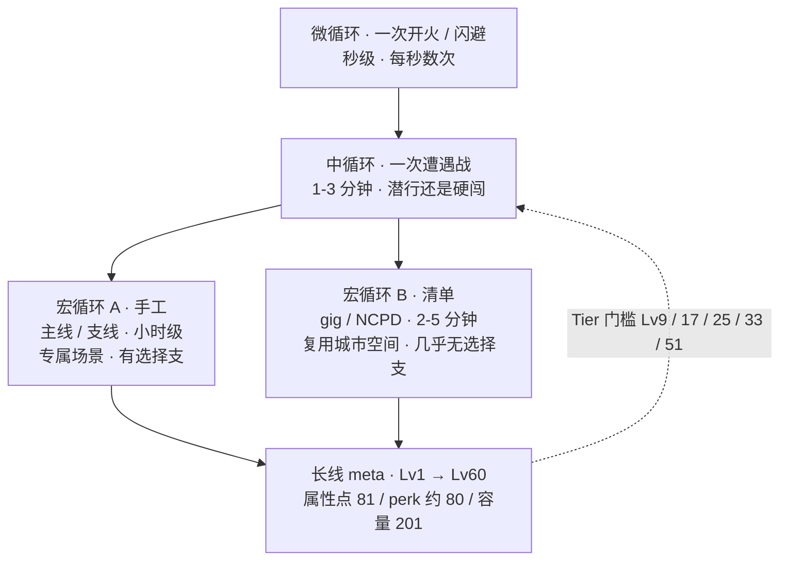
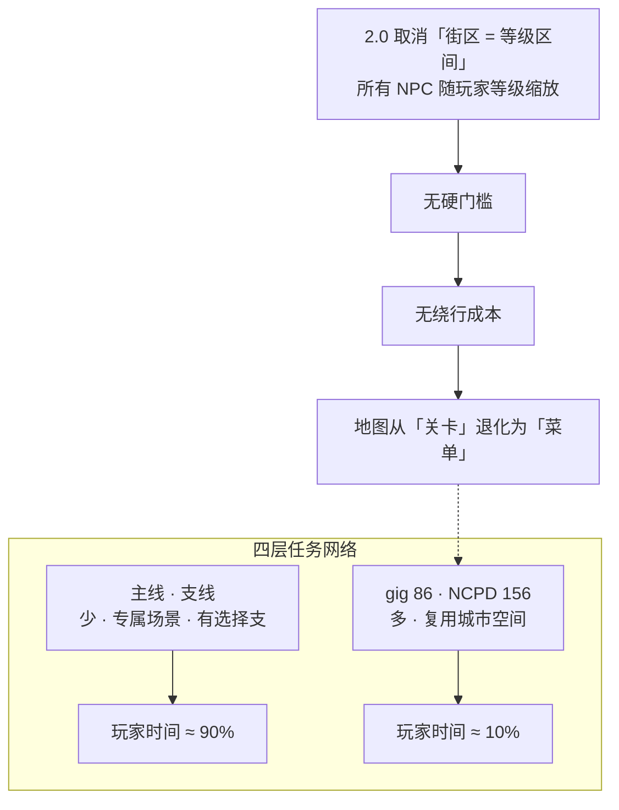
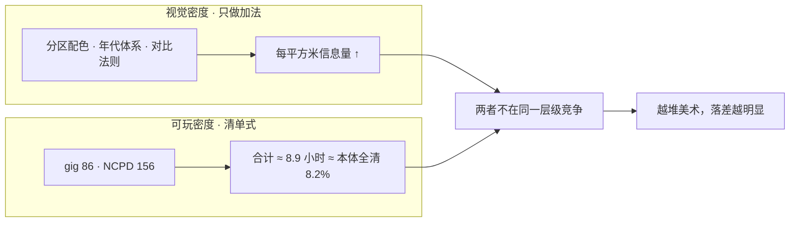
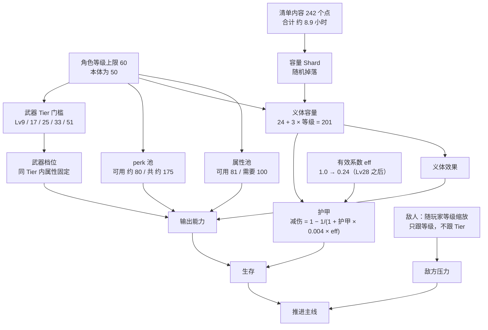
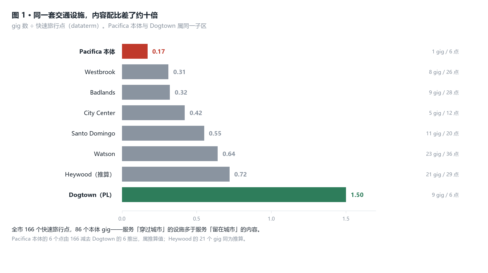
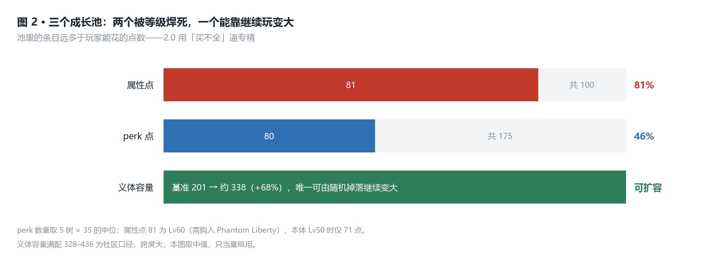
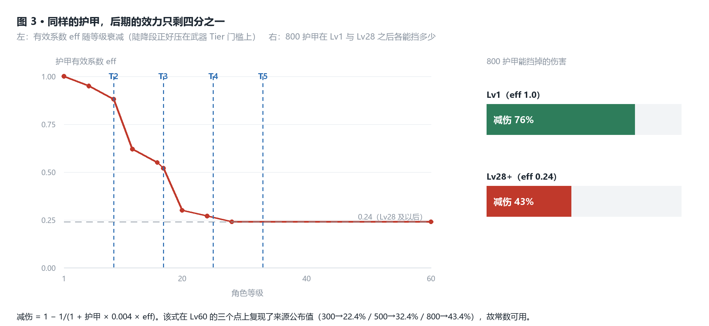
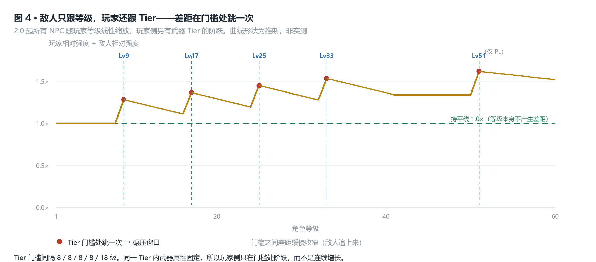
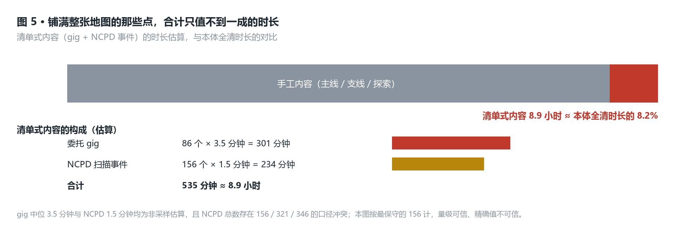

# 赛博朋克 2077 拆解案

> 版本锚点：**2.x（含 Phantom Liberty）· 本体 + 资料片全通**
> 本文所有结论的有效期止于下一次会改动义体 / 护甲 / 敌人缩放的大型更新。
> 版本为何必须钉死：**2.0（2023-09-21，早于 Phantom Liberty 五天）重做了四件事**——
> 义体容量（cyberware capacity）、护甲从「减伤点数」改为「减伤百分比」、perk 树整体重做、
> 敌人等级缩放。**1.6 与 2.x 在数值层几乎是两个游戏**，本文数值只采 2.0 及以后。

## 产品卡片

| 项 | 值 |
|---|---|
| 名称 | Cyberpunk 2077 / 赛博朋克 2077 |
| 开发商 | CD Projekt Red |
| 发行 | CD Projekt |
| 首发 | PC / PS4 / Xbox One，2020-12-10 |
| **版本锚点** | **2.x 最终态（2.0 = 2023-09-21；PL = 2023-09-26；至 2.3 = 2025-07-17，其后仅技术补丁）** |
| 品类 | 开放世界动作 RPG（open-world action RPG） |
| 结构 | 6 个城区 + Badlands；Dogtown 为 Pacifica 子区 |
| 体量 | 本体约 **4000 万**份、Phantom Liberty 约 **1500 万**份（CDPR 2026 H1 财报） |
| 难度阶梯 | Easy / Normal / Hard / Very Hard（+ Phantom Liberty 的额外开关） |
| **样本量** | 玩家 1 人 · 2.x 本体 + Phantom Liberty 全通 · 主力流派：枪械 / 技术武器 |

---

## 核心发现索引

五条跨域判断。每条注明出自哪个域。

1. **地图的「空」不只是密度问题，更是结构问题：2.0 拆掉等级墙之后，地图从关卡退化成了菜单。**
   没有硬门槛就没有绕行成本，没有绕行成本就没有路线，只剩点位。
   物证有两个：**166 个快速旅行点多于 86 个 gig**；
   本体 Pacifica 的 gig / dataterm ≈ **0.17**，而同属 Pacifica 的 Dogtown 是 **1.50**。（域二 · 域一）

2. **视觉密度是加法，可玩密度是清单，两者根本不在同一个层级上竞争——所以美术越做加法，落差越大。**
   地图上 242 个点状内容合计只值约 **8.9 小时**（估），不到本体全清时长的一成。
   **玩家的时间不在城里，在城里的几个房间里。**（域六 · 域一）

3. **2.0 把成长从「积累」改成了「分配」，但两个后门都在后期打开。**
   属性点 **81 / 100**、perk 约 **80 / 约 175**、义体容量基准 **201**——三个池都由等级焊死；
   而护甲的**效率**系数从 1.0 跌到 **0.24**——护甲始终有效（后期仍给 32%–43% 减伤），
   但每点护甲只值早期的四分之一，**防御端没有成长路径**，全部成长预算被导向输出。（域三 · 域四）

4. **终盘玩家的唯一边际收益是随机掉落的容量 Shard——而这恰好要求反复清理地图上密度最低的内容。**
   容量是三个池里唯一能继续变大的（201 → 约 338，**+68%**）。
   **地图的「空洞」与终盘的「唯一出路」是同一件事的两面。**（域四 · 域六）

5. **机制存在 ≠ 机制生效：四条战斗资源回路（耐力 / 治疗充能 / 义体冷却 / RAM）在 Normal 难度下没有一条形成约束。**
   2.0 把耐力改成唯一的「开火成本」，意图是让枪械流在战斗中持续付钱；
   但实测（作者 · 枪械流 · Normal · 全通）是「**没有任何卡我的地方**」。
   **这是全文唯一被实测否证的判断，也是最有价值的一条**——它把「设计意图」与「实际体验」的缺口，
   量化成「四条回路 × 零约束」。（域五 · 域三）

> **五条的关系**：1 与 2 是同一个病的两种说法（结构层面 / 密度层面）；
> 3 是 2.0 改动的意图与其被打开的后门；4 是 1 与 2 在终盘的结算方式；
> 5 是对 3 的反证——**成长池的重新分配确实发生了，但它没有在战斗层变成可感知的压力或压强。**
> **一条线串下来：这款游戏的所有问题都发生在「层级之间的错配」上——
> 视觉层与可玩层错配、设计意图与玩家体验错配、预算池与可优化空间错配。**
>
> 另有两条**被本文提出、又被实测否证**的假设，记录在案以免读者误当作结论：
> ① 跨 Tier 存在「碾压窗口」（作者未感到变强窗口）；② 耐力是枪械流的真实约束（作者不觉得卡）。
> 二者的证据与判负过程见**附录 D**。

---

## 域一 · 核心循环与节奏

### 事实

**四层循环结构**

| 层 | 单元 | 单次决策的对象 | 决策密度 |
|---|---|---|---|
| 微循环 micro | 一次开火 / 一次闪避 | 打谁、站哪、用不用义体 | 每秒数次 |
| 中循环 meso | 一次遭遇战 | 潜行还是硬闯、先处理谁 | **1–3 分钟 1 次** |
| 宏循环 macro | 一次出勤（接单 → 做完 → 回城整备） | 去哪、做哪条、绕不绕 | **10–40 分钟 1 次** |
| 长线 meta | 一次通关（Lv1 → Lv60） | 属性点怎么分、perk 点哪条、容量给谁 | **约 59 次**（每次升级 1 点） |



**两条宏循环的配比**（本域的核心结构事实）

| | 手工循环 | 清单循环 |
|---|---|---|
| 载体 | 主线任务、支线任务 | 委托 gig、NCPD 扫描事件 |
| 场景 | 专属室内场景 | 复用城市空间 + 固定据点 |
| 单次时长 | 小时级；**PL 的 gig 达 15–30 分钟** | **本体 gig 2–5 分钟**；NCPD 秒级至数分钟 |
| 选择支 | 有（多解法、多结局） | 极少（清场 + 取物） |
| 数量 | 少 | **242 个**（86 gig + 156 NCPD） |

- 地图上的清单循环合计约 **8.9 小时**，算式见域六。
- **166 个快速旅行点 dataterm**——服务「穿过城市」的设施，多于「留在城市」的内容。

### 拆解

**重心的错位：玩家做得最多的事与记得最牢的事不是同一条循环。**

清单循环有 242 个单元，是高频循环；手工循环数量少，却是唯一携带叙事与选择支的循环。
**高频循环的价值低、高价值循环的频率低**——这是「假大空」在循环层的表述，
也是它与域六那条密度算式是同一件事的两个投影。

**微循环的决策被机制主动压平。** 枪械流的三类武器里，
跳弹（Power）、自导引（Smart）、蓄力穿透（Tech）都是**降低操作要求**的机制；
再叠上耐力约束（域五），单次开火的可操作空间比看起来窄。
微循环决策密度高（每秒数次），但**每次决策的后果小**。

**长线 meta 只有约 59 次决策，却在 Lv60 之后彻底消失。** 属性点每级 1 点、
总量 81（域三、域四），是全作最重的决策——但它有明确的终点。
**封顶之后，元循环不再产出任何决策。**

### 判断

> **本域判断**：本作的核心循环断裂在宏循环层——**高频的那条（清单）价值低，
> 高价值的那条（手工）频率低**；而唯一决策分量最重的长线 meta 循环（属性点分配）
> 在 Lv60 封顶后彻底消失。**玩家在终盘同时失去两条循环**，
> 只剩域四那条随机掉落的容量 Shard——所以终盘的重复感不是内容不够，
> 是**循环结构本身在终盘没有出口**。
>
> **内部基准**：242 个清单点 / 约 8.9 小时 vs 主线支线的小时级单次时长；
> 166 个快速旅行点；长线 meta 仅约 59 次决策且有硬终点。
>
> **外部对标**：《巫师 3》把「问号」（POI）做成本身就有设计内容的怪物巢穴与强盗营地，
> 因此**高频循环自带价值**，重复清理仍然是在玩内容；本作的清单点则更接近清理项。
> 差别不在点的数量，**在点里有没有决策**。
>
> **边界与证伪条件**：清单循环的 8.9 小时建立在「gig 中位 3.5 分钟」这个非采样估算上，
> 与域六同源。若实测 gig 中位数显著更长（例如 ≥10 分钟），则「高频低值」的落差收窄，
> 本条判断强度下降。另需说明：**「微循环决策被压平」是对枪械流的观察**，
> 网络入侵流在菜单里做选择，微循环形态完全不同，未验证。
> 时长总量数据属社区统计口径，本文不做精确引用（见附录 D）。

---

---

## 域二 · 内容结构与关卡

### 事实

**分区与任务网络**（官方 + 攻略站逐项点算）

地图为 **6 个城区 + Badlands**；**Dogtown 是 Pacifica 的子区**（Phantom Liberty）。

任务网络分四层：**主线（main jobs）· 支线（side jobs）· 委托（gig）86 个 · NCPD 扫描事件 156 个**。

**2.0 取消了「街区 = 等级区间」这层结构**（官方补丁说明）：

> 所有 NPC **随玩家等级缩放**，敌人强度**不再绑定街区**，改由**阵营（faction）决定档次**。

因此本文**不使用** wiki 上常见的「区域推荐等级」——那是 1.x 的结构，2.0 之后已失效。

**各分区的「内容密度」与「交通设施」之比**（本文的核心表）

| 分区 | 本体 gig | dataterm（快速旅行点） | **gig / dataterm** |
|---|---|---|---|
| Watson | 23 | 36 | 0.64 |
| Heywood | 约 21 **（推算，见下）** | 29 | 0.72 |
| Santo Domingo | 11 | 20 | 0.55 |
| City Center | 5 | 12 | 0.42 |
| Badlands | 9 | 28 | 0.32 |
| Westbrook | 8 | 26 | 0.31 |
| **Pacifica（本体）** | **1** | 约 6 | **约 0.17** |
| **Dogtown（PL）** | **9** | 6 | **1.50** |

- **Heywood 的 21 是推算**：gig 总数 86 减去已确证的五个 fixer 辖区
  （Regina Jones 23 / Muamar 11 / Dakota 9 / Wakako 8 / Dino 5 / Mr. Hands 9），差额归 Padre 辖下的 Heywood。
- **Pacifica 本体只有 1 个 gig**（多数 gig 归 Mr. Hands，且集中在 Phantom Liberty 的 Dogtown）。

**数字冲突（必须在事实段标明）**

NCPD 扫描事件总数三源不一致：**156**（成就口径）vs 约 **321**（分区加总）vs **346**（疑含未标记内容）。
**因此本节一律不用 NCPD 做分区对比**，只使用口径较一致的 gig。

### 拆解

**结构配比是「少量深内容 + 大量浅内容」。** 主线与支线数量少、场景专属、带选择支；
gig 与 NCPD 共 242 个、复用城市空间、几乎无选择支。这个配比本身不反常——
反常的是 **2.0 把这两层之间的「等级墙」拆掉了**。

**拆掉等级墙的代价：地图失去了结构。**

传统开放世界（《巫师 3》《旷野之息》）的「区域推荐等级」承担着一个结构功能：
它制造**硬门槛**，硬门槛制造**绕行成本**，绕行成本制造**路线**。
玩家因此会形成对地图的**顺序记忆**——「那片区域我现在去不了」。

**2.0 之后，本作没有任何一个区域是「去不了」的。** 敌人随你升级，
所以任何地段在等级上都是可进的。于是：

```
无硬门槛 → 无绕行成本 → 地图上不再有「路线」，只剩「点位」
```



**地图从关卡退化成了菜单。** 而 166 个快速旅行点正是这个结论的物证：
**服务「穿过城市」的设施（166 个）多于服务「留在城市」的内容（86 个 gig）。**

**内容配比还不是均匀的，也不按面积分配。** 表里那两行是最直接的证据：
本体 Pacifica 每约 6 个快速旅行点摊到 **1 个 gig**，
Dogtown 每 6 个点摊到 **9 个 gig**——**同一套引擎、同一种设施，配比差 9 倍。**

### 判断

> **本域判断**：2.0 取消街区等级绑定，换来了「哪里都能去」，代价是**地图同时失去了结构**：
> 没有硬门槛就没有绕行成本，没有绕行成本，分区就退化成一片均匀的点位场。
> 玩家不再「因为打不过而绕路」，只会「因为太远而传送」。
> **开放世界的「开放」原本来自可去方向的数量，而在本作里所有方向都可去，方向于是不再重要。**
> 更有说服力的是：**Dogtown 用同一套设施把 gig 密度拉到本体的 9 倍**——
> 这说明 CDPR 知道怎么修，**只是没回头修本体**。
>
> **内部基准**：本体 Pacifica 的 gig / dataterm ≈ **0.17**，Dogtown 为 **1.50**（约 **9 倍**）；
> 全市 166 个快速旅行点 vs 86 个 gig。
>
> **外部对标**：《巫师 3》用「任务等级 + 区域威胁度」制造绕行成本，地图因此有先后顺序，
> 玩家会记住「那片区域我先去不了」——**这种「记得住的地图」正是本作在 2.0 之后没有的**。
> 《旷野之息》则用耐力与天气承担同样的功能。**两者都保留了一种「此刻到不了」的结构**，
> 而本作把三种门槛（等级、耐力、环境）全部取消了。
>
> **边界与证伪条件**：这是结构推断，不是实测。**证伪条件**：若实测显示某些区域确实存在
> 隐性硬门槛（例如敌人阵营档位造成实际不可战胜），则本节结论要从「地图无结构」
> 修正为「结构由阵营承担、而非由等级承担」。
> 数据侧的两个软点：**Heywood 的 21 个 gig 是推算值**；
> **NCPD 的分区数字口径冲突（156 / 321 / 346）**，因此全表不用 NCPD。
> 面积数据无官方值（域六），所以本文不做任何「每 km²」对比。

---

---

## 域三 · 数值与经济

### 事实

**属性池**（公开 · 多站一致 · 2.x）

| 属性 | 上限 | 每点收益 |
|---|---|---|
| Body | 20（起点 3） | **+2 最大生命** |
| Reflexes | 20（起点 3） | **+0.5% 暴击率** |
| Technical Ability | 20（起点 3） | **+2 护甲** |
| Intelligence | 20（起点 3） | **每 4 点 +1 最大 RAM** |
| Cool | 20（起点 3） | **+1.25% 暴击伤害** |

- 属性点总量：初始 22（5×3 = 15 + 自由 7）+ **每级 1 点**。
  **Lv50 → 71 点；Lv60（需购入 Phantom Liberty）→ 81 点。**
- **点满五项需 100 点——满级玩家必然留 19 点缺口。**
- 生命：基础 100，每级 +5，Body 每点 +2。
- 洗点规则：**perk 随时免费退还；属性点每个存档只能洗一次。**

**护甲（2.0 改版，本域最重的一条）**（数据挖掘 · 反编译）

2.0 把护甲从「减伤点数」改成「按百分比的减伤」，且不再来自服装——
服装变成纯外观，护甲改由义体的 Skeleton 与 Integumentary 槽提供。

```
有效系数 = base × eff(等级, 难度)
减伤    = 1 − 1 / (1 + 护甲 × 有效系数)

base = 0.004（Hard / Very Hard）；0.003（Easy / Normal）
eff  = 1.0（Lv1） → 0.24（Lv28 及以后）
```

- **eff 的跌幅是这条改动的核心：同样的护甲值，Lv28 之后的有效性只剩 Lv1 的 24%。**
  eff 的陡降段在 **Lv9–12** 与 **Lv17–20**。
- **公式的交叉验证（本文的正面证据）**：把 eff = 0.24 与 base = 0.004 代入 Lv60，
  公式复现了三个来源公布值（日文 wiki 2.01 版）：

  | 护甲 | 公式算出 | 来源公布值 |
  |---|---|---|
  | 300 | 22.4% | 约 23% |
  | 500 | 32.4% | 约 32% |
  | 800 | **43.4%** | 约 43% |

  **三点全部吻合**——公式从「社区转述」升级为可引用数值。
- **同一公式读出本文要用的数：800 护甲在 Lv1 减伤 76.2%，Lv28+ 只剩 43.4%。**
- Lv50 最大护甲约 **1500**（公式 ≈ 59% 减伤）。
- 护甲之后还有第二层判定：**Mitigation Chance** 掷骰，命中则再按 Mitigation Strength 削减。

**装备强度阶梯**（官方支持页）

| 档 | 武器解锁等级 | 义体解锁等级 |
|---|---|---|
| Tier 1 | Lv1 | — |
| Tier 2 | **Lv9** | Lv10 |
| Tier 3 | **Lv17** | Lv20 |
| Tier 4 | **Lv25** | Lv30 |
| Tier 5 | **Lv33** | Lv40 |
| Tier 5++ | **Lv51**（仅 PL） | — |

- **同一 Tier 同一型号的武器，属性固定**——Lv10 捡到的 Tier 3 与 Lv50 捡到的 Tier 3 一模一样。
  武器不再随角色等级变强；普通武器也不能再逐级强化（Iconic 例外）。
- 2.0 把整体伤害重定标下调约一个数量级；**爆头倍率与暴击倍率从「相乘」改为「相加」**。
- 货币去向在 2.0 后收窄两处：**治疗道具改冷却制、不再反复购买**；**服装不再提供护甲**。

### 拆解

**2.0 做的是把「数值膨胀」换成「预算分配」。** 四条改动同向：属性点 81/100
必然留缺口、容量带价格标签、同 Tier 同属性切断「越晚拿越强」、爆头与暴击改相加
（乘区从 2 减到 1，**拆掉指数膨胀的引擎**）。

玩家强度于是从「等级 × 装备」变成三个**固定池**的分配问题：属性点、容量、perk 点。
留了两个后门，都在后期打开：

**后门一 · 用命换容量。** Edgerunner（需 Technical 20）允许容量**超上限最多 +50**，
代价是每超 1 点 **−0.5% 最大生命**：`50 × 0.5% = −25% 最大生命`。
**+25% 容量，换 −25% 生命**——一次明码标价。

**后门二 · 护甲效力随等级衰减。** eff 一路掉到 0.24，防御端因此**没有成长路径**；
而陡降段（Lv9–12、Lv17–20）**紧贴武器 Tier 的 Lv9 与 Lv17**——每次拿到更高档武器，护甲同时被削一次。

### 判断

> **本域判断**：2.0 的成长是「分配」模型，不是「积累」模型——三个池的总量都由等级焊死
> （属性 81/100、perk 约 80、容量 201），所以前中期是真的紧张；两个后门
> （Edgerunner 超容量、Tier 阶跃）都在后期打开——**机制上，「前期的预算张力」
> 与「后期强度自由」是同一套设计的两个阶段。**
> **防御端要单独说清**：护甲**始终有效**——实测确认「有存在感」，公式上 500–800 护甲
> 在后期仍给 **32%–43%** 减伤；被 eff 削掉的是**效率不是作用**，1 点护甲后期只值 Lv1 的四分之一。
> **准话是：后期没有「让减伤继续变大」的成长路径，而非「护甲没用」**——
> 预算被导向输出，是防御端边际收益被压平的结果。
> **界线**：以上为机制推演；**实测未感到「后期强度自由」**（见域五）——池子确实焊死，
> 但闸门要么没关上，要么没人撞。
>
> **内部基准**：属性缺口 19 点（81/100）；容量超载上限 +50 = 基准的 +25%；护甲效力后期只剩 24%。
>
> **外部对标**：《巫师 3》的成长是「等级门槛 + 装备等级」的线性积累，属性点不设总量上限。
> **2077 的分配压力来自「总量固定」**，更接近《暗黑破坏神》的固定点分配，
> 而非 CDPR 自己的 RPG 传统。代价是**分配一旦完成，终盘就没有可优化的空间**（只剩刷容量，见域四）。
>
> **边界与证伪条件**：**函数形式与 Hard / Very Hard 的常数已被三个公布值验证**；
> 但难度项仍有冲突（`base` 高难度更高，`eff` 曲线又被说成高难度更低，净效应不可判定），
> **故只用 Hard / Very Hard 一支**。`eff` 曲线形状来自来源描述而非反编译原文，**只作示意**。
> 证伪条件：若实测显示后期护甲的实际减伤远低于公式给的 32%–43%，则公式或 eff 曲线有误。
> **注**：实测已确认「**护甲有存在感**」，与公式方向一致——本域因此保留
> 「**有效但无成长**」的表述，不写「护甲没用」。

---

---

## 域四 · 系统与内容池

### 事实

**三个成长池的总量与预算**（公开 · 多站一致 + 社区口径）

| 池 | 池里的条目 | 玩家能花的预算 | 覆盖率 |
|---|---|---|---|
| 属性 | 5 项 × 上限 20 = **100 点** | **81 点**（Lv60，需 PL） | **81%** |
| perk | 5 棵树 × 约 33–38 ≈ **约 175 个** | **约 80 点** | **约 46%** |
| 义体容量 | 义体逐件标价 | **基准 201**（24 + 3 × 60） | 可扩容，见下 |

- perk 树按属性门槛分 4 档：**Rookie 4+ / Pro 9+ / Phenom 15+ / Legend 20**。
- 另有 5 条**技能（Skill）**与属性解耦、纯靠玩法升级：
  **Headhunter / Netrunner / Shinobi / Solo / Engineer**，各上限 Rank 60，
  **Rank 15 与 Rank 35 各给 perk 点**。

**义体容量的扩容来源清单**（官方 wiki + 社区记录）

| 来源 | 增量 | 条件 / 代价 |
|---|---|---|
| Renaissance Punk（perk） | **最多 +20** | 每项 ≥9 的属性 +4 |
| Engineering 技能 Rank 10 / 30 | 约 **+15** | 靠使用技术武器升级 |
| Cyberware Capacity Shard | 按档 **+2 / 3 / 4 / 6** | **随机掉落**；基础版可累计约 +60，PL 再 +13–14 |
| Chrome Compressor（PL 义体 OS） | **+42** | 占用 OS 槽 |
| **Edgerunner（perk）** | **超上限 +50** | 需 Technical 20；**每超 1 点 −0.5% 最大生命** |

**Relic 技能树（Phantom Liberty）**：共 **15 点**（剧情自动给 6，Dogtown 内 9 个
Militech 终端各给 1），用于 **9 项 Relic Perk**。

**武器词条池**：词条（mod）装上后**不可拆**；槽位按「技术类型 × 武器类型」命名
（Power / Tech / Smart × Handgun / Shotgun / AR_SMG_LMG / Precision_Sniper_Rifle）；
配件（瞄具 / 消音 / 枪口）可自由装卸。

### 拆解

**「条目数远大于预算」这一个手法，被用了三次。** 属性 100 对 81、perk 约 175 对约 80、
义体逐件标价对容量——三个池都不是「收集」，而是**排除**。
这是 2.0 逼专精的实现方式：玩家不是攒得慢，是**买不全**。

但这三个池在「能否继续变大」上并不一样：

```
属性池：由等级封顶（Lv60 后再不增长）
perk 池：由等级 + 技能 Rank 封顶
容量池：可由 Shard 随机掉落 与 Chrome Compressor 继续变大   ← 唯一不封顶的池
```

满配容量的算式：

```
满配容量 ≈ 201（基准）+ 20（Renaissance Punk）+ 15（Engineering）
         + 60（Shard，基础版）+ 42（Chrome Compressor）
         ≈ 338
再叠 Edgerunner 超上限 +50  →  约 388

相对基准 201：+68%（不含超载）/ +93%（含超载）
```

**于是终盘玩家的唯一边际收益，被押在随机掉落的 Shard 上。** 这一条与域六直接咬合：
Shard 的获取方式是清理地图上的点状内容——也就是那 242 个合计只值约 8.9 小时的点。

### 判断

> **本域判断**：三个成长池里只有容量池能靠「继续玩」变大，另外两个被等级焊死——
> **2.x 的终盘把玩家的唯一边际收益押在了随机掉落的 Shard 上**，
> 而这恰好要求玩家反复清理地图上点密度最低的那类内容。
> **地图的「空洞」与终盘的「唯一出路」是同一件事的两面**：内容薄，但它是终盘唯一还在产出的资源。
>
> **内部基准**：属性 81/100 = 81%；perk 约 80 / 约 175 ≈ 46%；容量 201 → 约 338（**+68%**）。
> 三个池里唯一有增长空间的那个，正好是唯一靠随机掉落获取的那个。
>
> **外部对标**：《辐射 4》的 perk 同样是「条目数远大于点数」，但它**等级无上限**，
> 所以不存在「预算封顶后只能刷装备」的阶段；《巫师 3》把终盘收益放在任务与装备上。
> **2077 是三者里唯一把等级上限焊死在 60 的**，因此它必须把终盘收益转嫁给随机掉落——
> 这是「封闭预算」模型的必然代价，不是数值失衡。
>
> **边界与证伪条件**：perk 每树数量（33–38）与 perk 点总数（70 / 80）来自社区转述，
> 属中低可信。若实际「主 perk」只有约 11 × 5 = 55 个，则「覆盖率约 46%」要重算为接近覆盖，
> 本域「用排除法逼专精」的强度下降。容量满配值社区口径在 **328–436** 之间，跨度大，
> **本文取中值并只当量级用**。另需注意：属性点每存档只能洗一次，但 perk 可随时免费退还——
> **可逆性不对称**，本文按此理解「分配」的严肃性。

---

---

## 域五 · 玩法机制

### 事实

**一次行动的四种成本**（公开 · 官方 wiki / 补丁说明 · 2.x）

| 资源 | 回复方式 | 消耗场景 | 脱战能否回 |
|---|---|---|---|
| 生命值 | 基础 **100** + 每级 **+5** + Body 每点 **+2** | 承伤 | **能，自动回到 60%** |
| 耐力 stamina | 停手后短延迟即回 | **开枪 / 近战挥砍 / 冲刺 / 闪避** | 能 |
| 治疗充能 | **冷却制**（2.0 由消耗品改为充能） | 主动使用 Bounce Back | — |
| 义体冷却 | 各自计时（30–60s 量级） | 时停 / 狂暴 / 血泵 | — |

- **2.0 的耐力改动是决定性的**：脱战跑步与跳跃**不再消耗耐力**；
  开枪、近战挥砍、冲刺、闪避消耗**。抓取、处决、quickhack 不消耗。
  **耐力归零时：近战攻速剧降，枪械操控与精度下降。**
- 战斗中生命默认不自动回复：靠 Bounce Back（冷却制）或 Blood Pump
  （义体，瞬回 **50% → 90%**，CD **180s → 30s**）。
- 义体冷却示例：Sandevistan Militech「Falcon」MK.5 = 减速 30% / 持续 18s / **CD 60s**；
  Berserk Militech MK.5 = 60s / **CD 60s**。
- RAM：顶级 cyberdeck 在 Tier 5++ 达 **8 个 quickhack 槽**，可达最大 RAM 约 **30**。
- **枪械三类（Power / Tech / Smart）**：强力武器靠**跳弹（ricochet）**（基础约 5%）；
  技术武器靠**蓄力穿透护甲与掩体**；智能武器**自导引**但需手部 Smartlink——
  2.0 官方**下调了智能武器伤害**，同时用专属 perk 补偿（锁定更快、脱离视野后保持更久）。

**敌人侧**（官方补丁说明 + 数据挖掘）

- **2.0：所有 NPC 随玩家等级缩放**，强度不再绑定街区，改由**阵营（faction）决定档次**。
- 骷髅头标记 = **精英**（四条血条），**不代表等级更高**；扫描面板的稀有度档为
  Weak / Normal / Rare / Elite / Boss。

### 拆解

**枪械流的战斗资源有四条，但只有一条是「每次开火都消耗」的。**

生命脱战自动回、治疗走冷却、义体冷却以秒计——三条都自带恢复节奏。
**耐力是唯一按开火次数扣的资源。** 于是 2.0 那次改动（把跑跳移出耐力）的意图就清楚了：
改动前耐力是**赶路成本**（在城市里移动要付钱），改动后是**开火成本**（在战斗里付钱）。

按设计意图，**耐力应当取代弹药，成为枪械流的真实约束**：本作没有弹药焦虑
（弹药可制造、可购买，基本不构成瓶颈），所以设计把成本放到了耐力上——
0 耐力时枪械操控与精度下降，等于打在掩体上。

**敌人全等级缩放意味着等级不能让你变强**——你 +1 级，敌人也 +1 级，
**相对强度的唯一来源是 build。** 这条推出一条看似自洽的结论：

```
玩家侧增长 = 线性（等级 → 属性点 / 容量 / perk）+ 阶跃（Tier 门槛）
敌人侧增长 = 仅随玩家等级线性缩放
→ 两条曲线之差，在 Lv9 / 17 / 25 / 33 各跳一次
```

**本文最初据此判断「碾压窗口来自 Tier 差」——但这条被实测否证了**（见判断与附录 D）：
作者以枪械流在 Normal 难度全通，自述**一路强度差不多，没有出现变强窗口**。
机制层的「阶跃差」确实存在，却没有变成体感上的「碾压」。两种解释本文无法区分：
**要么敌人侧同步跳了档（强度守恒），要么 8 级的台阶太窄、在枪械流的击杀耗时里被抹平了。**

### 判断

> **本域判断**：本作为战斗资源设计了一整套成本——耐力、治疗充能、义体冷却、RAM——
> 但**实测反证了这套成本的兑现**：作者以枪械流在 Normal 难度全通本体 + 资料片，
> 自述「**没有任何卡我的地方**」。
> 也就是说：**四条回路里没有一条在常规难度上形成约束，枪械流的战斗不是资源管理题，只是瞄准题。**
>
> **内部基准**：四条回路里只有耐力按开火次数扣；但弹药可造可买、治疗改冷却、义体 CD 以秒计——
> **没有一条能在 Normal 上压住枪械流。**
>
> **外部对标**：《生化危机》《最后生还者》用弹药稀缺逼出资源管理，《毁灭战士 永恒》
> 用「弹药—处决」的强绑定逼你切武器。**两者的约束都来自「某条资源真的会归零」**——
> 2077 在 Normal 上把所有资源都调到了不会归零。**这不是说高难度不成立**：
> Very Hard 削耐力上限，本文原先设想的「Tier 阶跃 = 碾压」在高难度上仍是可检验的，
> 但**作者与本文都没有该难度下的数据，因此不作为结论。**
>
> **边界与证伪条件**：样本是 **n=1 · Normal · 枪械 / 技术武器流 · 全通**。
> 证伪条件：① 换 Hard / Very Hard 重复，若耐力与治疗开始卡人，则「资源不构成约束」
> 收缩为「仅在 Normal 成立」；② 换 network 流，其资源是 RAM，回路不同，未验证。
> **注**：本文原先那条「Tier 阶跃 = 碾压窗口」的假设**被本次实测判负**——
> 作者未感到跨档变强窗口。该假设的提出与判负过程见**附录 D**，此处不再作为结论使用。

---

---

## 域六 · 反馈与表现 ＋ 世界构建与视觉引导

> 本域是本作唯一被**扩容**的域：原「反馈与表现」并入**世界观与城市美术构建**，
> 回答两个问题——**城市如何成立**、**视觉密度与可玩密度是否匹配**。

### 事实

**空间事实**

| 项 | 数值 | 来源 |
|---|---|---|
| 夜之城可玩面积 | **无官方数字**。第三方测量 **43.5 / 约 50 / 约 225 km²**，跨度 5 倍 | 社区测绘（三个独立来源） |
| Badlands 可玩部分 | 约 **8.75 km²** | 社区测绘 · PowerPyx |
| Dogtown 面积 | **未查到** | — |
| 分区数 | 城区 **6** 个 + Badlands；Dogtown 属 Pacifica 子区 | 官方 |
| 快速旅行点 dataterm | 首发 137 → 1.5 版约 159 → 2.x **166** | 社区 wiki |
| 地铁 | 2.1 版加入，**5 条线 19 站** | 官方补丁说明 |
| 义体医生 ripperdoc | 本体 **14**（城区 13 + Badlands 1），Dogtown 再 +4 | 攻略站逐项点算 |
| 清单式内容 | 委托 gig **86**（本体）+ 9（PL）；NCPD 扫描事件 **112 + 27 + 17 = 156** | 攻略站逐项点算 / 成就口径 |

**可进入建筑 —— 本文最关键的空白**

- CDPR **从未给出数量或比例**。任务设计总监 Tomaszkiewicz 的原话是
  「a number of them that you can enter. **Not all of them**」；发售前 Q&A 亦直言
  「**This is not a game where you can go anywhere.**」；高级概念美术 Jonkers 说
  「we will never make half-empty buildings」（宁可少而精）。
- 社区流传的 10%–25% 全是玩家猜测，**没有任何数据挖掘支持**。

**官方对自己视觉层的两次回调**

- 发售前 CDPR 称地图标记**比《巫师 3》更少**；发售后官方承认本体**「视觉噪音」过密**，
  Dogtown 改用更清晰的配色、形体与留白规则改良。

**官方 art direction 的分区逻辑**（GDC《Art Direction Summit: Building Night City》）

- 每个分区有独立团队与配色母题（Japantown 偏浅红、Arasaka Waterfront 偏橙）；
  品牌主色「赛博黄」有意区别于 Blade Runner 式的红/蓝。
- 四套年代视觉体系（1980s 复古赛博朋克 / 1960s 塑料媚俗 / 企业新军国主义 / 暴富阶层的假自然）；
  核心法则是对比（contrast）。

**内容密度的官方自证 —— 本域最强的一条**

| | 本体 gig | Phantom Liberty gig |
|---|---|---|
| 单个时长 | **2–5 分钟** | **15–30 分钟** |
| 地图面积 | 全部 6 区 + Badlands | **更小**的 Dogtown |

### 拆解

**「假大空」不是一个问题，是两个方向相反的密度。**

**① 视觉密度一直在做加法。** 分区配色母题、四套年代体系、对比法则——目标是
每平方米信息量往上堆；代价官方自己说了：视觉噪音过密。
这一层**只增不减**，因为美术密度不占用游戏循环的预算。

**② 可玩密度是清单，而且点很浅。** 地图上有 86 + 156 = 242 个点；
按 gig 中位 3.5 分钟、NCPD 1.5 分钟估算（非采样，见边界）：

```
清单式内容总时长 = 86 × 3.5 + 156 × 1.5 = 535 分钟 ≈ 8.9 小时
占本体全清时长   ≈ 8.9 / 109 ≈ 8.2%      （109 小时 = HLTB 本体 100% 口径）
```

**铺满整张地图的那些点，合计不到本体全清时长的一成。** 剩下约九成时间发生在
**少数手工场景**——主线与支线的专属室内，即「能进的那部分建筑」。
**玩家的时间不在城里，在城里的几个房间里。**

**实测佐证（n=1，方向相反）**：作者偏爱本作世界观、会在城里纯散步；
即便算上这部分额外时间，**主体时间仍落在专属场景**——
**不是不愿意逛，是逛久了没事可做。**

两条独立证据：**官方口径**是「most of our content is hand-crafted」、
本作「more The Witcher 3 than GTA 5」，手工内容天然集中在少数场景；
**CDPR 在资料片里自己改了做法**（见上表）——Dogtown 面积更小、单个 gig 从 2–5 分钟
拉到 15–30 分钟（**×6.3**），是**拉长单点 + 缩小分母**，而不是往大地图里塞更多点。



### 判断

> **本域判断**：夜之城的问题不是「内容太少」，是**内容时长分布与地图面积分布错位**——
> 它被建成一座**通道**，却被当成**舞台**来卖：242 个点合计只值约 8.9 小时
> （不到本体全清的一成），真正耗时的手工内容却锁在少数建筑里，与城市尺度无关。
> **视觉密度是加法，可玩密度是清单，两者不在同一层级上竞争，所以越堆美术，落差越明显。**
>
> **内部基准**：242 个清单点 / 约 8.9 小时 / 约占本体全清时长的 8.2%。
>
> **外部对标**：《旷野之息》用 **120 座神庙 + 900 个呀哈哈**把「点」做成服务移动的
> 奖励节奏——点密度与移动行为同构；《巫师 3》把 POI 做成手工营地，问号本身即内容。
> **两者的「点」都是内容，本作的「点」是清理项**——差别不在数量，在点与移动的关系。
>
> **边界与证伪条件**：最软的一环是 gig 时长估算与面积分母（官方无面积数据，
> 故**全文不做「每 km²」对比**）。**证伪条件**：① 官方公布可进入建筑比例 ≥ 50%；
> ② 实测 gig 中位数 ≥ 10 分钟，则 8.2% 上修。另说明：**「假大空」是体感，
> 本文给的是它的机制解释，不否认体感本身。**

---

## 它付出的代价

把六个域的判断收拢，这款游戏用同一种货币支付了四次。这种货币叫**「层级错配」**。

**① 用「哪里都能去」换「地图没有结构」。**
等级墙是传统开放世界最便宜的结构工具，它同时承担门槛、绕行成本与顺序记忆三件事。
2.0 拆掉它，换来的是完全的自由——**代价是地图不再有先后顺序，
玩家对城市的记忆从「路线」退化成「点位」**。
需要说清的是：**「假大空」不是 2.0 造成的，1.x 时代就有**；
但 1.x 至少还留着等级墙这副骨架，2.0 把骨架也拆了——
**所以 2.x 的版本是「内容薄 + 骨架也没了」，比 1.x 更彻底。**

**② 用「封闭预算的分配深度」换「终盘无可优化」。**
属性 81/100、perk 约 80/约 175、容量 201——三个池都由等级封顶。
前中期因此有真实的分配张力（**这是 2.0 最成功的一处改动**），
但封顶之后，玩家在终盘没有可优化的空间，只剩刷容量一条。

**③ 用「敌人全等级缩放」换「压力曲线失去支点」。**
全等级缩放的本意是消灭「等级碾压」这个经典毛病，方向是对的。
但敌人被拉平之后，**玩家侧的任何成长增量都不再对应一个「打不过 → 打得过」的开关**。
本文曾判断「碾压从等级差转移到构筑差」，但**实测未感到任何碾压窗口**（域五）——
所以真正的代价不是「更陡的碾压」，而是**没有压强**：
压力曲线被设计成恒温，代价是它也就不再讲述「你变强了」这件事。

**④ 用「视觉密度做加法」换「落差的可见度」。**
美术密度不占游戏循环的预算，所以它可以无限加；可玩密度是清单，加一个要做一个。
**两个层级的成本结构不同，加法的速度也就不同**——
美术每加一分，落差就多显一分。官方自己在 Dogtown 上承认了这一点（减噪 + 加密同时做）。

**最尖锐的一处**：CDPR 在 Phantom Liberty 里把三个问题**同时修对了**——
Dogtown 面积更小（分母缩小）、gig 从 2–5 分钟拉到 15–30 分钟（单点加深）、
视觉改用留白与分色规则（减法）。**三项全部指向本文的五条发现。**
视觉改用留白与分色规则（减法）。**三项全部落在本文的「结构与密度」类发现上（①②④）。**
所以本文的结论不是「CDPR 不会做开放世界」，而是：
**他们知道怎么修，只是把这些修法放进了资料片，没有回头改本体。**

---

## 如果我来迭代

四条，每条都落到具体数值或规则，并写明代价。

**1. 把「阵营档位」显性化，用它接替等级墙做结构**

不恢复等级墙（那会与 2.0 的自由度直接冲突），而是**把敌人阵营的强度档做成可见的区域威胁度**：
扫描面板与地图上显示分区威胁档，当某区威胁档高于玩家 2 档以上时，敌人获得额外护甲与伤害。

- **能解决什么**：地图重新有了「此刻到不了」的区域，域二那条「菜单化」被部分逆转；
  玩家重新获得顺序记忆。
- **代价**：与 2.0「哪里都能去」的设计承诺正面冲突，会劝退探索型玩家；
  且需要 CDPR 接受「**劝退也是一种引导**」这个前提——而 2.0 的整个方向是相反的。
  **这条与 2.0 的设计哲学矛盾，是四条里最贵的一条。**

**2. 把本体 gig 的最小内容量从 2–5 分钟提到 8–10 分钟**

不做成 PL 的 15–30 分钟——86 个 gig 按那个标准总量会失控。取中位 9 分钟：

```
内容总时长 = 86 × 9 = 774 分钟 ≈ 12.9 小时
对比现状 = 86 × 3.5 = 301 分钟 ≈ 5.0 小时
增量约 +7.9 小时（+157%）
```

- **能解决什么**：域六那条「242 个点只值 8.9 小时」的落差收窄，清单循环的单点价值上升。
- **代价与局限（必须写明）**：**点数不变，所以地图上的空白感一点都不会改善**——
  这条只加深度、不加密度。它治的是「点太浅」，治不了「结构太平」。

**3. 把终盘的容量来源从随机掉落改为分区奖励**

Shard 保留，但**每个分区追加一个固定额度**：完成该区全部 gig 后，
一次性发放等同于该区 Shard 期望总和的容量。

- **能解决什么**：域四那条「终盘唯一收益是随机掉落」被打破，玩家不再需要反复清理同一批点位。
- **代价**：**重复游玩的动机被削弱**；且容量上限会更快触顶，
  域四那三个池会全部封顶——**必须同时给出一条新的终盘 sink，否则只是把问题往后推 5 小时。**

**4. 护甲有效系数不要衰减到 0.24**

改为缓慢衰减（如 Lv1 的 1.0 → Lv28 之后的 **0.6**），让防御端重新成为一条成长路。

- **能解决什么**：域三那条「防御端没有成长路径」被修正，玩家的成长预算不再全部导向输出；
  同时给域五那条「没有压强」的平线加回一个防御侧的成长维度。
- **代价**：**后期难度会明显下降**（玩家既更强又更硬），必须同时上调敌人输出——
  而上调敌人输出会压到网络入侵流与低生存 build 的生存空间。**这条不能单独做。**

**一个不该做的**：不要为了「让地图显得更满」而增加 POI / NCPD 事件的数量。
242 个点已经只值约 8.9 小时，加点只会把每个点摊得更薄。
**要改的是点里的决策与点之间的门槛，不是点的数量。**
本作真正缺的不是内容单位，是**内容单位与地图尺度之间的联系**。

---

## 附录

<details>
<summary><b>A · 系统依赖图</b></summary>



**读法**：三条成长管道（属性 / perk / 义体）汇进同一条「输出能力」，
而生存端只有「护甲」一条，且这条被 `eff` 从 1.0 削到 0.24——
**域三那条「防御端有效但无成长」就卡在 `ARM` 这个节点上。**
右下的环路是本文的另一半：**终盘唯一的增量（Shard）来自地图上最薄的那层内容。**

</details>

<details>
<summary><b>B · 数值细节与交付物表</b></summary>

由 `data/*.csv` 生成（GitHub 会自动渲染为表格）。

| # | 表 | 文件 | 状态 |
|---|---|---|---|
| 1 | 时间轴与结构配比（分区 × gig × 快速旅行点） | [`data/01-timeline.csv`](data/01-timeline.csv) | ✅ |
| 2 | 单位 / 敌人数值表 → 本作无固定敌人数值，改为**装备档位表** | [`data/02-tiers.csv`](data/02-tiers.csv) | ✅ |
| 3 | 成长曲线 vs 压力曲线 | [`images/03-护甲效力衰减.png`](images/03-护甲效力衰减.png) · [`images/04-阶跃对线性.png`](images/04-阶跃对线性.png) | ✅ |
| 4 | 资源产出、换算与定价（三个成长池的预算） | [`data/04-economy.csv`](data/04-economy.csv) | ✅ |
| 5 | 难度修饰表 | [`data/05-difficulty.csv`](data/05-difficulty.csv) | ◐ 仅护甲一支可填 |
| 6 | 内容池结构（容量扩容来源） | [`data/06-pools.csv`](data/06-pools.csv) | ✅ |
| 7 | 经济收支（来源 × 去向） | — | 见域三正文 |
| 8 | 路径期望（满配容量的期望） | [`images/02-成长池覆盖率.png`](images/02-成长池覆盖率.png) | ✅ |
| 9 | 单次行动收益表（四条资源回路） | [`data/09-action-value.csv`](data/09-action-value.csv) | ✅ |
| 10 | 行为时序与信息表 | — | 见域五正文（敌人缩放规则） |

**表 2 的替换说明**：框架预设的表 2 是「单位 / 敌人数值表」，
但本作 **2.0 起所有 NPC 随玩家等级缩放**，不存在固定敌人等级与血量表，
因此该表替换为**装备档位表**，这也是本作真正的强度阶梯。
**这是一处框架与品类不匹配的地方，已在附录 D 记为方法学缺口。**

**合格标准自检**：把表里两列一除能算出判断里的数——
表 1 的 gig ÷ 快速旅行点 → 域二那条 **0.17 vs 1.50**；
表 4 的池大小与预算 → 域四那条 **81/100 与 80/175**；
表 6 的容量来源求和 → 域四那条 **201 → 约 338（+68%）**。

</details>

<details>
<summary><b>C · 曲线与图</b></summary>

**正文内嵌图（mermaid）**

- 域一 · 四层循环与两条宏循环的分岔
- 域二 · 拆掉等级墙后地图为何退化成菜单
- 域六 · 视觉密度与可玩密度的错位
- 附录 A · 系统依赖图

**独立图表**（`images/`，由 `tools/make-figures.py` 从 `data/*.csv` 与正文算式渲染）

**图 1 · 同一套交通设施，内容配比差了约九倍**（域二）



本体 Pacifica 每约 6 个快速旅行点摊到 1 个 gig；Dogtown 每 6 个点摊到 9 个。
**同一子区、同一套设施，差约 9 倍——说明 CDPR 知道怎么修，只是没回头修本体。**

---

**图 2 · 三个成长池：两个被等级焊死，一个能靠继续玩变大**（域四）



属性 81%、perk 约 46%，而义体容量是唯一可由随机掉落继续变大的池。
**终盘玩家的唯一边际收益，落在唯一不封顶的那个池上。**

---

**图 3 · 同样的护甲，后期的效力只剩四分之一**（域三）



**eff 的陡降段（Lv9–12、Lv17–20）正好压在武器 Tier 门槛的 Lv9 与 Lv17 上**——
每次你拿到更高一档的武器，护甲同时被削一次。图中曲线形状为示意，
但公式本身在三个公布值上被验证过。

---

**图 4 · 敌人只跟等级，玩家还跟 Tier——机制上差距应在门槛处跳一次**（域五）



锯齿的每一处上跳本应是一次「碾压窗口」，两跳之间的下坡是「敌人追上来」。
**但这条曲线已被实测判负**：作者（Normal · 枪械流）自述一路强度差不多，
**没有感到任何变强窗口**。曲线形状本就是纯示意模型（参数由本文设定），
判负之后它只剩**机制推演**的用途，**不再作为对实际体验的预测**。

---

**图 5 · 铺满整张地图的那些点，合计只值不到一成的时长**（域六）



gig 与 NCPD 事件的时长估算都建立在非采样估算上，NCPD 总数本身还有 156 / 321 / 346 的口径冲突。
**量级可信、精确值不可信。**

</details>

<details>
<summary><b>D · 数据来源与可信度</b></summary>

### 实测（作者本人游玩）

样本：**1 名玩家 · 2.x 版本（2.0 之后）· 本体 + Phantom Liberty 全通 · 主力流派枪械 / 技术武器**。

| 数据 | 样本量 | 用在哪 |
|---|---|---|
| 「美术和城市设计很吸引人，但地图假大空导致很难细玩」 | n=1，自述 | **全文的轴** · 域一 · 域二 · 域六 |
| 主力流派枪械 / 技术武器；难度 **Normal** | n=1，自述 | 域五的覆盖范围与难度限定 |
| 战斗中「**没有任何卡我的地方**」 | n=1，自述 | **域五判断**——否证「战斗资源构成约束」 |
| 跨 Tier 后「**一路强度差不多**」，无变强窗口 | n=1，自述 | **否证「Tier 阶跃 = 碾压窗口」**（见下） |
| 时间「多数在专属场景」，且自述**偏爱世界观、会额外在城里散步** | n=1，自述 | 域六——作为**反向**佐证 |
| 「**护甲有存在感**」 | n=1，自述 | 域三——确认「**有效但无成长**」，否决「护甲没用」的读法 |

> ⚠️ **本表的诚实说明**：实测输入是**六条主观自述**，无一条是计量数据。
> 按 skill 的标准，节奏类结论需 5 局起步、统计规律需 n≥20，**玩家侧数据一条都不达标**。
> 因此本文**不用玩家数据下任何数值结论**——玩家自述只用于三件事：
> ① **确定拆解的方向**（「假大空」这条轴）；② **对机制推断做定性判负**；
> ③ **修正措辞的夸大**（「护甲有存在感」→ 把「防御端不参与成长」改准为「有效但无成长」）。
> **本文有两处判断被这套实测直接否证，且都已按否证后的状态改写**：
> - **「Tier 阶跃 = 碾压窗口」（域五）**——机制推演成立，但作者未感到变强窗口 → 判负，降级为「机制推演，不预测体验」；
> - **「耐力是枪械流的真实约束」（域五）**——作者在 Normal 上不觉得卡 → 收缩为「**仅在 Normal 成立**：四条资源回路没有一条形成约束」。
>
> 这两种「提出即判负」的记录保留在案，是为了让读者能分辨**本文的哪几条是结论、哪几条是假设**。

### 公开

| 来源 | 类型 | 用于 |
|---|---|---|
| 官方补丁说明（2.0 / 2.1） | 官方 | 属性与等级上限、敌人全等级缩放、耐力改动、护甲改版、智能武器下调 |
| CDPR 官方支持页（物品档位） | 官方 | 武器与义体的 Tier 解锁等级 |
| Fandom wiki / Game8 / Fextralife | wiki | 属性每点收益、义体容量、治疗与义体冷却、perk 树结构 |
| PowerPyx 逐项点算 | 攻略站 | gig 86、NCPD 156、分 fixer 辖区分布 |
| Fandom wiki（快速旅行点） | wiki | dataterm 166 与分区分布 |
| HowLongToBeat（本体 100% ≈ 109 h；PL 100% ≈ 31.5 h） | 社区统计 | 域六「占本体全清 8.2%」的分母 |
| CDPR 财报与官方新闻（销量、版本日期） | 官方 | 产品卡片体量；2.0 与 PL 的日期与版本史 |
| **Better Armor Tooltip（Nexus mod #9706，反编译）** | **数据挖掘** | 护甲减伤公式与常数——**本文唯一经过交叉验证的一条** |
| GDC《Building Night City》与开发者访谈 | 官方 / 访谈 | 分区视觉母题、赛博黄、视觉噪音自述、「不做半空建筑」、「手工内容为主」 |

**未采用媒体数值**：IGN / ScreenRant / 游民星空等媒体的数字**未用于任何结论**，
仅用于确认定性事实（如「官方承认视觉噪音问题」）。凡表格中的数值均来自上表来源。

### 本文的采集限制（必须写明的诚实说明）

1. **本次公开数据采集受工具额度限制**：三个采集子代理合计用尽本会话的搜索额度，
   且 WebFetch 对 fandom / nexusmods 等域名被网络策略拦截，**多数 wiki 页面未能逐页原文核对**，
   只能经搜索摘要与二手转述取得。**内容结构子代理的报告在成稿后才返回**，
   本文只据它做了两处交叉核对（版本日期、时长口径），**未重跑其它结论**。
2. 因此**标为「社区口径」的数值请勿当硬数引用**，包括：
   perk 每树数量（33–38）、perk 点总数（70 / 80）、义体容量满配值（328–436，
   跨度极大）、gig 单体时长（2–5 分钟）、单次伤害是否封顶。
3. **关于伤害封顶**：本次采集**没有找到任何 2.0 存在全局单次伤害上限的证据**，
   只有「2.0 把整体伤害下调约一个数量级」的证据。
   因此本文**不写任何封顶数值**——**未查到不等于不存在，本文按「未见证据」处理。**

### 推断（全部给算式）

| # | 推断 | 算式 | 建立在它之上的结论 |
|---|---|---|---|
| 1 | 清单式内容合计约 **8.9 小时** | `86 × 3.5 + 156 × 1.5 = 535 分钟` | 核心发现 2 · 域一 · 域六 |
| 2 | 清单内容占本体全清时长约 **8.2%** | `8.9 / 109`（109 为 HLTB 本体 100% 口径） | 核心发现 2 |
| 3 | 本体 Pacifica 的 gig / dataterm ≈ **0.17** | `1 ÷ 6`（点数由 166 − Dogtown 6 推出） | 核心发现 1 · 域二 |
| 4 | 满配义体容量约 **338** | `201 + 20 + 15 + 60 + 42` | 核心发现 4 · 域四 |
| 5 | 容量相对基准 **+68%** | `(338 − 201) / 201` | 核心发现 4 |
| 6 | Edgerunner 超载满额 = **−25% 最大生命** | `50 × 0.5%` | 域三 |
| 7 | 800 护甲减伤 **76.2% → 43.4%** | `1 − 1/(1 + 800 × 0.004 × eff)`，eff = 1.0 与 0.24 | 核心发现 3 · 域三 · 图 3 |
| 8 | Heywood 的 gig 数约 **21** | `86 − (23 + 11 + 9 + 8 + 5 + 9)` | 域二（已标为推算） |
| 9 | 相对强度的锯齿曲线 | 每道 Tier 门槛给 +0.28 的跃升，门内按 `1 − d/span × 0.7` 衰减 | ~~核心发现 5~~ **已判负**（作者未感到变强窗口） |

> **推断的脆弱点**：1、2、3、8 全部依赖二手计数（gig / dataterm 的分区口径），
> 且 8 是从总数反推的。9 是**纯示意模型**，参数（+0.28、衰减 0.7）由本文设定，
> **不是从游戏数据里读出来的**——它的作用是把机制关系画出来，不是给出数值预测。
> **而 9 已经被实测判负**：作者在 Normal 难度全通，未感到跨 Tier 的变强窗口。
> 这条判负是本文的正面结果之一——它说明**机制层的台阶确实存在，却没有落到体验层**。

### 未查到清单（不编造）

- 夜之城官方面积（第三方测量 43.5 / 50 / 225 km²，差 5 倍，**故全文不做每 km² 对比**）
- 可进入建筑的数量或比例（官方口径只有「一部分，不是全部」；社区的 10%–25% 无数据挖掘支持）
- Dogtown 面积
- 官方公布的难度逐档倍率（仅护甲公式中可比）
- 武器总数、单独敌营计数
- 官方公布的帮派总数、官方平均时长、Phantom Liberty 官方任务计数（均无官方口径）
- 敌人的换色／模型复用（reskin）记载（**证据不足，故本文不写「复用」相关的任何结论**）
- 单次伤害硬上限（见上）

</details>

<details>
<summary><b>E · 术语表</b></summary>

| 中文 | 英文 | 说明 |
|---|---|---|
| 开放世界动作 RPG | open-world action RPG | 本文认领的品类行 |
| 视觉密度 / 可玩密度 | visual density / interactive density | **本文自造的一对概念**：前者是每平方米的美术信息量，后者是每平方米的可交互内容量 |
| 核心循环 | core loop | 本文分微 / 中 / 宏 / 长线四层 |
| 委托 | gig | 地图上的清单式支线，由 fixer 派发 |
| 扫描事件 | NCPD scanner hustle | 警用扫描触发的清场事件，比 gig 更浅 |
| 快速旅行点 | dataterm | 本作的城市交通设施 |
| 属性点 | attribute point | 上限 20 × 5 项；Lv60 共 81 点 |
| perk 点 | perk point | 五条属性 perk 树的点数 |
| 义体容量 | cyberware capacity | 装备义体的预算，24 + 3 × 等级 |
| 有效系数 | `eff`（armorEffectivenessMultiplier） | 护甲公式里随等级与难度衰减的乘数 |
| 品质档 | Tier | 2.0 起取代旧稀有度名；同 Tier 内属性固定 |
| 减伤 | damage reduction | 2.0 起护甲按百分比减伤，不再是减伤点数 |
| 义体 | cyberware | 植入物；2.0 起护甲来源从服装改到这里 |
| 强力 / 技术 / 智能武器 | Power / Tech / Smart weapon | 跳弹 / 蓄力穿透 / 自导引三类 |
| 跳弹 | ricochet | 强力武器的招牌机制 |
| 耐力 | stamina | 2.0 起只由开火、近战、冲刺、闪避消耗 |
| 资源回路 | resource loop | 本文指血量 / 耐力 / 治疗充能 / 义体冷却四条 |
| 绕行成本 | detour cost | 因硬门槛而必须绕开的代价；**本作 2.0 之后几乎为零** |
| 元进度 | meta progression | 跨任务的长期成长，本作载体是属性 / perk / 容量三池 |

</details>
