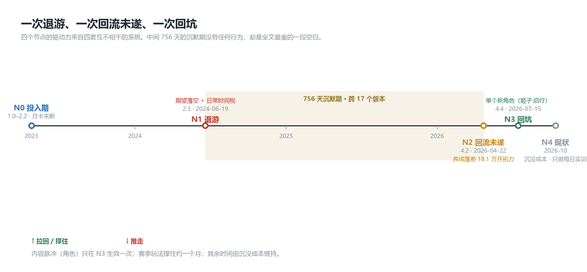
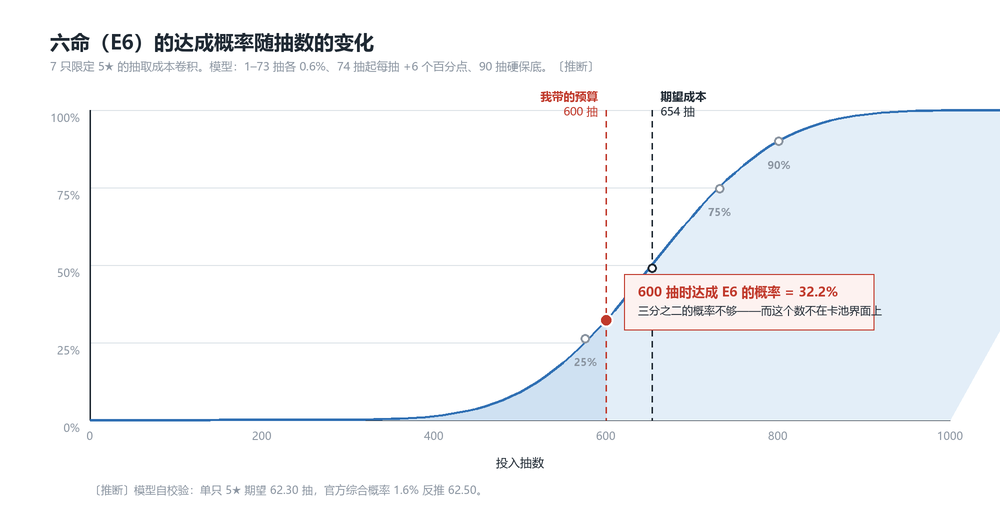
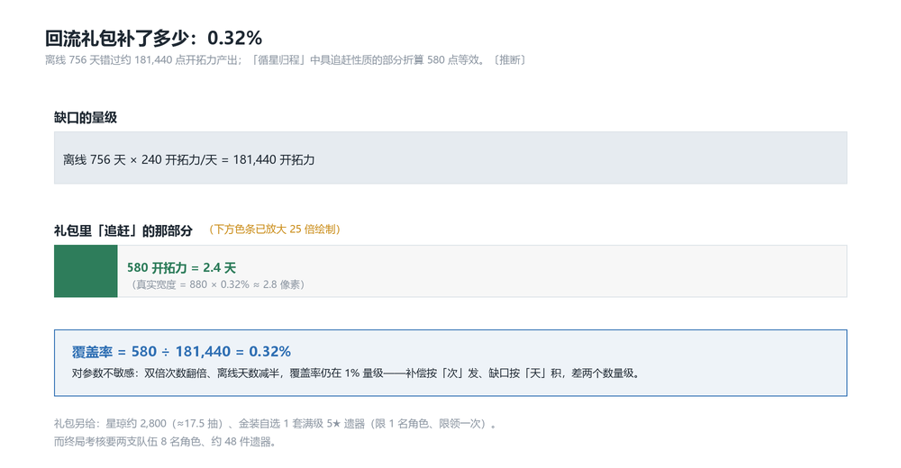
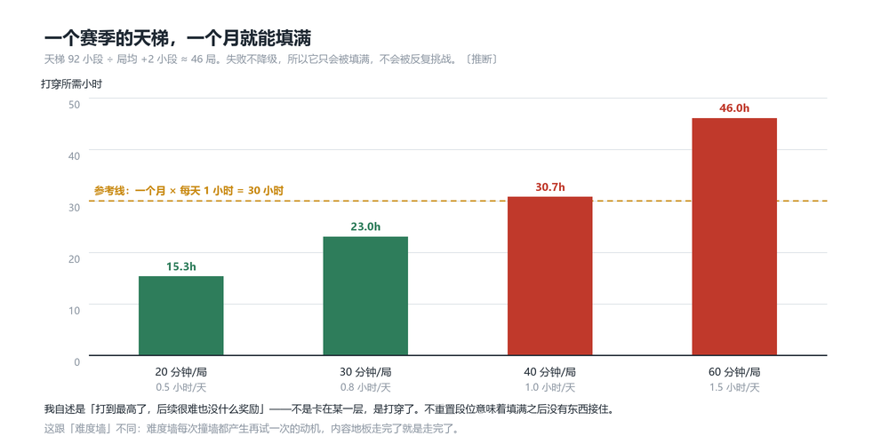

# 崩坏：星穹铁道：一次退游、一次回流未遂、一次回坑

> **版本锚点**：4.6「月升之前，与兽共舞」（2026-09-28 – 2026-11-11）。关键节点跨 2.x（2024）–4.4（2026-07-15），
> 各节点数值按当时版本计，引用处逐条标注。
>
> **这不是一份六域拆解案。** 我拆的是**一次真实的流失与回流**（churn & win-back）：哪套机制把人推走、哪套把人拉回、
> 哪套把人留下、以及留下的那个人最后在做什么。样本是本人（n=1）。
> 同一款游戏的**玩法层**拆解见本仓库[《货币战争》拆解案](../honkai-star-rail-currency-wars/拆解案.md)——
> 那份是旁观，这份是当事人；那份的样本量是 n=0，这份的样本量是 n=1，但观察者就是被观察者。

## 案例卡片

| 项 | 值 |
|---|---|
| 主体 | 《崩坏：星穹铁道》本体——台账式长线运营的免费手游，6 周一个版本 |
| 观察对象 | 单一玩家（本人）。常态目标为**最多 E1S1**，因流萤角色报料**主动升到 E6（六命）** |
| 玩家画像 | **低付费、极高投入**：月卡（¥30/月）未断，但不做星琼直购；常态抽到 E1S1 即止 |
| 时间跨度 | 2.3「Farewell, Penacony」（2024-06-19）退游 → 4.2（2026-04-22，三周年）回流未遂 → 4.4（2026-07-15）回坑 → 2026-10 现状 |
| 样本量 | **n=1**，且为**回溯性自述**（退游距今约两年） |
| 数据来源 | **实测**＝本人自述（逐条标 n=1）；**公开**＝卡池概率 / 版本节奏 / 收入项（标链接）；**推断**＝期望与折算（给算式，见附录 A） |

> **方法说明**：这是一份自我民族志（autoethnography）式的留存（retention）复盘，不是用户研究。
> 它的价值不在样本代表性，而在**机制与体验的对账**——我在退游两年后重新算了一次账，
> 发现当年那个把我推走的事件，用当时的公开数值可以算出来。附录 B 记录了一处算不平的地方。

---

## 核心发现

1. **我在留存报表里的位置是矛盾的：以流水口径看是低价值用户，以活跃与口碑口径看是高价值用户。**（N0 · N1）
   月卡未断但不直购；把约半年的全部星琼押在流萤的六个命座（Eidolon）上。
   **内部基准**：600 抽 = 96,000 星琼 ≈ 月卡党 **10.9 个月的周期性收入**〔推断〕。
   它的实际构成是 **约 200 抽的历史存量 + 半年的新增积攒**——即这不是一次冲动消费，
   而是把一年多积累的筹码一次性推上桌。同期总付费约 ¥180–¥390。
   **外部对标**：长线运营的二游普遍把「月卡党」当作 DAU 与社区内容的基座，而非流水基座——
   它的付费额低，但它的在线时长、攻略产出、二创与拉新贡献最高。
   **判断**：**同一份留存报表，流水口径与活跃口径会给出相反的优先级**。我这种用户在任何以 ARPU 排序的
   召回名单里都排在末尾——而按"整年收入押在一个角色上"的投入强度排序，我排在顶端。

2. **600 抽没出六命，不是运气问题，是信息问题。**（N1）
   E6 的期望抽取成本是 **654 抽**〔推断〕；我带的 600 抽，达成概率只有 **32.2%**〔推断〕。
   也就是说**三分之二的概率不够，而这件事在卡池界面上不存在**。
   **内部基准**：单只限定 5★ 期望 93.45 抽（= 1.5 × 62.30），E6 = 7 只 → 654 抽。
   **而我的常态目标只有 E1S1 ≈ 254 抽**——本次目标被一个角色抬高到 **2.6 倍**，
   抬高的那一步没有任何界面参与。600 抽相对旧基数是 2.36 倍余量（所以感觉是巨款），
   相对新基数是 92%（所以结果是失败）。
   **外部对标**：部分同类作品已把「距保底（pity）还差 N 抽」直接做进卡池界面，把目标成本从社区推算搬进客户端。
   本作显示的"综合概率 1.6%"正确、合法，却只描述**单次抽取**，不描述**目标成本**——
   中间隔着一层七重卷积，玩家只能靠社区帖子反推。
   **判断**：把目标成本留给社区，等于让玩家**用自己的钱做 A/B 测试**。这不是概率设计问题，是透明度设计问题。

3. **拦住我回流的不是没时间，是养成落差的绝对值——而官方给的回流补偿只有它的千分之三。**（N2）
   沉默期 756 天，跨 17 个版本。2026 年三周年版本（4.2）我**装回去看了两眼才走的**——
   这是一次**有行为的回流未遂**，不是"想过"。卡点：落后版本太多、强度跟不上。
   **内部基准**：离线 756 天 ≈ 错过 **181,440 点**开拓力（Trailblaze Power）产出；
   当期「循星归程」中具追赶性质的部分折算 **580 点**等效（= 2.4 天体力），**覆盖率 0.32%**。
   给成建制战力的只有「金装自选」的 1 套遗器（Relic）/ 1 名角色，而终局考核要 8 名角色。
   **外部对标**：追赶手段分三档——送资源 / 送存量 / 降门槛。
   本作把**降门槛**做得最完整（剧情跳过、概要、回顾、提前体验活动），
   把**送资源**做成主项（约 17.5 抽），而对**送存量**只给了一个限领一次的特例。
   我的卡点恰在最不可能被系统解决的那一档——**养成存量就是它的核心收入**。
   **判断**：**它解决了故事的断层，从未打算解决战力的断层。**
   这两件事在体验上是一句"落后版本太多"，在财务上是完全相反的两件事。

4. **把我拉回的是单个角色，撑住我的是赛季（season）玩法，而赛季玩法有上限、上限之外没有奖励。**（N3）
   4.4 的姬子·启行把我拉回来（抽到了）；主线推了一大半就**没兴趣了**；
   真正撑住约一个月的，是季节玩法「货币战争」的一个赛季。
   **内部基准**：该赛季天梯（ladder）≈92 小段、失败不降级、局均 +2 小段 → 约 46 局；
   局均 20–60 分钟 → **15–46 小时**，摊到 30 天 = 0.5–1.5 小时/天〔推断〕。我自报打穿到顶端，然后停下。
   停下的理由不是我打不过：是**后续很难，也没什么奖励**。
   **外部对标**：赛季制 Roguelike 的通行解法是"打穿之后给可重复的挑战层"或"赛季末重置段位并给新奖励"。
   本作的天梯是**一次性**的：不降级意味着它只会被填满，不会被反复挑战。
   **判断**：**赛季内容的留存天花板由内容总量决定，不由难度决定**——因为"打穿"在设计上是可达到的。
   一旦达到，没有奖励阶梯接住，留存立刻归零。难度墙会留住人，**内容地板不会**。

5. **"只做每日实训"是沉没成本留存：它养 DAU，不养收入，也不养内容。**（N4）
   我现在的全部行为是每日实训。自述理由：**"已经投入太多不想断"**。
   **内部基准**：每日实训 60 星琼/天，耗时约 10 分钟 → **6 星琼/分钟**；
   靠它攒满一注 600 抽需要 **1,600 天 = 4.4 年**〔推断〕。它改变不了任何事，但每天都要发生。
   **外部对标**：习惯型留存（因为有新东西可做而回来）与沉没成本型留存（因为断了可惜而回来）
   在 DAU 上完全同形，在产品健康上完全相反。
   **判断**：**用每日签到与月卡领取维持的 DAU，会系统性掩盖产品的真实热度。**
   这套留存还有一个反向特性：它的成本每天都要续期，因此**最脆弱**——
   一次断签（月卡漏签不补）就把"不可断"的账本清空，沉没成本的心理约束随之失效。我的下一次退游大概率是静默的。

---

## 旅程时间线


*图注：四个节点的驱动力来自四套互不相干的系统。中心那段两年的沉默期没有任何行为记录，
但它在因果上承载了 N2 的战力落差——这是全文最重的一段空白，也是这份复盘最没底的一段。*

| 节点 | 时点 | 状态变化 | 驱动力 | 出自哪套系统 |
|---|---|---|---|---|
| N0 投入期 | 1.0 – 2.2（2023-04 – 2024-05） | 开服玩家、月卡未断、常态抽到 E1S1 即止 | —— | —— |
| **N1 退游** | 2.3（2024-06-19） | 活跃 → **目标被报料抬高到 E6** → 流失 | 期望落空 + 日常时间税 | 卡池定价 · 日常循环 |
| **N2 回流未遂** | 4.2（2026-04-22，三周年） | 流失 → 装回去看了两眼 → 又走 | 养成落差 | 养成深度 · 内容断层 |
| **N3 回坑** | 4.4（2026-07-15） | 想回流 → 回坑 → 打穿赛季 | 单个新角色 | 角色发布（内容脉冲） |
| **N4 现状** | 2026-08 – 2026-10 | 回坑 → 最低维持 | 沉没成本 | 元进度 |

---

## N1 · 退游（2.3 / 2024-06-19）

### 事实

| 项 | 值 | 来源 |
|---|---|---|
| 退游时点 | **2.3「Farewell, Penacony」（2024-06-19）**，流萤卡池档期 | 实测 n=1 + 公开（版本表） |
| 常态抽卡目标 | 此前每个角色**最多抽到 E1S1**（1 命 + 专属光锥）即止 | 实测 n=1 |
| 目标升级触发 | **流萤角色报料后**，决定改攒满命（E6） | 实测 n=1 |
| 退游触发事件 | 流萤卡池累计投入 **600 抽**，未达成 E6（六命） | 实测 n=1 |
| 资金来源 | 退游前**已持有约 200 抽存量**；其后约半年继续积攒，**月卡未断**；未做星琼直购 | 实测 n=1 |
| 退游前日常 | 约 **10 分钟/天**（清开拓力 + 每日实训），已属打卡性质 | 实测 n=1 |
| 角色池 5★ 基础 / 综合概率 | 0.6% / 1.6% | 公开〔Wiki · Prydwen〕 |
| 角色池硬保底 | 90 抽；50/50 机制，最坏 180 抽必得当期 | 公开〔Wiki · Prydwen〕 |
| 星轨专票单价 | 160 星琼/抽 → 600 抽 = **96,000 星琼** | 公开〔Wiki〕 |
| 每日实训产出 | 60 星琼/天 | 公开〔Wiki〕 |

### 拆解

**这条退游路径上有两个独立的推力。一个是概率问题，一个是时间问题。它们的量级完全不同。**

**推力一：目标与预算的错配，而且这个错配在事前不可见。**

六命需要 7 只限定 5★。用软保底模型（1–73 抽各 0.6%，自第 74 抽起每抽 +6 个百分点，90 抽硬保底）
算出单只 5★ 期望抽数 **62.30**，与官方综合概率 1.6% 反推的 62.50 吻合，模型可用〔推断〕。
叠加 50/50 与保底后，单只**限定** 5★ 期望抽数 **93.45**（官方口径 93.75，差 0.3%）：

```
单只限定 5★ 期望抽数 = 1.5 × 62.30      = 93.45
E6（7 只）期望抽数   = 7 × 93.45        = 654
600 抽对应的期望命座 = 600 ÷ 93.45      = 6.42 只  ← 均值本身就不够
```

把 7 次单只成本卷积起来，**600 抽内达成 E6 的概率是 32.2%**；要到 75% 需要 732 抽，90% 需要 801 抽。


*图注：600 抽落在曲线的 32.2% 处——即这个预算有三分之二的概率不够。654 抽是 50% 分位，
也就是"期望成本"这个词落在这个目标上时的真实含义。曲线的陡峭段正好压在 500–650 抽之间，
我全部的筹码都押在这个区间里。*

所以"我很倒霉"是错的。**我带的预算，有三分之二的概率不够。**

而这件事在界面上不存在。卡池展示的是"综合概率 1.6%"——这个数正确、也合规，
但它描述的是**下一次抽取**，不是**把目标达成的总成本**。从 1.6% 到 654 抽中间隔着一层七重卷积，
玩家只能靠社区帖子反推，而社区帖子给的区间（"大概 600–700 抽"）听起来像是 600 也可以。

**推力一的成因：目标是被角色主动抬高的，而抬高的代价没有任何反馈。**

这不是一次"想抽就抽"的冲动消费，而是一次**目标升级**。我的常态上限是 E1S1。
用同一套模型把两个目标并排算：

```
常态上限 E1S1 = 2 只限定角色 × 93.45 + 1 只限定光锥 × 67  ≈ 254 抽
本次目标  E6  = 7 × 93.45                                 = 654 抽
目标被抬高    = 654 ÷ 254                                 ≈ 2.6 倍
```

再看我带的筹码：600 抽。

- **相对旧基数（254 抽）**：600 ÷ 254 = **2.36 倍余量** → 主观感受是"我攒了一笔巨款"。
- **相对新基数（654 抽）**：600 ÷ 654 = **92%** → 客观状态是"还差一点"。

落差的心理来源就落在这两个基数之间。而**从 254 到 654 这一步，游戏里没有任何界面参与过**：
卡池不会因为我想抽六命而改变显示，也不会告诉我这个决定比平时贵 2.6 倍。
抬高目标的是一个**角色**（内容侧），定价的是另一套**概率系统**（经济侧），
两者之间没有回调机制——**内容负责许诺，定价负责兑现，而它们不互相通知。**

**推力二：日常的时间税。**

退游前日常约 10 分钟/天。10 分钟听起来是这套系统最友善的一档，它确实是。
问题在于**这 10 分钟里没有决策**：清开拓力和每日实训都是把已有战力兑换成养成物料，不产生岔路。
于是它在体验上等价于"登录确认"，而它每天都要发生一次。
它的成本不是 10 分钟，是**每天必须想起这款游戏一次**。

把两个推力放在同一把尺子上：抽卡落差是一次性事件（发生了就是发生了），
日常是**每天都在续期**的成本。所以真正让退游变得不可逆的是后者——前者给了理由，后者让理由不用被重新审查。

### 判断

> **N1 的流失由期望落差触发，但让它不可逆的是那 10 分钟——触发事件是一次性的，日常是每天续期的。**
>
> **内部基准**：E6 期望成本 654 抽 > 实际投入 600 抽（差 8.3%），600 抽内达成概率 32.2%；
> 同期日常的决策密度为 **0**（清体力与每日实训都不产生岔路），时间成本 10 分钟/天、产出 60 星琼/天 = 6 星琼/分钟。
> **外部对标**：同类作品把目标成本前置的通行做法是显示「距保底还差 N 抽」与保底计数；
> 本作显示单次概率。差别在 E6 这种 7 只目标上被放大成 654 抽 vs 600 抽的落差——
> **差的这 54 抽，正好是我退游的那一年里没有任何界面提醒过我的那部分。**
> **边界与证伪条件**：若我在投入 600 抽之前就已经预期"可能抽不到"，
> 则"事前不可见"这条不成立，结论退回纯粹的沉没成本效应。
> **n=1，且为两年后回溯自述——本条是全文最脆弱的一条。**

---

## N2 · 沉默期与回流未遂（4.2 / 2026-04-22）

### 事实

| 项 | 值 | 来源 |
|---|---|---|
| 沉默期长度 | 约 **756 天（约 25 个月）**，2.3 → 4.4 | 公开（版本表） |
| 跨越的版本数 | **17 个**（2.4 – 4.3） | 公开（版本表） |
| 首次尝试回流的时点 | **4.2「So Laughed the Masses」（2026-04-22）**，恰为三周年版本 | 实测 n=1 + 公开 |
| 具体行为 | **装回去看了两眼，然后退出** | 实测 n=1 |
| 未回落的原因（自述） | "落后版本太多，角色强度跟不上" | 实测 n=1 |
| 当期回流活动 | **「循星归程」（Starlit Homecoming）**；4.2 起活动时长由 14 天延长为 21 天 | 公开 |
| 回流触发条件 | 开拓等级 ≥10 + 完成指定主线 + **连续 ≥14 天未登录** + 距上次激活 ≥40 天 | 公开 |
| 我是否符合条件 | **符合**（离线约 22 个月） | 推断 |
| 礼包折算（4.2 当期） | 星琼约 2,800（3 日签到 600 + 礼包 600 + 双倍上限 1,600）≈ **17.5 抽** | 公开 |
| 其中"追赶"性质的部分 | **42 次花萼双倍 + 4 次遗器/饰品双倍**；另 ≥90 天未登录可**金装自选：为 1 名已有角色选一套满级 5★ 遗器** | 公开 |
| 剧情追赶工具 | 3.4 已加「跳过 / 概要」，3.6 已加「剧情回顾」，且等级 ≥21 可提前体验未解锁活动 | 公开 |

> **注**：以上回流活动数值来自 HSR Wiki 对应条目（官方公告页为 JS 渲染，本机未能取回原文），
> 见附录 A「未取得」。

### 拆解

**这一段是全文唯一有行为证据却没有留存数据的地方：我回来了，登录了，看了两眼，走了。**

这个动作串值得被当成一次真实的回流失败案例来读，因为它排除了几种常见的解释：

- **不是"不知道有回归活动"**——我装回去了，界面会推给我。
- **不是"不想玩"**——想玩才会装回去。
- **也不是"没时间"**——看两眼只要几分钟。

排除下来只剩一个解释，也就是我自述的那个：**我看到了自己账号的处境，判断追不上，于是退出。**

"追不上"是一笔可以大致估的账。断线 25 个月意味着错过：

| 落差构成 | 性质 | 能否用礼包补 |
|---|---|---|
| 约 18 个版本的角色池 | 决定性（深渊考核按角色池宽度出） | 不能——补抽卡资源 ≠ 补角色 |
| 同期积累的遗器与行迹（Traces）存量 | 累积性（它是投入时间的结果，不是抽卡的结果） | 不能——这是最赚钱的付费点之一 |
| 主线与活动进度 | 体验性 | 部分能（剧情可跳过/回顾） |
| 当期强度门槛 | 结果 | —— |

关键在第二行。**养成存量是时间的函数，而回流礼包是资源的函数。**
这两者之间没有兑换率——这正是回流设计最容易搞错的地方。

**这个礼包到底补了多少？可以折成开拓力算。**

礼包里唯一具有"追进度"性质的两项，是 42 次花萼双倍与 4 次遗器/饰品双倍。
按每次双倍折算为一次额外产出（花萼 10 开拓力/次、侵蚀隧洞 40 开拓力/次）：

```
42 次花萼双倍 → 等价额外产出 42 × 10 = 420 开拓力
 4 次遗器双倍 → 等价额外产出  4 × 40 = 160 开拓力
                          礼包合计 = 580 开拓力
```

而 580 开拓力是什么概念？开拓力自然回复 240 点/天，所以：

```
580 ÷ 240 = 2.4 天
```

**整个回归礼包里"追赶"的那一部分，等于 2.4 天的体力。**

再看缺口的量级。离线 756 天，每天都少产出 240 点开拓力：

```
756 × 240 = 181,440 开拓力
礼包覆盖率 = 580 ÷ 181,440 = 0.32%
```

**千分之三。** 即便把"我不可能每天都清完体力"打个五折，覆盖率也只有 0.6%——
量级上翻不了案。这个结论对具体的双倍次数、离线天数都不敏感：
只要追赶补偿是按"次"发放（几十次），而缺口是按"天"积累（几百天），
两者之间就差两个数量级。

礼包里唯一跳出了这个数量级的东西，是**金装自选**——为 1 名已有角色选一套满级 5★ 遗器。
它是一次性的、有名额限制的（4.0–5.0 期间限领一次），而且只覆盖**一个**角色。
而终局考核需要的是**两支队伍**：混沌回忆 12 关要双节点、虚构叙事 4 关各需独立队伍、
末日幻影两个 Boss。按 8 名角色 × 6 件遗器算，是 **48 件**。


*图注：下面那条绿条按真实比例只有约 3 像素宽，所以图中已放大 25 倍绘制并明确标注了倍数。
这张图本身就是结论——回流补偿与错失进度不在同一个数量级上，
把倍数写在图上是为了不让这张图变成一次视觉夸张。*

**这款游戏在版本 3.4 与 3.6 两次系统性解决了"剧情断层"**——加了跳过、剧情概要、
命运星图里的剧情回顾，还允许等级 ≥21 的玩家提前体验未解锁的活动。
**但它从未给出对应的"战力断层"解决方案。** 剧情是能被回看的，战力不能被回看；
剧情追赶是设计问题，战力追赶是收入问题。

这也解释了为什么我在 4.2 装回去、看了两眼、退出：**我看到的不是"故事断了"，
是"我的账号落后了 18 万点体力"。** 而界面能给我的补偿是 2.4 天。

### 判断

> **回流礼包补的不是缺口里最便宜的那一块，而是缺口的 0.32%——而它补不了的那 99.68%，才是我退出的原因。**
>
> **内部基准**：离线 756 天错过约 **181,440 点**开拓力产出；「循星归程」中具追赶性质的部分
> 折算 **580 点**等效（= 2.4 天），覆盖率 **0.32%**；星琼部分约 17.5 抽。
> 唯一给出成建制战力的是「金装自选」的 **1 套满级遗器 / 1 名角色**，
> 而终局考核要 **8 名角色、48 件遗器**。
> **外部对标**：作品处理"追赶"的通行手段有三类——(a) 送资源（抽卡货币）、
> (b) 送存量（材料 / 装备 / 命座）、(c) 降门槛（跳过 / 概要 / 借力 / 提前体验）。
> **本作把 (c) 做得最完整**：3.4 加跳过与剧情概要、3.6 加剧情回顾、等级 ≥21 可提前体验未解锁活动。
> **把 (a) 做成了主项**：星琼约 2,800 ≈ 17.5 抽。
> **(b) 只给了一个特例**：金装自选，限 1 名角色、限领一次。
> 而我的卡点恰好落在 (b) 上——这是三档里唯一**不可能被系统性解决**的一档，
> 因为养成存量正是它的核心收入来源。
> **边界与证伪条件**：若我在 4.2 那次登录中根本没走到战力评估这一步（例如只翻了翻卡池就退出），
> 则"看到落差才走"不成立，本条降级为"未登录即退出"。
> **这正是我把 N2 单列一节的原因：它是全文唯一一处只有自述、没有行为轨迹的推断。**

---

## N3 · 回坑（4.4 / 2026-07-15）

### 事实

| 项 | 值 | 来源 |
|---|---|---|
| 触发因素 | **姬子·启行**（火 · 智识，SP 形态），4.4 版本上线 | 公开 |
| 卡池「拓星启明」档期 | 2026-07-15 – 2026-08-25 | 公开 |
| 是否抽到 | **抽到了** | 实测 n=1 |
| 回坑后主线进度 | 4.4 主线推了**一大半**，未完成；原因自述"**没兴趣了**" | 实测 n=1 |
| 回坑后主要活动 | 季节玩法「货币战争」一个赛季，自报打到天梯顶端（记作 A50） | 实测 n=1 |
| 该赛季持续 | 约 **1 个月** | 实测 n=1 |
| 停止赛季的原因 | "**打到最高了，后续很难也没什么奖励**" | 实测 n=1 |
| 天梯结构 | A0–A8 共 ≈92 小段，A8 独占 50；失败**不降级**；+1/+2/+3 按通关余 HP 计 | 公开〔见《货币战争》拆解案〕 |
| 「强度跟得上」的标尺 | 「异相仲裁」（3.6 新增）解锁需**同时**持有混沌回忆 12 关 3 星 + 虚构叙事 4 关 3 星 + 末日幻影难度 4 的 3 星；其 Knights 关敌等级 95，King in Check: Plight 敌等级 **120** 且须 2 循环内清 | 公开 |
| 混沌回忆战力抬升记录 | 1.6 由 10 关增至 **12 关**；当前敌人等级上限 95；4.3 三模式追加 Starward Mode（更难档，+100 星琼/期） | 公开 |

### 拆解

**回坑这件事在机制上是成功的——我抽到了那个角色。然后它还是只撑了一个月。**

这一个月里发生的事，按留存贡献排序：赛季玩法 > 主线 >> 日常。而这三者的可持续性正好相反：

| 内容 | 这一个月里占多少 | 有上限吗 | 打穿之后 |
|---|---|---|---|
| 货币战争（一个赛季） | 主要 | **有**——≈92 小段，不降级 | 归零（无奖励阶梯） |
| 4.4 主线 | 一部分（推了一大半） | 有 | 直接结束，且我没推完就失去兴趣 |
| 日常 | 每天 10 分钟，全程 | 无 | 永远在，永远一样 |

天梯那一段可以算：92 小段 ÷ 局均 +2 = 约 46 局；按社区口径的局均 20–60 分钟，
是 **15–46 小时**，摊到 30 天就是 **0.5–1.5 小时/天**〔推断〕——量级上正好构成"一个月的游戏"。


*图注：四根柱子是同一件事在四种局均时长下的样子。绿色两根落在"一个月每天 1 小时"的参考线下，
红色两根越过它。无论取哪一根，量级都正好是"一个月的游戏"——这正是我实际玩到的时长。
我自述"打了一个月"，与这张图互相印证，是本文少数几处自述与算式互证的节点之一。*

关键在于我停下的方式。我自述是"打到最高了"——**不是卡在某一层，是打穿了**。
而"打穿"意味着这个赛季的留存时长在设计上就是**有限且可耗尽**的：不降级的段位只会被填满，
不会被反复挑战。填满之后没有奖励阶梯接住，于是**留存曲线在打穿那一刻垂直归零**。

这也是它和"难度墙"的区别。难度墙留住人（每次撞墙都产生"再试一次"的动机），
内容地板不（走完了就是走完了）。我把这两件事在文档里分开写，是因为它们对应的迭代方向相反：
一个要调难度，一个要加内容。

### 判断

> **4.4 的回坑是"角色型回归"，不是"内容型回归"——而角色只能拉人回来，撑不住人留下。**
>
> **内部基准**：撑住这一个月的赛季内容量约 **15–46 小时**（46 局 × 20–60 分钟），
> 摊到 30 天 = 0.5–1.5 小时/天；主线未推完即失去兴趣；日常无上限也无变化。
> 三者中**唯一无上限的那一项，恰好是留存贡献最低的一项**。
> **外部对标**：赛季制 Roguelike 的通行解法是打穿之后给可重复的挑战层（变体、词缀、排行榜），
> 或赛季末重置段位并重发奖励。本作的天梯不降级、不重置段位，
> 于是它是一次性的**进度条**而不是可重复的**玩法**。
> **边界与证伪条件**：若存在"打穿后仍持续游玩"的玩家社群（例如为刷榜或为变体构筑重复游玩），
> 则"天花板由内容总量决定"这条减弱，退回到"我个人的兴趣阈值较低"。
> 我自报的段位记法（A50）沿用《货币战争》拆解案，未独立核实，见「局限」第 4 条。

---

## N4 · 现状：每日实训（2026-08 – 2026-10）

### 事实

| 项 | 值 | 来源 |
|---|---|---|
| 当前全部行为 | 每日实训 | 实测 n=1 |
| 是否推主线 / 打赛季 | 否 | 实测 n=1 |
| 自述动机 | "**已经投入太多不想断**" | 实测 n=1 |
| 每日实训产出 | 60 星琼/天 | 公开〔Wiki〕 |
| 每日实训耗时 | 约 10 分钟 | 实测 n=1 |
| 月卡领取规则 | 需每日登录领取，**漏签不补** | 公开〔Wiki〕 |

### 拆解

**我在 N4 只做一件事，而这件事的收益是 6 星琼/分钟。**

先把尺度摆出来：靠每日实训攒满一注 600 抽需要 **1,600 天 = 4.4 年**。
换句话说，N4 这个行为**在机制上不可能导向任何结果**——
它既不能让我追上养成落差（N2 的卡点），也不能让我重新获得赛季内容（N3 的卡点）。
它唯一的产出是"账号还在动"这个事实本身。

那么为什么还在做？自述答案是**"已经投入太多不想断"**。这一步很重要，因为它排除了另外两种常见解释：

- **不是习惯留存**——习惯留存的前提是"回来有东西可做"。我没有，我上线就是清掉列表。
- **不是等待留存**——我没有在等某个角色。等的状态会有目标意识，我没有。

排除下来是第三种：**沉没成本留存**。它的驱动不是"接下来能得到什么"，而是"断掉会损失什么"。

这套留存有两个必须一起看的性质：

1. **它在 DAU 上与习惯留存完全同形，在产品健康上完全相反。** 留存报表看不出"我每天来"是因为有内容还是因为有账本。月卡漏签不补这个规则还额外焊死了这一点：只要我还在领月卡，我的日活就被锁住了，无论游戏里有没有东西可玩。
2. **它是最脆弱的一种留存。** 沉没成本的心理约束依赖"账本不可断"，而这份账本每天都要重新签一次。一次断签（出差、生病、换设备）就把"不可断"的前提清空，约束随之失效。**所以我的下一次退游大概率是静默的**——不是被某个事件推走，而是某天漏签之后发现没事，然后就再也没回来。

### 判断

> **"只做每日实训"是这套留存系统的稳态，不是我的失败——而它正是留存指标最不可信的那一格。**
>
> **内部基准**：每日实训 60 星琼/天 ÷ 10 分钟 = **6 星琼/分钟**；
> 靠它攒满 600 抽需 1,600 天（4.4 年），即**该行为在任何时间尺度上都不导向目标**。
> 驱动为沉没成本（"已经投入太多不想断"），而非习惯或等待。
> **外部对标**：习惯型留存与沉没成本型留存在 DAU 上同形。
> 行业通行的做法是用"每日任务链"和"月卡领取"制造每日登录理由，
> 本作两者都用，且月卡漏签不补——这条规则把日活锁得更死，同时也把流失的触发点
> 从"某个失望事件"变成了"某一次漏签"。
> **边界与证伪条件**：若我未来三个月内因新角色或新赛季而恢复中高强度游玩，
> 则"沉没成本是稳态"这条被推翻，应改写为"沉没成本是我在内容空档期的过渡态"。
> **验证方式**：记录下一次让我恢复游玩的触因是角色、赛季还是别的（不设观察任务，仅记结论）。

---

## 把它当作一个留存案例读

把四个节点连起来，它不是一个"退游又回坑"的故事，而是一条**脉冲式留存**的完整周期：

```
内容脉冲（角色/赛季）
      ↓ 拉回
   定价闸门（期望成本 654 抽）
      ↓ 通过 → 短期高活跃（15–46 小时）
      ↓ 未通过 → 流失
   内容耗尽（打穿赛季 / 主线失去兴趣）
      ↓
   沉没成本接盘（每日实训）→ DAU 不降，热度归零
      ↓
   等待下一次内容脉冲
```

这条链上有三个可以被设计改动的接点：

**① 定价闸门（N1）——把目标成本前置。**
在卡池界面显示"本池 5★ 期望 93.75 抽 / 距保底还差 N 抽 / 六命期望 654 抽"。
**代价**：短期抽卡转化率会下降。把话说清楚会劝退一部分冲动消费——这正是它不做的原因。
因此这条建议单独提出来是不现实的，它必须与"降低命座边际成本"配套才有机会被采纳。

**② 回流闸门（N2）——把补偿从"抽卡资源"挪到"时间存量"，并且把补偿多少写在界面上。**
当期礼包的追赶部分覆盖错失进度的 **0.32%**（580 开拓力等效 vs 181,440）。
建议改成**按离线天数折算的存量补偿**：`补偿 = 离线天数 × 240 × 折扣率`，
分 21 天随活动逐步发放，并在界面上直接写明"本次补偿 ≈ 你错失进度的 X%"。
**代价**：三条里最贵的一条，因为它直接对抗收入——养成存量正是最赚钱的付费点。
即便折扣率只取 10%，756 天也意味着约 18,000 开拓力（≈76 天的正常产出），
相当于让回流玩家免费拿到两个多月的体力，这是一次实打实的收入置换。
**折中**：把目标从"补齐"降到"够启动"——补偿只保证回流玩家能通过**当期**深渊的下限，
不足以追上大部队。这样代价可控，且解决的是"第一次考核就再次流失"这个具体失败点。

**③ 内容地板（N3）——让打穿不等于归零。**
给赛季天梯加"顶端之后的可重复层"（变体词缀 / 排行榜 / 赛季末重置并重发奖励）。
**代价**：内容生产成本从"92 级一次性台阶"变成"可持续挑战层"。
若不做新关卡，就得靠词缀组合生成变体——这会引入平衡成本，
且词缀随机化本身会带来"难度不可控"的投诉。

三条里我判断**第 ③ 条的性价比最高**：它是唯一一条不直接对抗收入的改动，
而且它针对的是我在 N3 的**实际停点**（打穿之后无奖励），而不是我自述的理由。

## 局限

1. **n=1，且观察者即被观察者。** 我既是样本又是分析者，对"我为什么退游"的解释天然倾向于
   有利于叙事自洽的那一版。本文所有实测项由此打上同一处系统性偏差，无法通过增加记录消除。
2. **回溯性自述，退游距今约两年。** 关键数字（600 抽、10 分钟日常、一个月赛季）全部来自回忆，
   没有当时的记录。600 抽与公开收入模型的对账见附录 B——**它在第一版里是错的**，
   原因是我漏问了一项输入（历史存量 200 抽）。这段留在正文里，因为它说明：
   **n=1 的结论对"我有没有问全"极其敏感，而事后我无法自查哪一项还没问。**
3. **沉默期完全没有行为记录。** N2 的"装回去看了两眼"是回忆中的动作，
   它与 N3 之间相隔多久、是否其实发生在同一次，我没有当时的证据。
   若两者实为同一次，N2 作为独立节点不成立，应并入 N3——**这是我回来首要验证的事**。
4. **段位记法（A50）沿用《货币战争》拆解案**，未独立核实其在 A0–A8 体系中的确切位置。
   "打到最高"这一自述是该判断的支柱，因而支柱本身有待复核。
5. **公开数值轨为单源为主。** 本机抓取通道受限（详见附录 A），
   卡池概率与收入项均来自 HSR Fandom Wiki 与 Prydwen 的交叉一致，未取得官方公告原文。

## 附录 A · 数据来源与可信度

<details>
<summary>展开：三档来源与推断表</summary>

**实测（本人自述，n=1）**：退游时点与触发事件、常态目标 E1S1 与因报料升到 E6、600 抽及资金来源
（约 200 抽存量 + 半年积攒 + 月卡未断）、日常约 10 分钟、4.2 周年庆"装回去看了两眼"、
4.4 抽到姬子·启行、主线推一大半后失去兴趣、货币战争打穿天梯、现状与动机。

**公开**：

| 数值 | 来源 |
|---|---|
| 角色池 5★ 基础 0.6% / 综合 1.6% / 硬保底 90 / 50-50 | HSR Fandom Wiki · Prydwen |
| 星轨专票 160 星琼/张 | HSR Fandom Wiki |
| 每日实训 60 星琼/天 | HSR Fandom Wiki |
| 逐光捡金单期 800 星琼（三模式各 6 周、每 2 周交替） | HSR Fandom Wiki |
| 货币战争/模拟宇宙周期积分 225 星琼/期 | HSR Fandom Wiki · 官方 4.2 公告 |
| 版本维护补偿 300 星琼 | 官方 4.6 更新说明 |
| **1.0 – 4.6 完整版本发布时间表**（用于沉默期与节点定年） | HSR Fandom Wiki《Version》 |
| 列车补给凭证 ¥30 / 90 星琼·天 / 漏签不补 | HSR Fandom Wiki |
| 开拓力 300 上限 / 6 分钟 1 点 / 240·天；花萼 10、遗器本 40 | HSR Fandom Wiki |
| **「循星归程」触发条件、时长（4.2 由 14 天延长为 21 天）与奖励清单** | HSR Fandom Wiki《Starlit Homecoming》 |
| 主线跳过 / 概要（3.4）、剧情回顾（3.6）、提前体验活动 | HSR Fandom Wiki《Version/3.4》《Version/3.6》 |
| 混沌回忆 1.6 增至 12 关 / 敌等级上限 95 / 异相仲裁解锁门槛 | HSR Fandom Wiki《Forgotten Hall》《Anomaly Arbitration》 |
| 货币战争天梯结构与不降级规则 | 见本仓库《货币战争》拆解案 |

**推断**（算式见附录 B）：E6 期望抽数与达成概率、E1S1 目标成本、每版本收入折算、
600 抽的攒取周期、赛季天梯耗时折算、**回流礼包的追赶覆盖率**。

**未取得 / 存疑**：

1. **零氪"每版本星琼总量"无权威核算**（官方不公布，Wiki/Prydwen 均无此页）。
   收入表因此按**周期性来源**分项加总，并明确标注不含版本活动 / 主线 / 宝箱 / 成就等不定额来源——
   这正是不定额部分进入附录 B3 差额的原因。
2. **官方从未披露活跃 / 流水数字**（米哈游不公开发行经审计的财报）。
   第三方（Sensor Tower 转述）对 2025 年的月度流水估算彼此矛盾，本文不采信任何一条。
   **因此这份复盘无法与任何官方留存口径对照——这是它结构性的上限。**
3. **「循星归程」细节来自 HSR Fandom Wiki 而非官方公告原文**：官方公告页为 JS 渲染，本机静态抓取未取回。
4. **模拟宇宙 / 货币战争积分的刷新周期两个来源冲突**（每周 vs 每两周）。
   本文取每周口径；若实为每两周，每版本收入减少约 675 星琼（≈4.2 抽），
   对任何结论均不产生影响。
5. 本机 WebFetch 全域受限，公开轨以 HSR Fandom Wiki 的 MediaWiki API 单源为主；
   卡池概率有 Prydwen 交叉一致，其余多为单源。

</details>

## 附录 B · 数值细节

<details>
<summary>展开：算式与那一处对不平的账</summary>

### B1 抽卡模型

软保底模型：1–73 抽各 0.6%；自第 74 抽起每抽 +6 个百分点；第 90 抽 100%。

```
单只 5★ 期望抽数   = 62.30      （官方综合概率 1.6% 反推 62.50，吻合）
单只限定期望抽数   = 1.5 × 62.30 = 93.45   （官方口径 62.5 × 1.5 = 93.75）
E6 期望抽数        = 7 × 93.45  = 654
600 抽达成 E6 概率 = 32.2%      （7 重卷积）
里程碑：25% → 576 抽 · 50% → 654 抽 · 75% → 732 抽 · 90% → 801 抽
```

### B2 每版本（42 天）周期性收入

| 来源 | 星琼 | 折合抽数 |
|---|---|---|
| 每日实训（60 × 42） | 2,520 | 15.8 |
| 逐光捡金（800 × 3 期） | 2,400 | 15.0 |
| 货币战争/模拟宇宙积分（225 × 6 周） | 1,350 | 8.4 |
| 版本维护补偿 | 300 | 1.9 |
| 登录活动 Gift of Odyssey（10 专票） | 1,600 | 10.0 |
| **零氪合计** | **8,170** | **51.1** |
| 月卡追加（90 × 42 + 立得折算） | 4,200 | 26.2 |
| **月卡党合计** | **12,370** | **77.3** |

### B3 600 抽的账

我自述的资金构成是：**退游前已持有约 200 抽存量**，其后约半年继续积攒，月卡未断。

| 口径 | 星琼/天 | 攒满 600 抽需 | 半年新增 | 加上 200 抽存量 |
|---|---|---|---|---|
| 零氪·纯周期性 | 194 | 494 天（16.5 个月） | 221 抽 | **421 抽** |
| 月卡党·纯周期性 | 295 | 326 天（10.9 个月） | 335 抽 | **535 抽** |
| 月卡党 + 一次性来源估 5,000/版本 | 413 | 232 天（7.7 个月） | 470 抽 | **670 抽** |

600 抽落在 **535 – 670** 区间内。差额取决于半年里清掉了多少一次性内容来源
（版本活动 / 主线 / 宝箱 / 成就 / 邮件）：按月卡党周期性口径只差 **65 抽**，
即在这些来源里再拿约 10,400 星琼即可补齐——对半年而言属正常量。**账合上了。**

> **须坦白一条**：这个对账在第一版里是错的。我当时把它写成了"130–380 抽的缺口"，
> 并列了四种可能解释，**因为我没有问到"之前已经攒了 200 抽"这一项输入**。
> 记在这里，是因为它本身就是这份复盘的一条元数据：
> **n=1 的研究里，漏问一项输入就能推出一个结构上完全错误、但看起来严丝合缝的结论。**
> 而当事人（我）无法自查哪一项还没问——只能靠被追问。

### B4 时间税与天梯

```
每日实训 60 星琼/天 ÷ 10 分钟 = 6 星琼/分钟
靠每日实训攒满 600 抽 = 96,000 ÷ 60 = 1,600 天 = 4.4 年

赛季天梯 92 小段 ÷ 局均 +2 = 46 局
局均 20 分钟 → 15.3 小时（摊 30 天 = 0.5 小时/天）
局均 40 分钟 → 30.7 小时（摊 30 天 = 1.0 小时/天）
局均 60 分钟 → 46.0 小时（摊 30 天 = 1.5 小时/天）
```

### B5 回流礼包的追赶覆盖率

```
42 次花萼双倍 → 42 × 10 开拓力 = 420 开拓力等效
 4 次遗器双倍 →  4 × 40 开拓力 = 160 开拓力等效
                    礼包合计 = 580 开拓力 ≈ 2.4 天的自然回复量

离线 756 天 → 756 × 240 开拓力 = 181,440 开拓力
覆盖率 = 580 ÷ 181,440 = 0.32%
```

对参数不敏感：即便双倍次数翻倍、离线天数减半，覆盖率仍在 1% 量级。
只要补偿按「次」发放、缺口按「天」累积，两者就差两个数量级。

</details>
