# 崩坏：星穹铁道「货币战争」拆解案

> **版本锚点**：4.6「月升之前，与兽共舞」（2026-09-28 – 2026-11-11）。该玩法 3.7 版本（2025-11-05）常驻上线，首赛季「零和博弈」。**每赛季重排内容池**，跨版本引用本文数值须重新取数。

## 产品卡片

| 项 | 值 |
|---|---|
| 拆解对象 | 《崩坏：星穹铁道》常驻玩法「**货币战争**」（Currency Wars）。**不含游戏本体的抽卡经济与深渊** |
| 开发商 / 发行 | HoYoverse（米哈游） |
| 平台 | PC / iOS / Android / PS5 |
| 品类 | **自走棋（auto-battler）× Roguelike · PVE** |
| 上线 | 3.7 版本 2025-11-05，常驻；首赛季「零和博弈」 |
| 参与门槛 | 开拓等级 ≥ 21 |
| 一局结构 | 3 个位面 · **23 个节点** |
| 人口 | 上阵 8–10（前台 ≤4 + 后台 ≤6），上限随等级 |
| 段位 | A0–A8，小段合计 **≈92**（A8 独占 50） |
| 内容体量（4.6） | 角色 63（+9 外援）· 羁绊 33 · 装备 ≈148 · 投资环境 83 · 投资策略 334 · 词缀 55 |
| 样本 | 用户自报段位 **A50**、主玩「标准博弈」的队伍（n=1，深度玩家，判断段交其复核）；其余走公开数据 |

> **样本与边界**：本文的段位、职级修饰、概率表、池子规模全部来自公开 wiki 与官方文本镜像（见附录 D）。**本机采集通道受限**——WebFetch 全域被拦、datamine 站（homdgcat / hakush）不通、中文 wiki 正文页 404——公开轨数据整体降级为**单源**，凡只有单源的数值**不标「官方」**。文中凡标〔推断〕处均给出算式。**本稿的实测样本量 n=0**，所有体验性结论均标注为待验证。

## 核心发现

1. **这个玩法把一切都折算成了时间：没有死亡，只有倒计时。**（域二 · 域五）角色受到致命一击**不会倒下**（官方教程：立即回复部分 HP），代价是**倒计时被扣**；后台 6 人永不被敌人选中，但**照常出手**。胜负只有一个判据：在行动值（倒计时）内清完敌人。
2. **连胜有奖励，连败没有补偿。**（域三）对标 TFT——它的连胜与连败收入完全对称（2–4 连 +1 / 5 连 +2 / 6+ 连 +3）。本作只保留了连胜那一半，"弱势期先输着攒钱"这条策略失去了物质基础。
3. **"过渡流派少"不是"没有发动机"，是"够用的档位够不着"。**（域四 · 域三）33 条羁绊里 **10 条**自带独立伤害源，**全部 2–3 人即可开档**——问题不在门槛。问题在**数值梯度**：这些发动机的伤害随档位陡增，**首档 → 满档 = 2×–15×（中位 4.2×）**，可及的那一档扛不住中期敌人；要堆到够用就得爬到 **8–10 人 = 整个人口上限**。于是成型仍是"整队压上一条"，换一条要重买角色、重付 6–10 份刷新税 ≈**112–280 金**，吃一局收入 **28%–70%**。
4. **局外成长不是没有，是与压力曲线不相交。**（域四）满配优势布局给攻击/暴击伤害各 +48%、减伤 +25%；敌人 HP 在职级上膨胀到 +358%（A5-1）、+2103%（A8-1）。**交叉点落在 A2-1 附近**——这正是"前期用不上，后期不够看"。
5. **后排是"永不被选中、却照常出手"的输出层——全队生存容量被锁死在 4 格上。**（域五 · 域二）站位是角色自带的属性（前台 / 后台 / 双向），编队因此受**角色池**约束；后台 6 人永不被敌人选中，但会自动攻击敌人或支援队友。因为角色不会倒下，生存压力恒等于**前排 4 人的坦度**，与上阵 8 人还是 10 人无关。

## 一 · 核心循环与节奏

### 事实

**四层循环（core loop）**

| 层 | 一次多长 | 做什么 |
|---|---|---|
| 单节点 | 数分钟 | 备战（商店自动刷 1 次 → 买角色 / 买装备 / 升级 / 调站位）→ 出阵 → 战斗在行动值内结算 |
| 单位面（9 / 7 / 7 个节点） | 5–20 分钟 | 同一套备战循环重复，只在位面边界换数值刻度 |
| 单局（3 位面 23 节点） | 社区口径：低职级 ≈20 分钟；A8 **40 分钟–1 小时**；超频更短 | 击败第三位面首领即胜；小队生命归 0 即败 |
| 赛季 | 一个版本周期 | 更替内容池与段位外进度 |

**一局的节点配比（共 23）**

| 类型 | 数量 | 说明 |
|---|---|---|
| 战斗 | 7 | 有行动值倒计时 |
| 奖励 | 4 | 无限行动值，纯收益节点 |
| 补给 | 3 | 五选一 |
| 遭遇 | 3 | A2 翠钢起出现，二选一 |
| 首领 | 3 | 每位面一个，行动值预算大于普通节点 |
| 策略选择 | 3 | 叠在战斗节点上（1-3 / 2-2 / 3-2），三选一，同次同稀有度 |

**决策密度**：23 个节点 = **23 次备战**。最小决策单位是"刷不刷"——每次刷新固定 2 金。

### 拆解

先定位"有意义的决策"落在哪：23 个节点里，**只有 3 次策略选择和 3 次补给是"改规则"的决策**，其余 17 个战斗 / 奖励节点的决策空间是同构的——买人、刷新、升级，三选一。位面之间换的也不是机制，是刻度（行动值预算 180 → 150 → 120，敌人数值上抬）。

也就是说：**本作一局之内的变奏来自商店随机数，不来自关卡设计。** 这是一局 20–60 分钟里重复度的来源，也是它敢把一局做这么长的前提——它不需要新关卡，只需要新商店。

节奏的推进由两个**可预测的刻度**承担：行动值预算随位面递减，和每 3 个节点一次的补给 / 遭遇。玩家因此能数着节点规划经济——"还剩 4 个节点，这波钱要不要攒"。

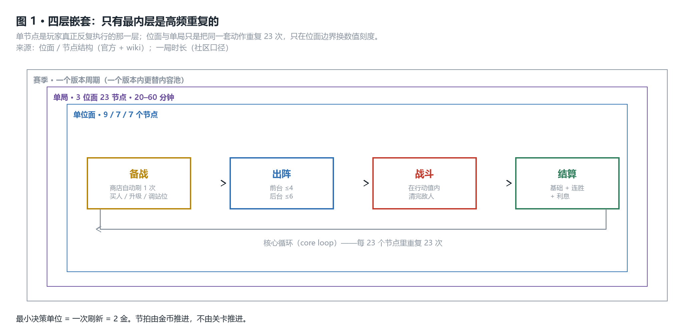
*图注：四层里只有最内层是高频重复的。位面与单局没有引入新循环，只是把同一套动作重复 23 次，并在位面边界换一次数值刻度。*

### 判断

> **本作把"节奏"从关卡手里拿走，交给了经济：23 个同构节点里，节拍器是金币，不是关卡。**
> **内部基准**：23 个节点中有 17 个决策空间相同；机制只在**职级**维度引入（A2 词缀、A3 惩罚加重、A5 起始生命下降），**单局之内不换机制**。
> **外部对标**：TFT 靠"选秀轮 / 野怪波 / 强化符文"三类特殊回合在约 30 回合里制造变奏；本作把这三类合并成"奖励 / 补给 / 遭遇"共 10 个节点，且都不改变备战的三选一结构。
> **边界与证伪条件**：若实测发现策略 / 补给节点的思考时间显著高于战斗节点，则"节拍器是金币"成立；反之，若玩家在战斗节点上停留最久（手动操控前台），则节奏重心其实在战斗侧，本条需改写。**本机无实测（n=0），待验证。**

## 二 · 内容结构与关卡

### 事实

**位面结构**

| 位面 | 节点序列 | 节点数 |
|---|---|---|
| 第一位面 | 奖励 → 奖励 → 策略/战斗 → 战斗 → 补给 → 战斗 → 遭遇 → 奖励 → 首领 | 9 |
| 第二位面 | 战斗 → 策略/战斗 → 补给 → 战斗 → 遭遇 → 奖励 → 首领 | 7 |
| 第三位面 | 战斗 → 策略/战斗 → 补给 → 战斗 → 遭遇 → 奖励 → 首领 | 7 |

**压力机制**

| 项 | 值 | 档位 |
|---|---|---|
| 小队初始生命值 | **100**（A5 紫金起降为 **80**） | 官方 |
| 胜负判据 | 在**行动值**（界面显示为「倒计时」）归零前清完敌人 | 官方 |
| 行动值预算 | 位面 1/2/3 = **180 / 150 / 120**；首领 = 200 / 160 / 160 | wiki，**单源待验** |
| 清不完的扣血 | 战斗 / 遭遇 **5 / 10 / 15**（按位面）；首领 **10 / 15 / 20** | wiki |
| **角色受致命一击** | **不会倒下**，立即回复部分 HP；代价是**扣倒计时**（A0–A2 扣 35；**A3 起 45**） | 官方 |
| 胜利时的小队生命 | **不变**（只有未通关才扣） | 官方 |
| 失败唯一条件 | 小队生命值归 0（在此之前角色不会死） | 官方 |
| 回血 | 优势布局「长线作战」每节点 +2；「大胜表彰」击败最终首领且余 1 轮以上 **+40** | 官方 |

**职级难度修饰**

| 职级 | 解锁的修饰 |
|---|---|
| A1 | 高稀有度投资策略开始加难度（金 +1 / 棱彩 +3） |
| A2 翠钢 | 敌人随机词缀 ×1；遭遇节点出现 |
| A3 钴银 | 未达最低进度扣血更多；阵亡惩罚 **35 → 45** |
| A4 冰钛 | 敌人词缀 ×2 |
| A5 紫金 | **开局生命 100 → 80**；**升级经验需求提高**（9→10 级：72 → 84） |
| A6 | 敌人词缀 ×3；不再白送精密拆装扳手 |
| A7 资本帝王 | 策略难度代价升为 **金 +3 / 棱彩 +6**；随机节点狂暴化 |
| A8 | 敌人词缀 ×4；追加"同步行动" |

**敌人数值放大（位面 3）**：A0-1 **+5%** → A2-1 **+75%** → A5-1 **+358%** → A7-1 **+1099%** → A8-1 **+2103%**。

**段位**：A0–A8 共 ≈92 小段。通关余 HP ≥70 → +3 小段；40–69 → +2；<40 → +1；**失败不降级**。A5-7 后须打晋升赛。

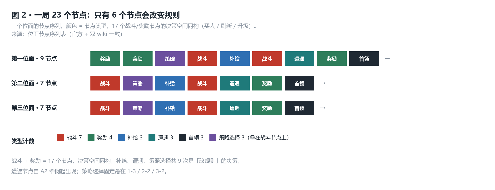
*图注：一局的节点序列。战斗与奖励共 17 个节点的决策空间同构；只有补给、遭遇、策略选择这 9 次会改变规则。*

### 拆解

把难度修饰的清单读下来，**A5 是分水岭，而且是双向的**：

- 敌人那边：词缀从 1 个加到 4 个，HP 膨胀从 +5% 拉到 +2103%（基础值的 22 倍）。
- 你这边：**开局生命从 100 降到 80，同时升级更贵**（9→10 级从 72 经验涨到 84，满级总需求 +36 经验 = +36 金）。

从 A5 起，难度不是"敌人更强"，是**"敌人更强，同时你更穷、容错更少"**。A7 再叠一层：选了好策略要付更多敌人难度，越强越贵。

而"角色受致命一击不会倒下、只扣倒计时"这一条，把压力**从生存侧整体搬到了时间侧**。本作里**没有死亡这件事**：角色不会倒下，小队生命只在整局结束后被读一次（决定 +1 / +2 / +3 小段）。

于是三种东西被折进了同一根尺：

- **打出伤害** = 省下时间（更早清完）
- **承受致命一击** = 花掉时间（倒计时被扣，官方明说这会让"战斗提前结束"）
- **治疗与续航** = 也是花在时间上的钱——官方教程的对应建议原文是"用治疗角色、羁绊或续航装备提高生存力，**以免战斗过早结束**"

**生存在这套系统里不是"保命"，是"保时间"。** 这让"低血量苟过去"成为一种合法且高收益的打法：余 HP ≥70 一次加 3 小段，是最快的爬级路径。

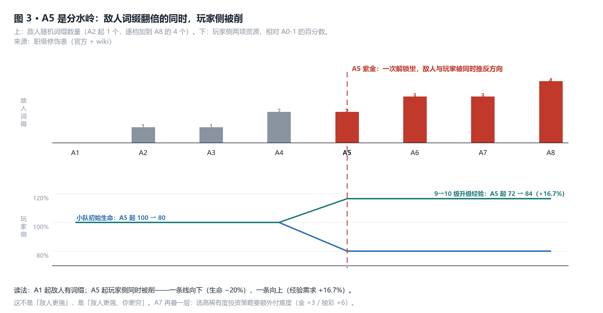
*图注：上格是敌人词缀数量，下格是玩家侧两项资源的相对值。A5 一次解锁同时把两条线推向相反方向——敌人词缀翻倍，而玩家的开局生命下降、升级经验需求上升。*

### 判断

> **本作的难度不是一条压力曲线，是一条静态刻度上的双向挤压：职级越高，敌人越强，而你的开局资源越少。**
> **内部基准**：A5 同时做两件事——敌人 HP 膨胀跳到 +358%，玩家开局生命 100 → 80、满级经验需求 +36。A8 把敌人 HP 拉到 +2103%，等于基础值的 22 倍。
> **外部对标**：TFT 不做难度档——难度来自 7 名真人对手的强度分布，是**内生**的；本作是 PVE，只能把难度做成一条**外生**的静态曲线，再用 A0–A8 的 92 个小段把它切成 92 级台阶。代价是这条曲线必须独自承担全部强度爬升压力，只能走"数值膨胀"这一条路。
> **边界与证伪条件**：若在 A5–A8 区间存在"低血量苟到终局"的高胜率打法（玩家普遍余 HP 很高），说明这条双向挤压没有真正咬住玩家的资源决策，判断减弱。**n=0，待用户佐证。**

## 三 · 数值与经济

### 事实

**结算公式（官方）**：本节点金币 = **基础金币 + 连胜金币 + 利息**

| 项 | 值 | 档位 |
|---|---|---|
| 利息（interest） | `min(floor(金币 / 10), 5)` → 存满 **50 金吃满 5 息** | 官方 |
| 连胜 | 连续胜利额外金币；官方原句只有"**连胜越长，金币奖励越多**"，**未公布分档**；**连败一侧无对应机制** | 官方 |
| 刷新商店 | **2 金 / 次**，固定不递增；每节点自动刷 1 次 | 官方 |
| 购买角色 | **价格 = 费用**（1–5 金） | 官方 |
| 卖出返还 | 1★ 原价；升星后 = 购入总价 − 1 | 社区 |
| 等级 | 上限 **10 级 = 10 人口**；1 经验 = 1 金、**4 经验起购**；每节点 +2 经验；**9→10 级 = 84 经验** | 官方 |
| 升星 | 自动触发；**3★ = 9 张** | 官方 |
| 商店概率（Lv.10） | 1/2/3/4/5 费 = **5 / 10 / 20 / 40 / 25 %** | wiki |
| 星级倍率 | 1 费 100→160→220；**5 费 200→320→2000** | wiki |
| 一局金币量级 | ≈**400 金**（**成就门槛口径，非均值**） | 社区 |

**核心算式〔推断〕**

> 追一张 3★ 五费的真实成本 = 买价 + **刷新税（reroll tax）**
>
> ```
> 单格刷出指定五费：q = 该费出现率 × 剩余张数 / 该费剩余总张数
> Lv.10 追某张五费：q = 0.25 × 9 / 90 = 0.025
> 一次刷新 5 格，至少出一张：P≥1 = 1 − (1 − 0.025)^5 = 11.9% → 期望 8.4 次刷新
> 凑满 3★ 需 9 张 → 8.4 × 9 ≈ 75 次刷新 ≈ 151 金
> 买价 = 9 × 5 = 45 金
> 总成本 ≈ 196 金，其中刷新占 77%
> ```

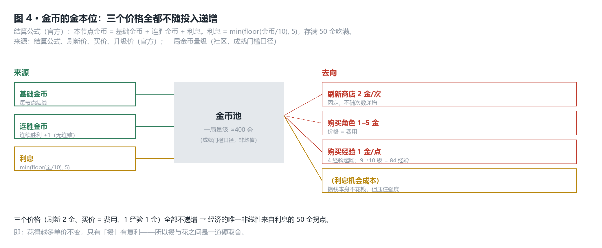
*图注：金币的三个来源与四个去向。三个价格（刷新 2 金、买价 = 费用、1 经验 1 金）全都不随投入递增，所以经济的唯一非线性落在"攒"这一侧。*

### 拆解

这个算式改写了"成本"的构成：**买一张五费 3★ 的钱里，77% 花在"看不见"的地方**——角色本身只要 45 金，寻找它要 151 金。推到阵容：中期转型要换掉 7 个人，每人重走一遍"找同名角色"的过程，单张寻找成本 **8–20 次刷新 × 2 金 = 16–40 金**。

> **换一套 7 人阵容的刷新税 = 7 × (16–40) = 112–280 金，即一局总收入的 28%–70%。**〔推断〕

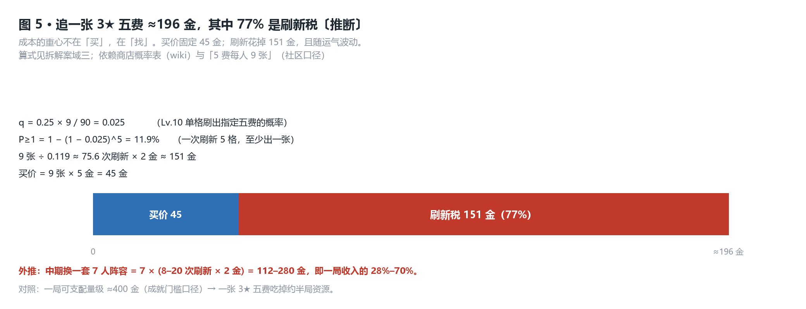
*图注：买价固定 45 金，刷新花掉 151 金。成本的重心不在"买"，在"找"——而这部分随运气波动，无法预算。*

对比 TFT：它的连胜与连败收入**完全对称**（2–4 连 +1 / 5 连 +2 / 6+ 连 +3）。连败是**有财政来源的**——这就是"弱势期先输着攒钱、等成型"这条策略的物质基础。本作只保留连胜那一半：官方教程只给了一句"**连胜越长，金币奖励越多**"，而**连败一侧没有任何对应机制**。过渡期是纯亏钱的。

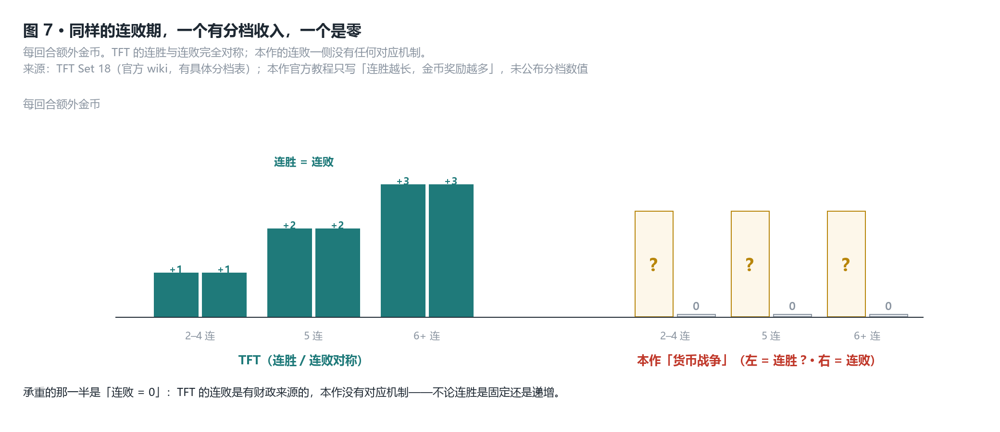
*图注：同一个连败期，TFT 有收入且有分档，本作是零。无论连胜是固定 +1 还是随连数递增，缺的都始终是连败那一半。*

再看升星的量级：TFT 的 3★ 是基础值的 **3.24 倍**（100% → 180% → 324%，逐星 ×1.8 叠乘）；本作五费的 3★ 是 **10 倍**（2★→3★ 这一段单独就是 **6.25 倍**）。TFT 的成型是一条**坡**，本作的成型是一个**台阶**。

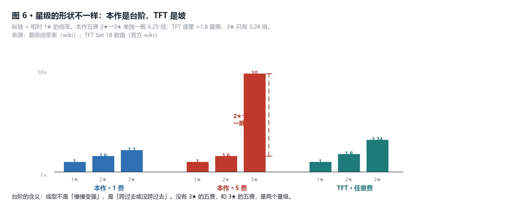
*图注：本作五费从 2★ 到 3★ 一跳 6.25 倍，TFT 全程只有 3.24 倍。这是第二根支柱——过渡到成型之间没有中间态可站。*

### 判断

> **本作的过渡流派不是造不出来，是"够用的档位够不着"。**
> **内部基准**：33 条羁绊中 **10 条自带独立伤害源**（无视 DEF / 韧性保护 / 减伤 / 易伤，按档位与节点 1× → 8.8× 缩放），**且全部在 2–3 人开档**——所以"过渡流派太少"不是"没有"，是**数值不够**：这些发动机的伤害随档位陡增，**首档到满档的倍率 = 2×–15×（中位 4.2×）**：贝洛伯格 600 → 1200%；击破 120 → 500%；能量 800 → 12000%。**可及的那一档只给满档的 1/2 到 1/15**，扛不住中期的敌人；要把数值堆到够用，就得爬到 **8–10 人 = 人口上限**。而换一条 = 重买角色 + 重付 6–10 份刷新税 ≈ **112–280 金**，吃一局收入 **28%–70%**。
> **外部对标**：TFT 的连败期有对称财政收入、3★ 又只是 3.24 倍的坡，"先过渡、后换核"因此低摩擦；本作两条都拿掉了。
> **用户点名四条**：击破（120%）· 持续伤害（240%）· 群攻（250%）· 仙舟（300%）——**恰好是首档 ≤300% 的全部**；首档 ≥500% 的五条全不在内。据 n=1，持续伤害也**不算能用**：它伤害是多段叠起来的，在限时局里正是它用不上的原因。
> **边界与证伪条件**：若存在**由羁绊自身产出伤害、门槛 ≤3 人、且首档数值就扛得住中期敌人、能接力到 A8 通关**的阵容，本判断被推翻。用户 n=1 给的两条判据：其一"流派本身就能造成伤害而不靠角色"（33 条里 10 条符合，见附录 D）；其二本轮新增、更硬的一条——**"有些数值不够，过渡都用不上"**，即**门槛达标 ≠ 档位够用**。这条把本判断从"结构问题"钉成了"数值问题"。
> **依赖链**：承重于"发动机 10 条 + 各档数值"（单一 wiki 逐条核对，CN / EN 有个别出入，**狼狩倍率分歧最大**：EN 1200→15000% / CN 1000% 起）与"5 费每人 9 张"（社区口径，两派一致）。

## 四 · 系统与内容池

### 事实

**内容池（4.6）**

| 池 | 规模 |
|---|---|
| 角色 | **63 标准 + 9 外援**；按费 1/2/3/4/5 = **14 / 14 / 13 / 14 / 10** |
| 羁绊 | **33 条** = 阵营 13 + 学派 12 + 独立 8 |
| 装备 | 非消耗品 **≈148**（基础 8 / 进阶 36 / 特权 36 / 纹章 22 / 黑客 16 / 命运 18…）+ 消耗品 7 |
| 投资环境 | **83**（每局开始三选一） |
| 投资策略 | **334**（棱彩 122 / 金 135 / 银 77）——与另一路的 141 冲突，疑为计数口径差 |
| 词缀 | **55** |

**羁绊的两类效果（逐条核对全 33 条，明细见 `data/11-bonds.csv`）**

| 类 | 条数 | 判据 | 首档 |
|---|---|---|---|
| **发动机**（自带伤害源） | **10** | 有独立于角色面板的伤害，**无视** DEF / 韧性保护 / 减伤 / 易伤，按档位与节点 **1× → 8.8×** 缩放 | 贝洛伯格 · 列车同行 · 击破 · 燃血 · 持续伤害 = **2 人**；仙舟 · 狼狩 · 能量 · 群攻 · 欢愉 = **3 人** |
| **放大器**（只有增益） | **22** | 效果是强度 % / 增伤 / 速度 / 护盾 / 治疗，乘在角色输出上 | 夜之半神 · 星核猎手 · 减益 · 战技点 · 治疗… |
| 存疑 | **1** | 大守护者：召唤物伤害 = 布洛妮娅攻击力 1200% + 生命上限 240%，随其星级缩放 | 单人 |

发动机内部再分两档成色：**整条即引擎 4 条**（欢愉 = 整个「阿哈」单位、击破、持续伤害、能量）；**混合体 6 条**（仙舟 / 狼狩 / 贝洛伯格 / 列车同行 / 群攻 / 燃血——召唤物打固定基础伤害，主增益仍是强度 %）。

**数值梯度（本文第二条承重数据）**：发动机的伤害随档位陡增，**首档 → 满档 = 2×–15×（中位 4.2×）**

| 羁绊 | 首档 → 满档 | 倍率 |
|---|---|---|
| 贝洛伯格 | 600% → 1200% | 2.0× |
| 持续伤害 ▲ | 240% → 960% | 4.0× |
| 击破 ▲ | 120% → 500% | 4.2× |
| 群攻 ▲ | 250% → 1500% | 6.0× |
| 仙舟 ▲ | 300% → 1200% | 4.0× |
| 燃血 | 500% → 4000% | 8.0× |
| 能量 ※ | 800% → 12000% | 15× |

※ ▲ = 用户 n=1 点名"过渡用不上"的四条（首档 ≤300%）。狼狩 CN / EN 分歧最大，欢愉不按百分比，均见 `data/11-bonds.csv`。

**优势布局（局外成长 / meta progression）**

| 档 | 属性节点 | 合计 |
|---|---|---|
| 永久 | 7 项 × 20 钻钞 | 攻击 +12% · 生命 +6% · 暴击率 +6% · 暴击伤害 +12% · 防御 +8% · 击破特攻 +15% · 效果抵抗 +8% |
| 季节 | 8 项 × 20 钻钞 | 攻击 +36% · 减伤 +25% · 防御 +36% · 生命 +12% · 暴击率 +18% · 击破特攻 +30% · 效果抵抗 +16% · 暴击伤害 +36% |
| 点满 | ≈**1520 钻钞** | 可重置，全额返还 |

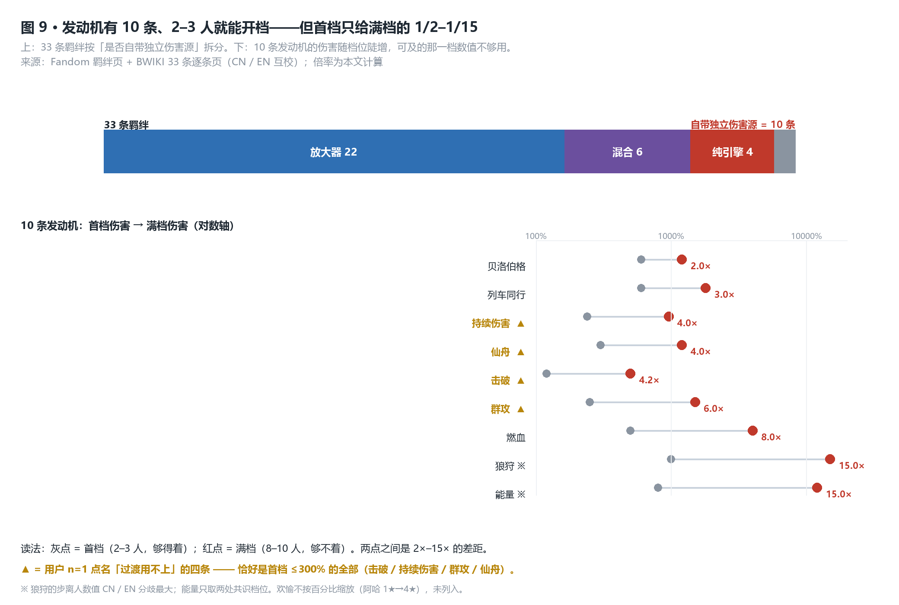
*图注：上 = 33 条按是否自带伤害源拆分；下 = 10 条发动机的**首档（灰，够得着）到满档（红，要 8–10 人）**差距 2×–15×。门槛不卡人，数值卡人。*

### 拆解

**门槛假说被数据判死，"过渡流派少"的真相是数值不是门槛**：33 条里**没有一条首档在 4 人以上**，10 条自带伤害源的**全部 2–3 人开档**——"能启动一条会自己打人的流派"**不稀缺**。但**能用**是另一回事：数值随档位陡增，**首档只给满档的 1/2–1/15**，而满档要 **8–10 人** = 人口上限。卡人的从来不是"开不开得起来"，是"那点数值够不够用"。仙舟是现成对照：强度 **20% → 200%**，伤害 **300% → 1200%**。

**还有一层"纸面够、实战不够"**：仙舟 / 击破 / 能量 / 星核猎手各有 2 名"专家顾问"，不占常规招募位、出现不稳定——纸面人数够开档，实战未必凑得及。另有若干羁绊被高费锁死：欢愉 6 人里 4 名 4 费；头号玩家 / 领航员绑定 5 费专属角色，**拿不到就不存在**。

**局外成长与压力曲线的错位**（用户 n=1 佐证）：满配优势布局给攻击 / 暴击伤害各 +48%（永久 +12% 与季节 +36% 加算）、减伤 +25%——是**几十个百分点**；而职级压力是**数倍到二十倍**。两者不在同一根尺上：

| 职级 | 局外能给到 | 敌人 HP 膨胀 | 比值 |
|---|---|---|---|
| A0-1 | 攻击 +48% | **+5%** | 领先 |
| A2-1 | 攻击 +48% | **+75%** | **被反超** |
| A5-1 | 攻击 +48% | **+358%** | 差 ≈7 倍 |
| A8-1 | 攻击 +48% | **+2103%** | 差 ≈44 倍 |

**交叉点落在 A2-1 附近。**

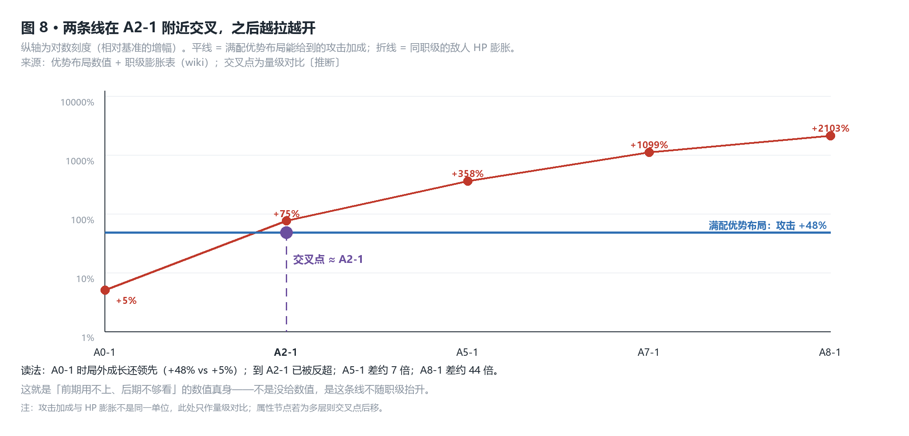
*图注：纵轴为对数刻度。蓝色的平线是优势布局能给到的攻击加成上限，红色的折线是敌人 HP 随职级的膨胀。两条线在 A2-1 附近交叉，之后差距一路拉开到 44 倍。*

### 判断

> **优势布局不是"给了你优势"，是给了一条与压力曲线不相交的平线。**
> **内部基准**：满配给攻击 +48%、暴击伤害 +48%、减伤 +25%；敌人 HP 在 A2-1 已 +75%、A5-1 +358%、A8-1 +2103%。交叉点 A2-1。前期用不上（敌人仅 +5%，且早期 1–2★ 无羁绊时 +36% 落在很小的底值上），后期不够看（基数已差 7–44 倍）。
> **外部对标**：TFT 明令**不做局外数值成长**（官方口径：绝不出售强度），所以不存在这条错位——它的成长全部发生在局内、跟着对局走。本作把成长放到局外，又让它**不随职级缩放**，于是造出一条恒定高度的线去对抗一条指数上升的线。
> **边界与证伪条件**：若属性节点为多层（同一节点可重复投资），总值上浮、交叉点后移——需官方数值确认。若玩家在职级爬升中确实感到优势布局"有存在感"，本条减弱。用户 n=1 的表述为"前期用不上，后期不够看"，与本判断一致。

## 五 · 玩法机制

### 事实

**站位与赋能（官方）**

- 上阵 **8–10 人** = 前台 ≤4 + 后台 ≤6。
- **站位是角色自带的属性**，不是自由摆放：每个角色被标为「前台」「后台」或「双向」（官方原文：characters have their own "positioning", classified as either "On-Field" and "Off-Field"）。编队因此受**角色池**约束，不是纯空间问题。
- **后台角色永远不会被敌人选为目标**，但**照常出手**——官方原文：后台角色"用强化后的能力在后台作战，自动使用技能攻击敌人或支援队友"。
- 赋能（Empowerment）**必须放对站位才激活**；秘技由前台自动施放，互斥时只生效最靠左的一个。
- 每角色最多 **3 件装备**；**任意 2 件简易 → 1 件进阶**。装备池：简易 **8** → 进阶 **36**。
  `C(8,2) + 8 = 36`——与官方"进阶 36 种"**精确吻合**，这条自洽性是硬证据。

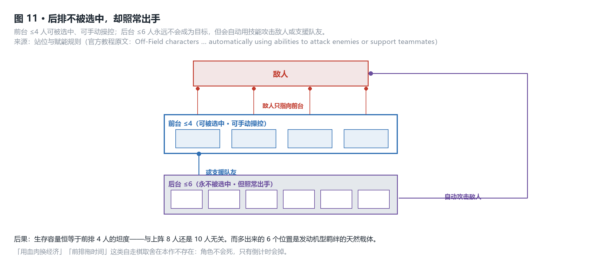
*图注：敌人只指向前台 4 人；后台 6 人永不被选中，但照常出手攻击或支援队友。生存容量因此被压缩到前排 4 格的坦度上。*

**单次行动的费效比**

| 行动 | 成本 | 收益 |
|---|---|---|
| 刷新商店 | 2 金 | 5 格新选项；Lv.10 出指定五费的期望 11.9% |
| 买角色 | 费用（1–5 金） | 一份羁绊计数 + 一个输出 / 承伤载体 |
| 买经验 | 1 金 = 1 经验，4 经验起购 | 抬高人口与高费出现率 |
| 攒钱 | 0 | 每 10 金 1 息，上限 5（存满 50 金） |
| 合成进阶装备 | 2 件简易 | 1 件进阶（组合数 36，与池子吻合） |

### 拆解

利息封顶 5、刷新封顶 2、买价 = 费用——**三个价格全都不随投入递增**。经济的唯一非线性来自利息：攒到 50 金后，再攒钱不产生额外收益（`min(floor(g/10), 5)`）。于是 **50 金是一个硬拐点**：低于它，每一金都在买未来的息；高于它，多余的钱必须花出去换成强度。

把这个拐点塞进 23 个节点的局里：攒到 50 金需要约 **5–7 个节点**不吃不喝，而前半局只有 9 + 7 = **16 个节点**。**利息的复利窗口，与一局长度是同一量级**——攒钱流没有真正的滚雪球空间。

这正好解释了第三种模式「超频博弈」为什么存在：官方在那个模式里**把利息整个删掉，改为每节点直接发金币**。等于承认：利息是主模式的引擎，且它的收益高度依赖局长。

站位这一条改变了自走棋的资源含义：**后台 6 人是一层"不承受伤害的自动输出"**。前排 4 人吸走全部仇恨，后排照常出手、全程不被选中、也永不会倒下。后果是：**你的生存容量恒等于前排 4 人的坦度，与你上阵 8 人还是 10 人无关。** 把主要输出放后排、把坦度压在前排 4 格，是这套结构的直接最优解。而后排那 6 个人恰恰是**发动机型羁绊**（欢愉的「阿哈」、仙舟的「神君」等召唤 / 触发式伤害）的天然载体——不被选中，羁绊伤害却照常打出。**场地是为发动机建的，装上去的发动机却只有 4 台。**

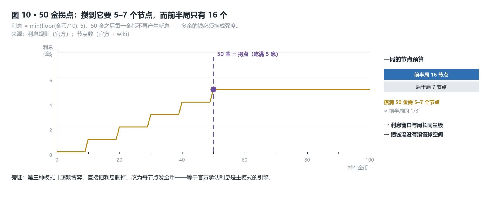
*图注：利息是持有金币的阶梯函数，50 金处封顶。攒到它要 5–7 个节点，而前半局只有 16 个节点——利息窗口与一局长度是同一量级。*

### 判断

> **利息封顶 5 与局长 23 个节点互相卡住：这个玩法的经济引擎，转一圈正好用完。**
> **内部基准**：`min(floor(g/10), 5)` 使 50 金成为硬拐点；攒到 50 金需约 5–7 个节点，而前半局只有 16 个节点可用，利息窗口与局长同量级，无法在局内滚复利。
> **外部对标**：TFT 一局约 30 回合、基础收入 5 金/回合，利息窗口（50 金）相对局长更宽裕。更关键的是它的 PVE 变体 Tocker's Trials **只留利息、删掉被动收入与连胜**——两个 PVE 自走棋在同一个问题上给出了相反答案：TFT 认为 PVE 里利息的收入项太少，所以只留利息；本作认为利息是引擎，所以保留它并额外挂上连胜。
> **边界与证伪条件**：若实测"50 金吃息后一次性爆发"的攒钱流在职级爬升中稳定可行，则利息窗口够用，判断减弱；若玩家普遍在 5–7 个节点后就因压力被迫花钱，判断成立。**n=0，待用户佐证。**

## 它付出的代价

1. **生存侧的策略被整条拿掉。** 角色**不会死**（受致命一击不倒、只扣倒计时）、后台永不被选中，"用血肉换经济""前排拖时间"这类自走棋的经典取舍在本作里不存在。决策空间从二维（输出 × 生存）压成一维（输出）。
2. **过渡期的财政没有来源。** 删掉连败补偿之后，弱势期只能靠攒利息和奖励节点回血，而这两者都要求**你打得过当前节点**——一个死循环。"卡住"比"输掉"更难受。
3. **局外成长成了一个不产生决策的系统。** 优势布局既与压力曲线不相交，又可重置、全额返还——玩家点它不是在取舍，是在**纯累积**，它不承载任何代价。
4. **一局之内没有机制变奏。** 23 个节点里 17 个决策空间同构，节奏全靠商店随机数。一局 40 分钟到 1 小时，靠的是商店而非关卡的多样性在撑。

## 如果我来迭代

1. **把连败补偿加回来，并且让它超过连胜。** 连败 3 连 +2、5 连 +3、7 连以上 +4。
   **代价**：会激励玩家"故意输"攒钱，须用"连续 3 场未清完则后续节点奖励衰减"来对冲。
2. **让优势布局的节点随职级缩放。** 属性节点改为"基础值 ×（1 + 职级档位 × 0.15）"，或按职级分层解锁（A2 解第一层、A5 解第二层）。
   **代价**：局外成长开始承载强度，削弱"所有人同一起跑线"这一承诺，须在赛季重置时同步清零。
3. **给后台一个生存代价，把第二根轴还回来。** 例如"对局中阵亡的角色在下一节点不可上阵"，或"每阵亡一名角色，本节点结算金币 −10%"。
   **代价**：抬高操作门槛，且与"后台不被选中"这条官方明示规则直接冲突，等于重做站位系统。
4. **把利息拐点从 50 金抬走。** 改为"每 15 金 1 息、上限 8"——拐点从 50 抬到 120 金，让攒钱流在一局内有真正的复利窗口。
   **代价**：会显著抬高高职级通关率，须同步上调敌人数值膨胀，否则 A5–A8 的难度曲线会被经济打穿。
5. **给中期一个低门槛的强度源。** 把 1–2 费角色 3★ 的倍率从 220 抬到 300，同时在前两个位面上调其刷新权重。
   **代价**：低费核变强会压缩高费角色的存在感，5 费的核心地位须靠羁绊满档重新确立。

## 附录

<details>
<summary><b>附录 A · 系统依赖（mermaid）</b></summary>

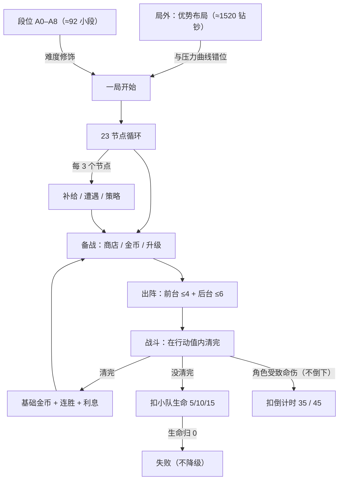

</details>

<details>
<summary><b>附录 B · 交付物表（由 data/*.csv 生成）</b></summary>

| # | 表 | 文件 |
|---|---|---|
| 1 | 位面 × 节点配比 | `data/01-structure.csv` |
| 2 | 角色 / 敌人数值（星级倍率、敌人膨胀） | `data/02-units.csv` |
| 3 | 局外成长 vs 职级压力曲线 | `data/03-curves.csv` |
| 4 | 金币产出、换算与定价 | `data/04-economy.csv` |
| 5 | 职级难度修饰表 | `data/05-difficulty.csv` |
| 6 | 内容池结构（按费 × 张数 × 羁绊） | `data/06-pools.csv` |
| 7 | 经济收支（来源 × 去向） | `data/07-flows.csv` |
| 8 | 路径期望（3★ 成型期望，含算式） | `data/08-expectation.csv` |
| 9 | 单次行动收益（费效比） | `data/09-actions.csv` |
| 10 | 行为时序与信息表 | `data/10-timing.csv` |
| 11 | **羁绊逐条分类（33 条 × 门槛 × 效果 × 发动机/放大器）** | `data/11-bonds.csv` |

**合格标准**：表里两列一除，能算出正文判断里的那个数。

</details>

<details>
<summary><b>附录 C · 曲线与图</b></summary>

| 图 | 说明 | 用在 |
|---|---|---|
| 图 1 | 核心循环（四层嵌套） | 域一 |
| 图 2 | 一局 23 节点结构配比 | 域二 |
| 图 3 | 难度双向挤压（敌人 HP 膨胀 × 玩家资源收窄） | 域二 |
| 图 4 | 金币收支流向 | 域三 |
| 图 5 | 追 3★ 五费的成本构成（刷新税 77%） | 域三 |
| 图 6 | 星级倍率：本作 vs TFT | 域三 |
| 图 7 | 连胜 / 连败收入：本作 vs TFT | 域三 |
| 图 8 | **局外成长 vs 职级压力（交叉点 A2-1）** | 域四 |
| 图 9 | 羁绊分类 + 发动机的档位数值梯度 | 域四 |
| 图 10 | 利息拐点 50 金 vs 一局 23 节点 | 域五 |
| 图 11 | 站位结构（前台 4 / 后台 6，后台不被选中） | 域五 |

</details>

<details>
<summary><b>附录 D · 数据来源与可信度</b></summary>

**一 · 实测**

**n=0。** 本机无实测样本。用户自报段位 A50、主玩「标准博弈」、卡点自述"流派成型难，过渡流派太少且后期发力"、"优势布局给的提升前期用不上，后期不够看"——这些作为 n=1 的**体验证词**用于复核判断段，**不用于支撑任何数值结论**。

**二 · 公开**

| 来源 | 覆盖 | 状态 |
|---|---|---|
| 游戏内教程原文镜像 | 结算公式、利息、刷新价、连胜、升星、站位、装备合成、回血节点 | 官方 |
| Fandom 羁绊页 + BWIKI 33 条逐条页 | **全部 33 条羁绊的档位、效果原文、缩放依据** | wiki（CN / EN 逐条互校） |
| BWIKI / Fandom / JP wiki | 商店概率表、角色池、职级修饰、装备池 | wiki（双源一致处标 wiki） |
| 本体引擎页（Elation DMG / Break Effect / Toughness） | 佐证"基础伤害按等级缩放、不吃增伤" | wiki |
| NGA / GameFAQs / 5ch | 牌库张数、卖出返还、一局金币量级 | 社区（不标官方） |

**⚠️ 采集通道限制（2026-10-11 实测）**：WebFetch 全域被拦；`honkai-star-rail.fandom.com` 正文页被 Cloudflare 拦（MediaWiki API 可用）；`homdgcat.wiki` / `hakush.in`（datamine）不通；`wiki.biligame.com` 正文页 404 / 567。**后果：公开轨数据整体降级为单源**，datamine 与中文 wiki 两层交叉校验均缺失。

**三 · 推断**

| # | 推断 | 算式 | 建立在什么之上 |
|---|---|---|---|
| 1 | 追一张 3★ 五费 ≈**196 金**，刷新占 **77%** | `q = 0.25 × 9 / 90 = 0.025`；`P≥1 = 1 − 0.975^5 = 11.9%`；`9 ÷ 0.119 ≈ 75.6` 次刷新 × 2 金 | 商店概率表（wiki）+ 每角色 9 张（社区） |
| 2 | 换 7 人阵容的刷新税 **112–280 金**（一局收入的 **28%–70%**） | `7 × (8–20) × 2`，分母取 ≈400 金 | 推断 1 + 一局金币量级（成就门槛口径） |
| 3 | 局外成长与压力曲线的交叉点 **A2-1** | 满配 +48% 攻击 vs 敌人 HP +5%/+75%/+358%/+2103% | 优势布局数值 + 职级膨胀表 |

**四 · 口径冲突（未解决，如实披露）**

| 争点 | 说法 A | 说法 B | 本文处置 |
|---|---|---|---|
| 牌库张数 | 每角色统一 9 张 | 按费递减（1 费 ≈30 / 5 费 9） | 两说在"5 费 = 9 张"一致 → 承重算式不受影响；正文标**社区口径** |
| 投资策略数量 | 141（银 46 / 金 46 / 棱彩 49） | 334（银 77 / 金 135 / 棱彩 122） | 疑为"含升级变体"与否的计数差，**两数并列** |
| 奖励刷新周期 | 每周（官方 4.6 文本） | 每两周（Fandom） | 未解决，正文回避具体周期 |
| 竞争对手阵营数 | 19 | 20 | 正文写 19 |
| 狼狩【步离人】倍率 | EN：1 级 1200% → 7 级 **15000%** 基础伤害 | CN：1 级 **1000%**（经验阈值亦不同） | 随版本改过，**不作为承重数值**，正文只用"按等级缩放"这一定性 |
| 欢愉实装版本 | CN 页标 **4.2** 实装 | EN 页 3.7 起已有其他羁绊 | 版本锚点取 4.6，两说均不影响结论 |

**五 · 判负留痕（不进正文）**

原候选轴「自走棋的公平起点被 PVE + 局外成长置换掉了」经用户 n=1 复核**判负**。用户先答"多给你几个选项可挑，数值上大家还是同一起跑线"，后补充"优势布局给的提升前期用不上，后期不够看"——两条合起来说明：公平起点确实保住，但理由是**局外成长太弱**而非**不存在**。该轴因此**改写**为「局外成长与压力曲线错位」（正文域四），原表述剔除。

**判负留痕 2（本轮新增）**：原判断「本作的羁绊是放大器、不是发动机，所以过渡流派无处生根」经**逐条核对全部 33 条羁绊**判负——发动机型实有 **10 条**（自带独立伤害源，无视 DEF / 韧性保护 / 减伤 / 易伤，按档位与节点 1× → 8.8× 缩放），且**全部 2–3 人开档**。原表述的核心前提（"伤害终究由角色打出"）不成立。判断因此改写为「能启动、不能接力」（正文域三判断）。**遗留冲突**：用户 n=1 仍称"过渡流派太少"，与 wiki 计数的 10 条不一致——用户是否把"更上档才算流派"或"混合体不算流派"的口径算进去了，尚未确认。

</details>

<details>
<summary><b>附录 E · 术语表</b></summary>

| 术语 | 原文 | 本文含义 |
|---|---|---|
| 自走棋 | auto-battler | 备战期购买单位、战斗期自动结算的品类 |
| 核心循环 | core loop | 玩家重复执行的最小行为单元 |
| 刷新税 | reroll tax | 为"找到"目标单位而支付的刷新费用，不含购买价 |
| 利息 | interest | 按持有金币数按比例结算的被动收入 |
| 连败补偿 | loss-streak compensation | 连续失败时给予的额外收入，用于支撑弱势期经济 |
| 局外成长 | meta progression | 跨对局累积、带入单局的成长 |
| 保底 | pity | 达到一定次数后必得的机制（本玩法**无**卡池保底） |
| 有效生命 | EHP | 计入减伤与治疗后的实际可承受伤害量 |
| 羁绊 / 档位 | bond / bond level | 上阵同名角色数触发的加成；同一羁绊按人数分档，档越高效果越强 |
| 发动机 / 放大器 | engine / amplifier | **本文分类**：自带独立伤害源、不依赖角色面板的羁绊 = 发动机；只提供强度 %、增伤等增益、乘在角色输出上的 = 放大器 |
| 基础伤害 | Base DMG | 按等级 / 档位与节点缩放、**不吃攻击力与增伤**的独立伤害类型；本作羁绊的召唤物与触发伤害多走这一路 |
| 前台 / 后台 | On-Field / Off-Field | 角色的固有站位属性；后台永不被敌人选中，但照常自动攻击或支援 |
| 行动值 | Action Value | 本作单局内的倒计时预算；承受致命一击会扣减，清完敌人即胜 |

</details>
