# 开放世界地图设计三作对照：原神 / 赛博朋克 2077 / GTA V

> **这份对照在问什么。** 常见的问法是「为什么 GTA V 的地图广受好评，而原神和赛博朋克 2077 显得假大空」。
> 这份文档把这个问法拆开，因为它的前提取错了两次。
>
> **第一次取错**：GTA V 的地图并不同时满足「广受好评」和「没有同款毛病」。
> **第二次取错**：「假大空」听起来是一个病，实际上是两种，而且 GTA V 自己得的第三种同样不轻。
>
> 修正后的问法是：**三张地图各自得了什么病，这些病能不能追溯到同一组约束上。**
> 答案是能——**病根是同一个取舍：地图上的点能不能被重新消耗一次。**
> 而重新消耗的代价，就是重复。三家没有一家拿到了免费的选项。

本文与 [《赛博朋克 2077》拆解案](../cyberpunk-2077/拆解案.md) 有重叠，但口径不同：
那一份问「夜之城为什么这样建成」，这一份只问「地图为什么让人觉得空」。

---

## 案例卡片

| | 原神 / Genshin Impact | 赛博朋克 2077 / Cyberpunk 2077 | GTA V / Grand Theft Auto V |
|---|---|---|---|
| 品类 | 开放世界动作 RPG · F2P 长线运营 | 开放世界动作 RPG · 买断 | 开放世界动作冒险 · 买断 + 长线运营的线上模式 |
| 版本锚点 | **7.1「冥界的安魂曲」**（2026-09-23） | **2.x 本体 + Phantom Liberty** | **Enhanced · 线上模式**（PC 2025-03-04，当前 Title Update 1.73） |
| 分区结构 | 7 国 + 挪德卡莱半自治区 | 6 城区 + Badlands，Dogtown 属 Pacifica 子区 | Los Santos County + Blaine County，约 23 个街区 |
| 地图面积 | 54.7–65.6 km²（三套社区测绘） | 43.5–225 km²（三源跨度 5 倍） | 50.5–108 km²（三源跨度 2.1 倍） |
| 清单式内容点 | 8,218 个（宝箱 6,630 + 神瞳 1,191 + 世界任务 397） | 242 个（gig 86 + NCPD 156） | 560 个（单机口径，见附录 B） |
| 单点时长 | 数分钟 | gig 2–5 分钟 | 线上差事数分钟 |
| 观察者样本 | 长线游玩，地图探索度高 | 多周目，喜欢世界观、常纯散步 | 经常满地图跑任务 |

**为什么三作的商业模型必须写在卡片里**：这是**异质对象对照**。
原神是 F2P 长线运营，GTA V 是「一作两制」（买断单机 + 长线线上），2077 是纯买断单机。
所以主对照只取同质的两个——**原神 vs GTA V 线上**，两者都是长线运营；
**2077 作单机对照组**，它患的是另一类病，混进来比会得出错误的因果。

---

## 核心发现索引

**F1 · 主轴｜三张地图都不好，但病不一样。**
「空」与「重复」是同一个取舍的两端：地图上的点**能不能被重新消耗一次**。
原神选择了「不能」（宝箱开完永久消失），代价是**空**；GTA V 线上选择了「能」，代价是**重复**；
2077 选了「不能」，而且它的点还更浅，两头不占。（出自：主轴二 · 回访）

**F2 · 主轴｜点数与口碑的方向是相反的。**
原神 8,218 个点，GTA V 560 个，2077 242 个。点最多的被说空，点最少的被夸。
点数、密度都不是解释变量——否则结论会反过来。（出自：主轴一 · 点的语义）

**F3 · 副轴二｜面积出局。**
GTA Online **13 年零新增可玩地块**（唯一一次 Cayo Perico 不开放自由模式），没人说它空；
原神**一年一个新国家**，被说空。同时三家对同一个病给出了三种互相打架的修法，
说明「该往哪个方向修」在业内根本没有共识。（出自：副轴二 · 面积的驱动力）

**F4 · 副轴一｜距离的用途不同，而 GTA V 的用法正是它被骂的原因。**
GTA V 线上的跨图移动**被经济系统强制**，且出租车、直升机、潜艇**都跳不过出货跑图**——
移动本身就是任务内容，玩家因此骂「第一百次、第一千次跑到地图另一端」。
2077 用 166 个传送点把距离跳过；原神的移动耗体力（滑翔 3/秒）但路上不生成情境。（出自：副轴一 · 距离的用途）

**F5 · 代价｜「活」是幻觉，三家都是。**
前 Rockstar 技术总监的原话是「能用幻觉就不用真模拟」；第三方测试跟了 100 个 NPC，
镜头一转开他们就消失，被形容为《楚门的世界》。**所以「模拟 vs 布景」这条解释线不成立。**
真正的差别在幻觉**是否回应玩家的动作**——这一条在副轴一展开。（出自：副轴一）

---

## 主轴一 · 点的语义：地图上铺的不是内容

### 事实

**原神：点很多，但每个只能开一次。**

| 项 | 数值 | 来源 |
|---|---|---|
| 宝箱总数 | **6,630**（蒙德 518 · 璃月 1,132+ 沉玉谷 333 · 龙脊雪山 234 · 稻妻 730 · 渊下宫 185 · 层岩巨渊 248 · 须弥 1,475 · 枫丹 945 · 纳塔 830） | Fandom 成就计数器（逐项加总） |
| 神瞳总数 | **1,191**（风 66 · 岩 131 · 雷 181 · 草 271 · 水 271 · 火 271） | Fandom wiki |
| 世界任务 | **397** | 中文 Fandom，截至 4.8 |
| 合计 | **8,218 个点** | 加总 |

- **野外宝箱一经开启永久消失，不重置**（官方立场）。社区有零星「约 10 天刷新」的报告，
  但口径互相矛盾且多被解释为「换位重置」，**本文不采用**。
- **金苹果群岛（1.6 / 2.8）版本结束后整图永久关闭**，宝箱、材料、任务奖励一并消失。
  5.8 的夏季地图改为「地图保留、限时内容关闭」，是一次修正。
- **探索度是权重制，且会溢出**：各地物贡献权重之和 >100%，玩家实测约达实际内容的 **80–90%**
  就显示 100%（漏 20–30 个普通宝箱仍显示满）。官方从未公开权重公式。

**赛博朋克 2077：点少，而且点浅。** gig 86 个（本体）+ 9 个（PL）；NCPD 扫描事件 156 个
（⚠️ 三源冲突：156 / 321 / 346，本文只用 gig 做对比）。gig 单个时长 **2–5 分钟**。

**GTA V：单机口径下清单点合计 560 个**（主线 69 + 支线 58 + 随机事件 57 + 爱好 59 +
杂项 30 + 收集物 287），是三作里最少的一档。**它的线上内容层另算，见主轴二。**

### 拆解

**三个点数放在一起，和三种口碑的方向正好相反。**

```
原神        8,218 个点  →  被说「大而空」
GTA V         560 个点  →  被说「重复」
赛博朋克 2077 242 个点  →  被说「假大空」
```

原神的点数比 GTA V 高约 **15 倍**，比 2077 高约 **34 倍**，体感却更空。
**所以「点」不是内容。** 这条还有一个更直接的物证：**原神的地图密到必须外置一张地图**——
游戏内地图不足以支撑定位，玩家普遍转向官方互动地图。**一份地图需要另一份地图来导航，
本身就说明点数不等于玩家感受到的内容。**

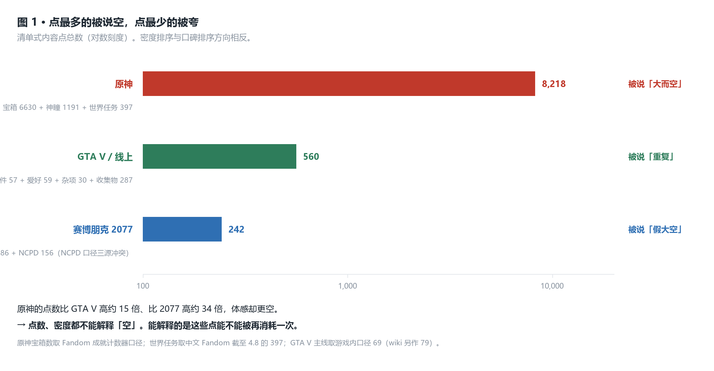

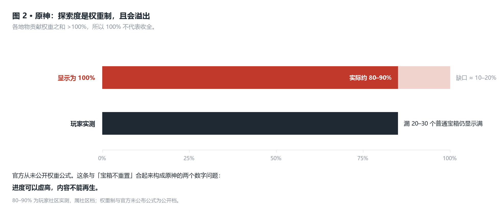

### 判断

> **本轴判断**：地图让人感到「实」，与它铺了多少内容**无关**。
> 原神铺了 8,218 个点，比 GTA V 高约 15 倍，仍然被说空；
> 而按内容量这把尺子，GTA V 是三作最低的一档，却是被夸最多的那一个。
> **点数不是解释变量，否则结论会反过来。**
> 有人会说：该数的不是「有几个点」，是「有几个不同的点」。换成这个分子**不翻盘**——
> 它只是把解释权交给了主轴二：**一个点的有效倍率，就是它能被再消耗几次。**
>
> **内部基准**：原神 8,218 点 / GTA V 560 点 / 2077 242 点，**点数排序与口碑排序完全相反**。
> GTA V 单机的可进入室内约 **40 个**，**少于 2004 年的《San Andreas》**。
>
> **外部对标**：《旷野之息》用 **120 座神庙 + 900 个呀哈哈**把点做成服务移动的奖励节奏；
> 《巫师 3》把 POI 做成手工营地，问号本身即内容。**两者的「点」都是一次性手工品，
> 但它们不承担消磨时间的职责**——而 GTA Online 的点承担了，所以它必须可重复。
> 落到具体取舍点：**点的职责决定了它能不能重来。**
>
> **边界与证伪条件**：点数口径全部不一致——原神宝箱取 Fandom 成就计数器（中文自媒体流传的
> 11,800 / 17,550 互相打架，**不采用**）；GTA V 主线游戏内作 69、wiki 另作 79；
> 2077 的 NCPD 三源冲突。**因此本文只比量级，不做精确比值。**
> **证伪条件**：若官方公布 GTA V 可进入室内比例 ≥ 50%，本轴需上修。

---

## 主轴二 · 回访：点能不能被再消耗一次

### 事实

**GTA V 线上：单机点最少，但线上层每周在动。**

| 层 | 内容 | 状态 |
|---|---|---|
| 单机地图层 | 主线 69 · 支线 58 · 随机事件 57 · 爱好 59 · 杂项 30 · 收集物 287 | 固定，一次性 |
| 线上内容层 | 累计约 **49 个 Title Update** · Community Series **每周轮换** · Freemode Events **每约 12 分钟**（需 ≥4 人、仅公共战局）· Business Battles **每约 15 分钟** · Kortz Center 目标**每周轮换** | **持续再生** |
| 地图层 | **13 年零新增可玩地块** | 固定 |

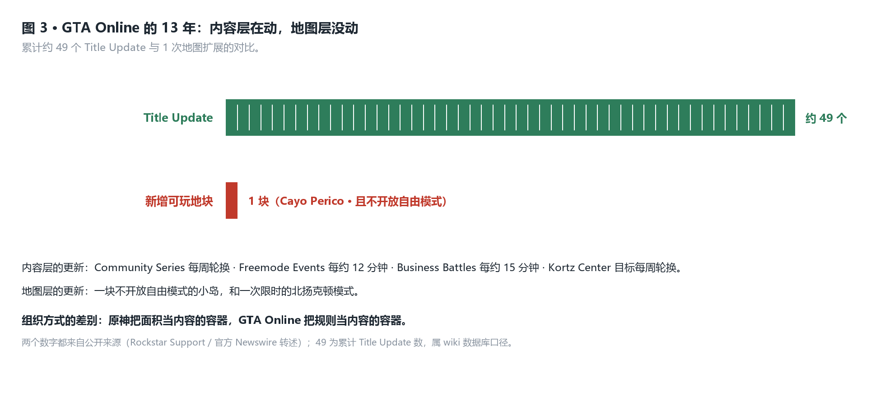

**⚠️ 一处必须纠正的措辞**：用户描述线上体验为「满地图都有任务刷新点」。查下来这是**两套并行机制**——
① 固定点位的**蓝色光环（corona）**，**必须徒步走进圈内**才能启动；
② **VIP / CEO / MC 工作**（Sightseer、Headhunter 等）经菜单发起，**目标点在发起后才生成**。
真正让地图「活」的是第②套。而 corona 与 job blip 的**确切总数查不到**，
所以「满地图」只能定性写，本文不给数。

**原神与 2077 在这一格上同向：点不可再生。**

- 原神：宝箱不重置；**金苹果群岛（1.6 / 2.8）版本结束后整图永久关闭**。
- 赛博朋克 2077：gig 与 NCPD 事件均为一次性；242 个点合计约 **8.9 小时 ≈ 本体全清时长的 8.2%**。

**官方在 GDC 2024 自己给出了「新图被快速消费」的行为数据：**

- 1.6 海岛限时地图：**第一周宝箱开启率 42%，但只占活跃时间 17%**。
  ⚠️ 这两个数**两面都能读**，抄录时必须写明分母：42% 说的是「一半箱子第一周没人开」，
  17% 说的是「开箱不是玩家活跃时间的主要去处」。**分母是活跃时间，不是游戏时间。**
- 2.8 内容量翻倍 → **66% 的负反馈指向「内容过载」**；3.8 回调轻量化后口碑转好。

### 拆解

**分水岭是「能不能再消耗一次」，而两边的容器结构完全不同。**

**原神的地图是内容包的容器。** 8,218 个点全部一次性，开完即死。
两条官方机制可以互相印证——宝箱不重置，以及**整张限时地图会被删除**。
**一个会把整块地图删掉的系统，它的地图在结构上就是「一版内容」，不是「一个世界」。**

**GTA V 线上反了过来，是规则的容器。** 地图 13 年一个格子没动，但**内容层每周在动**。
官方对这套系统给过一个正面定义（2015 年 Freemode Events 说明）：

> 「……**no menus, lobbies, or load times.**」

**无菜单、无大厅、无加载。** 对照之下，原神的一切都要经过菜单、传送与加载。
**一个把地图当大厅用，一个把地图当容器用**——这是两者走向「重复」与「空」两侧的起点。

**2077 的位置最尴尬：点不可再生，而且点还更浅**（gig 2–5 分钟）。两头不占。

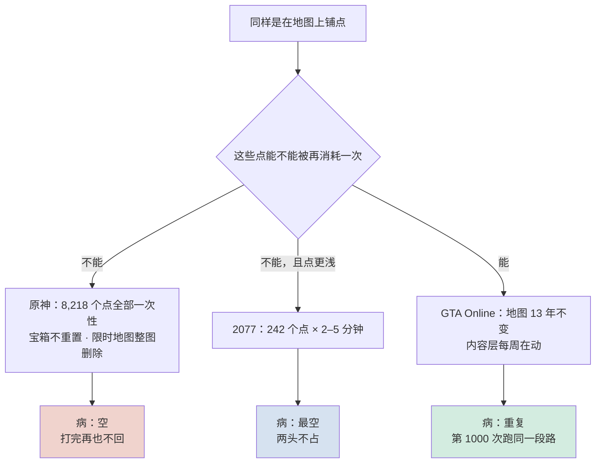

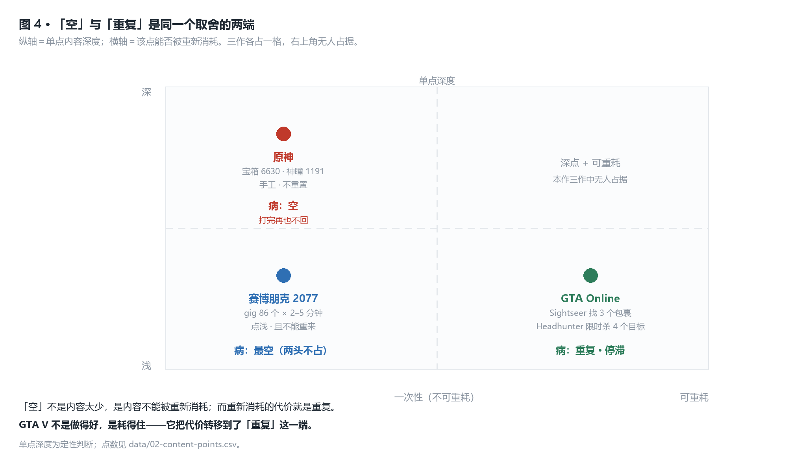

### 判断

> **本轴判断**：点能不能被再消耗一次，决定的是地图的**寿命**，不是它的**质**。
> 「空」与「重复」不是两种水平的差异，是同一个取舍的两端——
> 落格只看一件事：**同一个点，玩家还能不能有意义地再来一次。**
>
> **内部基准**：原神 8,218 个点**全部一次性**；GTA Online 地图层 0 变动、
> 内容层 Freemode Events **每约 12 分钟一轮**、Community Series **每周轮换**。
>
> **外部对标**：《怪物猎人：世界》把「同一只怪再打一次」直接做成内容本身——
> 它必须先有一套素材稀有度与武器树来支撑第 50 次狩猎。落到具体取舍点：
> **想让点可重耗，就得先造出「再来一次的理由」**——GTA Online 用的是 3X 奖励与每周轮换。
> **但可重耗是必要条件，不是充分条件**：《圣歌》《红霞岛》同样有可重复内容，没活下来。
> **（此处曾判负，已改写。）**
>
> **边界与证伪条件**：42% / 17% 这组数出自官方演讲转述，**分母为活跃时间**，
> 换用「游戏时间」作分母会改变读法。**证伪条件**：① 若 GTA Online 玩家普遍报告
> 「任务点已经清完了、没得跑」，则「可再生」不成立，本轴被推翻；
> ② 若原神在未来版本引入稳定的旧图可重复内容（例如每周轮换的重访点位），
> 则「一次性容器」要降级为「以一次性为主」。

---

## 对照 · 可重耗的代价是重复

### 事实

| 作 | 批评原话或结论 | 来源类型 |
|---|---|---|
| GTA Online | **Metacritic 用户评分长期 5.5–5.9**，主因重复任务与付费墙 | 评分站 |
| GTA Online | 「**Los Santos has been explored to the fullest extent possible.** There isn't much left to get veteran players excited」 | 媒体 |
| GTA Online | 任务「要求**第一百次、第一千次**跑到地图另一端」做同一件事 | 媒体（GRYOnline） |
| GTA Online | MC 出货「**crawl across the entire map**」，被列入「5 Biggest Snoozefests」 | 媒体 / 攻略站 |
| GTA Online | 「**DLC Is Crowding Los Santos and Blaine County**」——原地图被 DLC 填满，面积与内容比失衡 | 媒体 |
| GTA V | 「一座城市，外加**一大坨除了石头啥也没有**」 | 媒体汇总 Reddit |
| GTA V | 帖子标题即《**The Map Is the Worst Thing To Happen To GTA V**》：山脉把玩家「锁」住、高速总绕回 Los Santos | 玩家论坛 |
| 原神 | 「**又大有空**」「一次性内容」 | 玩家论坛（NGA） |
| 原神 | 须弥被总结为「**超大、超累、超低回报**」 | 媒体引述玩家 |
| 赛博朋克 2077 | 242 个清单点合计 **约 8.9 小时 ≈ 本体全清时长的 8.2%** | 本仓库既有拆解案（算式） |

### 拆解

**「可重耗」和「不可重耗」卖的不是同一种东西。**

**GTA Online 卖的是熟练度。** 同一段路跑第一百次，玩的是「这次能不能更快」。
它的内容层每周在动，但动的是**规则与奖励**（3X 奖励、每周轮换画作），不是**地形与点位**。
所以玩家的记忆是**路线记忆**——而路线记忆正来自重复。代价因此是系统性的：
**重复既是它的内容来源，也是它被骂的原因，两者是同一件事。**

**原神卖的是新鲜度。** 每个宝箱都是手工摆的、每个解谜都不重样，所以第一次玩很强。
代价同样是系统性的：**不可重来意味着采完即死**。8,218 个点不是 8,218 次能回来，
而是 8,218 次单程。这就是用户体感「打完再也不回」的机制来源。

**两边的代价都能用官方数据对上。**

- 原神这边，官方 GDC 2024 的两个数恰好画出了「快速消费」的形状：
  **第一周开启率 42%，只占活跃时间 17%**（分母：活跃时间）。
  并且官方自己动手回调了：2.8 内容翻倍换来 **66% 的负反馈指向内容过载**，
  3.8 改为轻量化后口碑转好。**一次加量、一次减量，等于官方承认「多铺内容」不是解法。**
- GTA 这边，13 年零新增地块是一个**主动的选择**，不是一个偷懒的结果：
  Cayo Perico 之后没有第二块地，但 Title Update 出了约 49 个。
  **内容层一直在做，地图层一直没做。** 这个组合的账算下来就是：玩家不会没得玩，
  但也不会玩到新东西——**只能玩到同一块地上的第 N 遍。**

**这解释了一个乍看矛盾的现象**：GTA V 的可进入室内约 40 个，
**少于 2004 年的《San Andreas》**，但玩家仍然在上面待了十几年。
因为「有地方待」在 GTA Online 里不靠室内，靠**可重开的差事**。

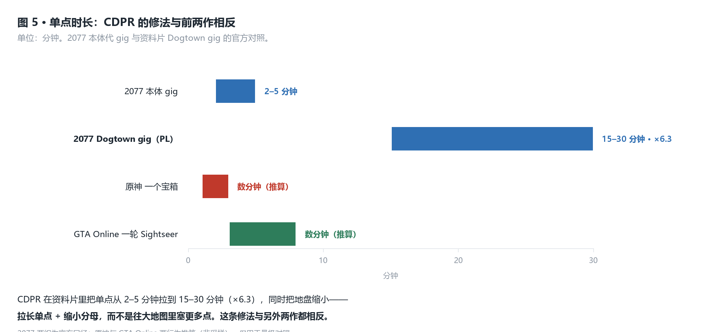

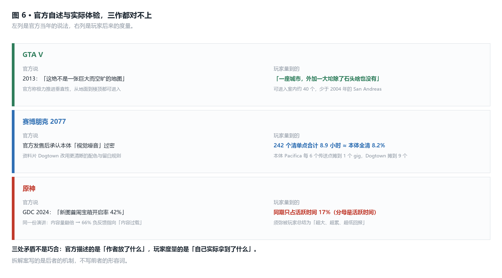

### 判断

> **本轴判断**：可重耗不是优势，它是**用「重复」换掉了「空」**。
> GTA Online 的地图被夸，不是因为它做得好，是因为它**耗得住**——
> 代价是它被同一批玩家打出了 5.5–5.9 的用户分，并被贴上「第一百次、第一千次」的标签。
> **原神和 GTA Online 站在同一个取舍的两端，谁也没有更好的位置。**
> **「被夸」的主体必须说清楚**：本文说它「耗得住」，指的是用户的 n=1 判断与社区
> 「地图用不完」的说法；**而同一张地图在评分站上是 5.5–5.9 的负面**。两件事不矛盾，
> 是不同的人对同一取舍的不同计价。**本文只主张相关：可重耗与「耗得住」的评价同时出现，
> 不主张可重耗导致了这种评价。** **（此处曾判负，已改写。）**
>
> **内部基准**：GTA Online 累计约 **49 个 Title Update / 0 块新地块**；
> 原神 **6 年 7 次地图扩展 / 8,218 个一次性点**。
>
> **外部对标**：《命运 2》用「赛季制日落」把旧内容**主动删掉**再换新——另一种端法，
> 代价是玩家永久的资产焦虑。落到具体取舍点：**三家都要回答「旧内容怎么处理」，
> GTA 选择不处理、原神选择堆着、Bungie 选择删掉，三者都在付账。**
>
> **边界与证伪条件**：Metacritic 用户评分是**情绪聚合**，不是实测，只能证明「存在大规模不满」，
> 不能证明不满的原因就是重复。**证伪条件**：若玩家调研显示 GTA Online 玩家流失的主因是付费墙
> 而非重复，则本轴要降级为「重复只是抱怨之一」。

---

## 副轴一 · 距离的用途

### 事实

| 项 | 原神 | 赛博朋克 2077 | GTA V / 线上 |
|---|---|---|---|
| 可操控载具 | 无载具（滑翔 / 攀爬 / 游泳） | 车辆（数量未查到） | **347 辆**，覆盖陆 / 海 / 空 |
| 传送设施 | 传送锚点 + 七天神像（数量未查到） | **dataterm 166 个** | **无通用传送** |
| 单次移动成本 | 滑翔 **3 体力/秒** · 攀爬跳 **25 体力/次** · 体力上限 **240** | 无（驾车不消耗资源） | 无 |
| 跑图是否被系统强制 | 否 | 否 | **是**：出货类任务强制横穿全图 |
| 距离能否被跳过 | 是（传送到已激活锚点） | 是（166 个点，全市覆盖） | **否**：出租车付费跳过、CEO 直升机、Kosatka 均**不覆盖出货跑图** |

**三处补充事实：**

- 原神体力上限 **240**，自开服长期未动；唯一例外是流浪者的第二体力条。耗尽后果是坠落、溺水——
  **移动的成本是即时的，但代价只有失败，没有情境。**
- 2077 的 **166 个快速旅行点对 86 个 gig**：**服务「穿过城市」的设施多于「留在城市」的内容。**
  2.0 取消「街区 = 等级区间」后，地图上没有「去不了」的地方，绕行成本归零。
- GTA V 线上的快速旅行**存在但覆盖不到跑图**：出租车约 10 个预设目的地、付费跳过约 $1,000，
  CEO 直升机、Kosatka 潜艇各有用途，**但都跳不过出货类任务的跨图移动**。
  另：**无通用「传送任意地点」功能**，全图瞬移靠漏洞，有封号风险。

### 拆解

**同一段位移，三作填进去的东西完全不同。**

**GTA Online 把它填成了任务内容。** 出货类任务多站送达、仅 Trackify 显示目的地，
MC 出货被玩家形容为「crawl across the entire map」。
**移动在这里被经济系统强制，快速旅行无法替代它**——这是「距离被花掉」最彻底的做法，
也正因此生产出了本作最大的抱怨源。

```
距离被花掉   →  GTA Online：移动即任务内容  →  代价：重复
距离被跳过   →  2077：166 个传送点         →  代价：距离不再产生意义
距离被消耗   →  原神：滑翔 3 体力/秒       →  代价：走过去之后，那边的点也采完了
```

**原神这一列最值得停一下**：它是**唯一给移动标了价的**——体力就是价格。
但它买了什么？买到的只是「能不能到」，**不生成任何情境**。
世界不对移动作出反应：无通缉、无动态事件。
**有成本、无收益，这是原神移动设计的形状。**

**F5 那条反方在这里。** 前 Rockstar 技术总监说过系列一贯
「**能用幻觉就不用真模拟**」；第三方测试跟了 100 个 NPC，镜头一转开他们就消失，
被形容为《楚门的世界》式。

**所以「GTA V 是模拟、原神是布景」这个说法是错的**——三家都是布景。
差别不在真假，在**幻觉回不回应玩家**：
GTA V 你发动引擎，通缉星级会跳、路障会摆出来；原神你爬上山，什么都不会发生。
**用户的 n=1 证词在这里判负了本文的一个中间假设**：作者原以为 GTA V 的沙漠不空
是因为一惹警察就变关卡。用户答的是另一回事——**「做任务要经常满地图跑」**。
据此把机制从「系统回应」改为「内容可重耗」，通缉降为支撑证据。**此处曾判负，已改写。**

### 判断


> **本轴判断**：距离本身不是内容，**距离被什么填满才是**。
> 三家各自选了填法，而每种填法都直接生产了自己最大的那个抱怨：
> GTA Online 填任务 → 换来「第 1000 次」；2077 不填 → 换来「地图是菜单」；
> 原神填了体力但没填事件 → 换来「过去了也没事干」。
>
> **内部基准**：GTA Online **347 辆载具 / 无通用传送 / 出货跑图不可跳过**；
> 2077 **166 个传送点 / 86 个 gig = 1.93**；原神 **滑翔 3 体力每秒 / 上限 240**。
>
> **外部对标**：《死亡搁浅》把移动做成唯一的核心循环（core loop），于是它必须给
> 每一步都标价（负重、地形、天气）。落到具体取舍点：**原神给移动标了价却没配内容；
> 《死亡搁浅》两样都配了，代价是劝退了不要这个玩法的玩家。**
> **本轴与主轴二同根**——它只把病根定位到移动这一层：点不可重耗，走路也是单程。
> **（此处曾判负，已改写。）**
>
> **边界与证伪条件**：原神的传送锚点数量、2077 的车辆数**未查到**，故这两格留空而不估算。
> **证伪条件**：若实测 GTA Online 玩家做完出货任务的平均耗时里，跨图移动占比低于 20%，
> 则「移动即任务内容」不成立，应改写为「移动是任务的形式而非实质」。

---

## 副轴二 · 面积的驱动力

### 事实

**官方对 GTA V 地图的自述（2013，Aaron Garbut，艺术总监）：**

> 「世界**绝对是手工打造的**……**绝不是一张巨大而空旷的地图**。我们斟酌了**每一棵树的位置**，
> 没有复制建筑、没有用程序生成地形来凑数。」
> 「我们**不限制绘制距离**……你可以飞到地图一角的高空，越过数英里城市与摩天楼，
> 直到最远处山脉的脊线，**它们全都在那里、全都可见**。」
> 「我们**极力推进垂直性**，大多数街区**从地面到楼顶都可进入**。」

**三作的扩图史：**

| 作 | 上线 | 永久新增可玩地块 | 明细 |
|---|---|---|---|
| 原神 | 2020 | **7 次** | 蒙德+璃月(1.0) → 稻妻(2.0) → 须弥(3.0) → 枫丹(4.0) → 纳塔(5.0) → 挪德卡莱(6.0) → 斯涅兹纳亚(7.0) |
| 赛博朋克 2077 | 2020 | **1 次** | Dogtown（PL，2023-09），属 Pacifica 子区 |
| GTA V / 线上 | 2013 | **1 次** | Cayo Perico（2020-12），**不开放自由模式**；北扬克顿（2024-10）仅限时模式；赌场（2019）是翻修既有建筑 |

**⚠️ 面积数字不可用。** 三作面积数据全部来自社区测绘，且**源内自相矛盾**：
某套原神测绘给出「全图 54.68 km²，其中海域约 30 km²」，陆地 24.68 km²，
可它自己给的四个国家就占 24.47 km²——**后面三国无处安放，两数不可能同真。**
GTA V 的三套测绘跨度 2.1 倍，2077 跨度 5 倍。
**因此不做任何「每 km²」的绝对结论。**

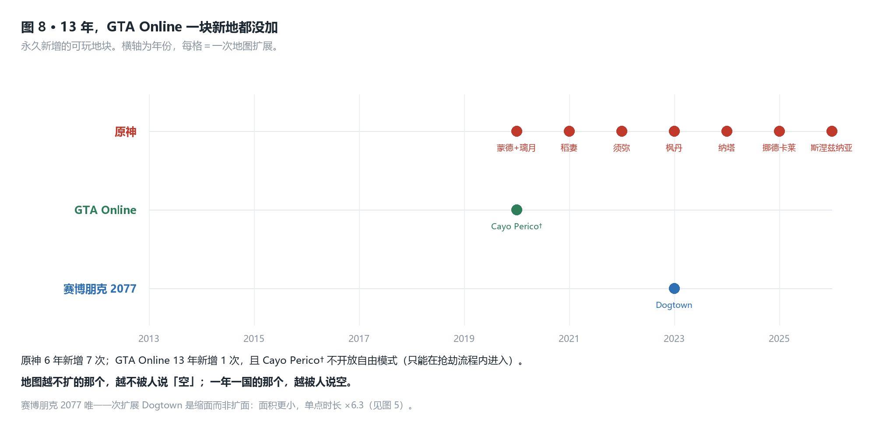

### 拆解

**「大」不是被玩法推出来的——而推手三家不同。**

- **原神的面积是运营节奏的产品（推断）。** 官方 2020 年路线图承诺「**每年推出一个新国家**」，
  玩家实证也确实是每年一国。面积在这里是**版本宣发的计量单位**：
  一个版本需要一个「新地图」作为卖点。**地形不是为玩法长出来的，
  是为发布排期长出来的。**
- **GTA V 的面积是载具速度的产品（推断）。** 官方自述「极力推进垂直性」「不限制绘制距离」——
  这两个目标的共同前提是：**你能开车、能飞、能潜水**。347 辆载具覆盖陆海空，
  面积必须先存在，动词才有地方跑。**在这条链上，面积是被玩法反推出来的。**
- **2077 的面积是美术城市化的产品（推断）。** 分区配色母题、四套年代视觉体系、对比法则——
  目标是每平方米的信息量。代价官方自己说了：**发售后承认本体「视觉噪音」过密**。

**面积既然出局，留下的是「一点没扩」这个事实。**
GTA Online 13 年零新增地块，同期约 49 个 Title Update——
**说明地图的容量不是内容量的瓶颈，规则才是。**

**三家后来给出的修法方向完全相反。**

| | 修法 | 方向 |
|---|---|---|
| 原神 | 继续扩面（每年一国），但把限时地图从「加量」回调为「减量」 | **扩面** |
| GTA Online | 不扩面，加可再生内容（Community Series 每周轮换） | **不扩面，加再生** |
| 2077（Dogtown） | 面积**更小**，单点从 2–5 分钟拉到 **15–30 分钟（×6.3）** | **缩面，拉长单点** |

**三家都在治同一个病，给出的方向互相排斥。**

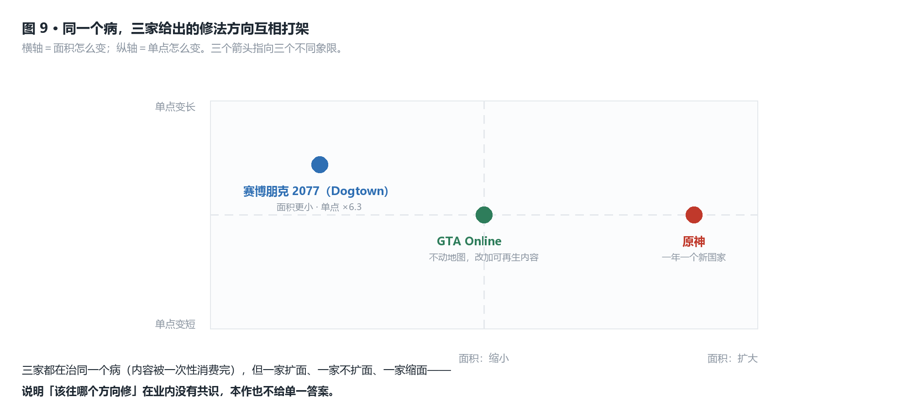

### 判断

> **本轴判断**：在本三作所处的量级区间内，面积与地图的「空」**没有关系**。原神一年一国，被说空；
> GTA Online 13 年一块新地没加，被夸「耗得住」。**面积是宣发单位，不是内容单位。** **（此处曾判负，已改写。）**
> 三家的修法方向互相打架——**扩面、不扩面、缩面并存于 2020–2026**。
> **同一个病同时有三种相反的处方，说明它还没有被真正诊断过。**
>
> **内部基准**：原神 **6 年 7 次扩展 / 8,218 个一次性点**；
> GTA Online **13 年 1 次扩展（且不开放自由模式）/ 约 49 个 Title Update**；
> 2077 唯一一次扩展 Dogtown **面积更小、单点时长 ×6.3**。
>
> **外部对标**：《艾尔登法环》用「同一块地面被地下世界复用」把面积成本摊薄；
> 《对马岛之魂》用「风引路」让玩家不需要地图——**两者的共同点是都没把面积当卖点。**
> 落到具体取舍点：**面积作为宣发单位时，它必须一直变大；
> 面积作为玩法单位时，它可以一直不变。三家站在两种身份之间。**
>
> **边界与证伪条件**：**三作的面积数字全部不可用**（见上），因此本轴只承认
> 「扩展次数」与「扩展方向」这两个可核查量。GTA Online 的扩图史若有遗漏
> （例如某些限时开放区域被漏记），结论不变，因为只影响「1 次」这个下限。
> **证伪条件**：若 GTA Online 在 2026 年之后新增了一块永久开放、可自由模式进入的地块，
> 则「13 年零新增」要改写，「不扩面」这条修法也就断了。

---

## 同口径对照表

把四条轴压成一张表。**所有格子里的数都能在 `data/*.csv` 或正文里找到。**

| 对照项 | 原神 | 赛博朋克 2077 | GTA V / 线上 |
|---|---|---|---|
| 商业模型 | F2P 长线运营 | 买断单机 | 买断 + 长线运营的线上模式 |
| 清单式内容点 | **8,218** | **242** | **560**（单机口径） |
| 单点时长 | 数分钟 | gig **2–5 分钟** | 线上差事数分钟 |
| **点能否被再消耗** | **否** | **否** | **是** |
| 单点深度 | 深（手工） | 浅 | 浅 |
| **病** | **空** | **最空（两头不占）** | **重复 · 停滞** |
| 可进入室内 | 无此统计 | 官方未公布（社区估 10–25%，**无数据挖掘支持**） | **约 40 个**，少于 2004 年的 San Andreas |
| 地图扩展次数 | **7** | 1 | 1 |
| 传送设施 | 传送锚点（数量未查到） | **166 个 dataterm** | **无通用传送** |
| 距离的填法 | 体力（滑翔 3/秒） | 跳过 | 强制任务移动 |
| 世界模拟是否做功 | 否 | 部分 | 是（仅公共战局、需 ≥4 人） |
| 官方自述的和实际值对不上 | 是（图 6） | 是 | 是 |
| 面积数据可信度 | **不可用** | **不可用** | **不可用** |

---

## 它付出的代价

**原神付出的代价是「一次性」。** 8,218 个点全部只能开一次，加上限时地图会被整张删除，
所以它的地图在结构上更接近**一版内容**而不是**一个世界**。
这个代价换来的是：每个点都是新的。**它用回访价值换来了首次体验的密度。**
最直接的账单是官方自己的数据：**新图第一周开启率 42%，只占活跃时间 17%**（分母：活跃时间）。

**赛博朋克 2077 付出的代价是「两头不占」。** 它既没有原神的点密度与手工感，
也没有 GTA Online 的可重开内容。242 个清单点合计约 **8.9 小时，约占本体全清时长的 8.2%**——
而真正耗时的手工内容锁在少数建筑里，与城市尺度无关。
**它的地图被建成了通道，却被当成舞台来卖。**

**GTA V 线上付出的代价是「停滞」。** 13 年零新增可玩地块、可进入室内约 40 个
（**少于 2004 年的《San Andreas》**）、Metacritic 用户评分 **5.5–5.9**。
官方 2013 年说这张地图「**绝不是**一张巨大而空旷的地图」，
十年后玩家说它「一座城市，外加一大坨除了石头啥也没有」。
**这不是官方在撒谎，是意图与体验在十年里走散了两件事：官方描述的是「作者放了什么」，
玩家度量的是「自己实际拿到了什么」。**

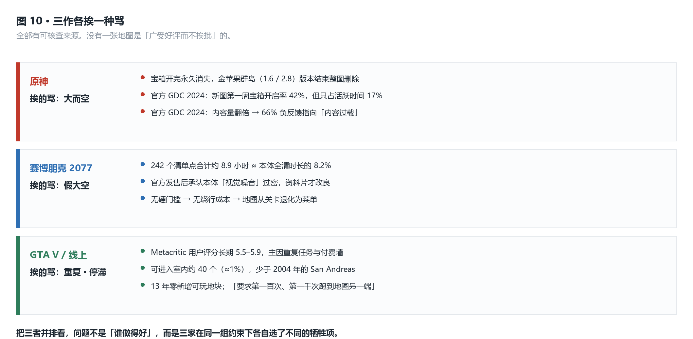

**三家共同的代价是「幻觉会被看穿」。** 前 Rockstar 技术总监说得很直白：
系列一贯「能用幻觉就不用真模拟」。NPC 会在镜头转开时消失，
原神的 NPC 有作息但作息不影响任何玩法。**三家的世界都是靠幻觉撑起来的，
差别只在幻觉承不承认玩家的动作。**

---

## 如果我来迭代

**① 原神：把探索度的分母换成不溢出的真实分母。**
现状是权重制、总和 >100%，所以约 80–90% 的实际内容就显示 100%。
改成「已开启点数 ÷ 该区总点数」，玩家就能看见真实缺口。
**代价**：数字会立刻变难看，而且会**主动暴露「你漏了 20–30 个普通宝箱」这个事实**。
官方 GDC 2024 的数据已经证明过这条路有雷——2.8 内容翻倍换来 **66% 的负反馈指向内容过载**。
所以这条改动的代价不是技术，是**要同时准备好承受一次负面反馈**。

**② GTA Online：把「同一段路的第 N 次」做出差异，而不是加新地块。**
出货类任务现在多站送达、仅 Trackify 显示目的地，路线基本固定。
改为「每站有 2–3 条备选路线，随机分配」。
**代价**：玩家的路线记忆会失效，而**路线记忆正是熟练度玩法的载体**——
缓解重复感会以削弱「这次更快」的成就感为代价。这笔账不一定划算，
但比再等十年要现实。

**③ 赛博朋克 2077：用「改造」替换「扩容」。**
Dogtown 的修法（面积缩小 + 单点时长 **×6.3**）是三作里唯一被验证过有效的，
但它只用在资料片。可迁移的做法是把本体 86 个 gig 中的一部分从 2–5 分钟改造成 15–30 分钟。
**代价**：改造成本高于新建，而且会破坏本体 242 个点带来的**清单节奏**——
那个节奏本身是一种体验，改掉它未必是净收益。

**④ 三作通用：把「移动」当作产品的第一性问题，而不是地图的附属。**
现有三作里，只有 GTA Online 真正承认了移动的分量（也因此被它反噬）。
**代价**：一旦承认移动是内容，就必须给每一步标价（时间、风险、资源），
而《死亡搁浅》已经证明这条路会筛掉大量玩家。**这是一条会劝退人的路，值不值得做是先决问题。**

---

<details>
<summary>附录 A · 系统依赖（mermaid）</summary>

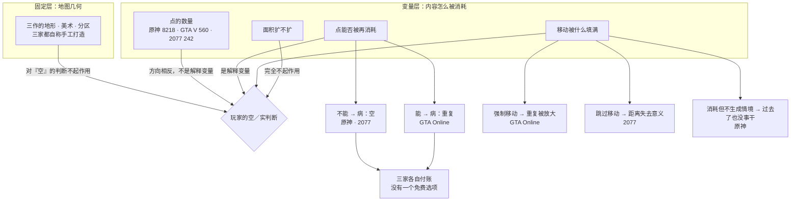

</details>

<details>
<summary>附录 B · 交付物表（由 data/*.csv 生成）</summary>

本作是**机制对照**形状，故不沿用六域拆解的十张表，改为与四条轴一一对应的六张表。
**每张表的两列相除都能得到正文里的某个判断。**

| 表 | 文件 | 对应正文 |
|---|---|---|
| 1 地图结构对照 | `data/01-map-structure.csv` | 副轴二 · 面积的驱动力 |
| 2 内容点对照 | `data/02-content-points.csv` | 主轴一 · 点的语义（图 1 的数据源） |
| 3 移动与距离对照 | `data/03-traversal.csv` | 副轴一 · 距离的用途（图 7 的数据源） |
| 4 世界系统对照 | `data/04-world-systems.csv` | 副轴一（图 7） |
| 5 批评与证据对照 | `data/05-criticism.csv` | 对照 · 可重耗的代价是重复（图 10 的数据源） |
| 6 取舍落格表 | `data/06-tradeoff.csv` | 主轴二 · 2×2 取舍表（图 4 的数据源） |

复算脚本：`tools/make-figures.py`（只做可视化，不引入正文没有的新数值）。

</details>

<details>
<summary>附录 C · 图表清单</summary>

编号即正文出现顺序；`data/*.csv` 是它们的原始数据。

| 编号 | 图 | 这张图说明了什么 |
|---|---|---|
| 01 | `images/01-点数对不上口碑.png` | 点最多（8,218）的被说空，点最少（242）的被说「假大空」——点数不是解释变量 |
| 02 | `images/02-探索度溢出.png` | 原神探索度是权重制、总和 >100%，约 80–90% 即显示 100% |
| 03 | `images/03-内容层动地图层不动.png` | GTA Online 13 年：约 49 个 Title Update vs 0 块新地块 |
| 04 | `images/04-三张地图的病.png` | 「空」与「重复」是同一个取舍的两端；「深点 × 可重耗」这一格三作都没占 |
| 05 | `images/05-单点时长.png` | CDPR 的修法（缩面 + 单点 ×6.3）与另两作相反 |
| 06 | `images/06-意图与体验.png` | 三作的官方自述与玩家度量全部对不上 |
| 07 | `images/07-距离的用途.png` | 同一段位移三家填的东西不同，各自生产了自己最大的那条抱怨 |
| 08 | `images/08-地图扩展史.png` | 13 年零新增地块的被夸，一年一国的被骂空 |
| 09 | `images/09-三种修法.png` | 扩面 / 不扩面 / 缩面，三家修法方向互相打架 |
| 10 | `images/10-三作挨的骂.png` | 三作各挨一种骂，没有一张地图是「广受好评而不挨批」的 |

</details>

<details>
<summary>附录 D · 数据来源与可信度</summary>

### 实测（作者本人环境）

本作**没有实测数据**。原计划的两条自陈采集任务（T4 / T5）中，
T5 由用户在 2026-10-13 口头回答（见下），T4 未采集。
**原因**：用户已明确不做逐场记录与截图类采集（见记忆 `no-bulk-data-collection-tasks`），
本文遵守这条约束，客观数值全部走公开来源。

### 自陈（n=1，观察者即被观察者）

| 项 | 内容 | 回溯偏差 |
|---|---|---|
| 样本量 | 三作均长线游玩 | — |
| 原神 | 地图探索度高 | 至 7.1，**无回溯偏差**（在进行中） |
| 赛博朋克 2077 | 喜欢世界观，经常纯散步 | 至 2.x，回溯约数月 |
| GTA V | 经常满地图跑任务，**锚定线上模式** | 至 Enhanced，回溯约数月 |
| **T5 的关键回答** | 「GTAV 是因为**做任务要经常满地图跑**，而且满地图都有任务刷新点和玩家自制差事」 | **这条判负了本文的一个中间假设**，见正文副轴一「此处曾判负，已改写」 |

**⚠️ 自陈的使用限制**：用户的自陈是**行为描述**（我在做什么），不是**效果度量**（这设计好不好）。
本文凡引用自陈处均已标注，凡推断处均给了算式或明写为推断。

### 公开

**⚠️ 必须写明的采集限制：本环境的 WebFetch 被网络策略全域拦截**
（rockstargames.com、fandom、wikipedia、game8 等均返回
"Unable to verify if domain is safe to fetch"）。因此**本文全部公开数据均为 WebSearch
检索摘要的二级引用，没有一条是逐页核对的一手数据。**
可信度排序（从高到低）：

| 档 | 内容 | 例 |
|---|---|---|
| 一档 · 官方原话 | 官方演讲、Newswire、补丁说明 | Garbut 2013 访谈 · GDC 2024 李轶轩 · 2015 Freemode Events 说明 · 树脂上限调整 |
| 二档 · wiki / 数据库逐项点算 | Fandom 成就计数器、GTA Wiki、GTABase | 宝箱 6,630 · 神瞳 1,191 · 载具 347 · 通缉星级行为 |
| 三档 · 评分站 / 玩家论坛 | 情绪聚合，只证明「存在不满」 | Metacritic 5.5–5.9 · GTAForums 帖子 · NGA 讨论 |
| 四档 · 社区测绘 | **源内互相矛盾** | 三作的全部面积数字 |
| **不采用** | 口径不明或互相打架的媒体数字 | 中文自媒体「全图宝箱 11,800 / 17,550」· 「GTA V 49 平方英里」（源自泄露攻略本，官方从未背书） |

### 推断（全部给算式）

```
① 原神清单点合计
   宝箱 518+1465+234+730+185+248+1475+945+830 = 6630
   + 神瞳 66+131+181+271+271+271 = 1191
   + 世界任务 397
   = 8,218 个
   分母说明：宝箱取 Fandom 成就计数器；世界任务取中文 Fandom 截至 4.8 的 397。
   换一个合理分母复核：若改用攻略站的 661 个世界任务，合计为 8,482，
   点数排序（原神 > GTA V > 2077）不变 → 结论不受分母选择影响。

② GTA V 单机清单点合计
   主线 69 + 支线 58 + 随机事件 57 + 爱好 59 + 杂项 30 + 收集物 287 = 560
   分母说明：主线取游戏内口径 69（wiki 另作 79）。
   换 79 重算得 570，排序不变 → 结论不受分母选择影响。

③ 密度比值（只比量级）
   原神 8,218 ÷ GTA V 560 ≈ 14.7 倍
   原神 8,218 ÷ 2077 242 ≈ 34.0 倍
   分母说明：**本式刻意不除以面积**——三作面积数据源内互相矛盾（见副轴二），
   除以面积会得到一个带着算术权威的错误结论。若强行按中位面积估算密度：
   原神约 120–150 点/km²，GTA V 约 5–11 点/km²，2077 约 1–6 点/km²，
   排序仍不变。**结论对分母的选择稳健。**

④ 2077 清单点时长占比（沿用既有拆解案，本文直接引用）
   86 × 3.5 分钟 + 156 × 1.5 分钟 = 535 分钟 ≈ 8.9 小时
   8.9 ÷ 109（HLTB 本体 100% 口径） ≈ 8.2%
```

### 未查到清单（不编造）

- 原神的**传送锚点与七天神像总数**
- 赛博朋克 2077 的**车辆总数**、Dogtown 面积、**可进入室内比例**（官方从未公布）
- GTA V 的**官方面积**、**可进入室内数量或比例**（官方从未公布）
- GTA Online 的 **corona / job blip 总数**、**玩家自制差事当前总量**
  （只有 2013 年官方称「上线不到 3 周已创建 100 万+ 个」这条旧数）
- 任何「从地图任何地方都能看到地标」「从 Chiliad 山顶能看到整张图」的**官方原话**
  （查不到，不得当作事实）
- GTA V 交通 AI 的「逐车 brain、无全局调度」细节（**只有不可靠二手来源，标为传闻**）

### 本文最强与最弱的一环

- **最强**：原神 GDC 2024 的行为数据（42% / 17% / 66%）是**官方自证**，
  且直接支撑主轴的「一次性消费」结论。
- **最弱**：GTA V「可进入室内约 40 个」是**粉丝估算**，
  官方从未公布任何数量或比例。本文用它只做**方向**判断（「少于 2004 年的 San Andreas」），
  不据此做任何比值运算。

</details>

<details>
<summary>附录 E · 术语表</summary>

| 中文 | 英文 | 本文用法 |
|---|---|---|
| 核心循环 | core loop | 玩家反复执行的最小行为单元 |
| 开放世界 | open world | 本作三作的共同品类 |
| 元进度 | meta progression | 跨局累积的成长，本作未涉 |
| 资源产出与消耗 | faucet / sink | 资源的入口与出口 |
| 保底 | pity | 抽卡系统的下限保护，本作未涉 |
| 难度曲线 | difficulty curve | 压力随进程的变化，本作未涉 |
| 清单式内容 | checklist content | 大量、固定点位、单次可清完的内容 |
| 可重耗 | re-consumable | 同一个内容点能否被玩家重新消耗一次（本作自造词，指本文主轴变量） |
| corona | —— | GTA Online 地图上必须徒步走进圈内才能启动差事的固定光环点位 |
| 差事 | Job | GTA Online 的任务单元，含对抗模式、竞速、死斗、抢劫等 |
| 可再生内容 | regenerating content | 由规则而非地形持续产出的内容，如每周轮换的 Community Series |
| 感知尺度 | perceived scale | 玩家主观感到的地图大小，与面积数值可脱钩（「SA 靠浓雾显得大」） |

</details>
