# 守望先锋 2 拆解案

> **版本为何必须钉死**：2026 年官方把赛季编号重置为「赛季年」结构——一年 **6 个赛季**
> （官方原文：*"Season 1 through Season 6, before a new Season 1 launches in 2027"*），
> 同年计划推 **10 名新英雄**。官方新闻与补丁页自本赛季起也不再在标题里署「2」。
> 实时服务游戏的数值几个月就失效，本文所有数值只采 **2026 赛季年（Reign of Talon）S1–S5**，
> 且逐条标出处。

## 产品卡片

| 项 | 值 |
|---|---|
| 游戏 | **Overwatch**（官方材料自 2026 赛季年起不再署「2」；社群仍通称 OW2） |
| 开发商 / 发行 | Blizzard Entertainment |
| 平台 | PC / PlayStation / Xbox / Nintendo Switch |
| 品类 | 竞技 · 多人（英雄射击 / hero shooter） |
| 服务形态 | 免费游玩 + 战斗通行证 |
| 上线 | 2022-10-04（免费化） |
| 当前锚点 | Season 5: A Grim Doctrine（2026-10-06 起） |
| 赛季结构 | 一年 6 个赛季；2026 年计划新增 **10 名**英雄（官方原文） |
| 英雄池 | **54 名**（坦克 15 · 输出 23 · 辅助 16），数自官方 heroes 页的 54 个英雄卡片锚点 |
| 体量 | 官方 2024-07 自述「**tens of millions** of new players that have only played 5v5」；总玩家数官方未公布 |
| 实测样本 | 作者累计 **2000 小时以上**；主玩**快速游戏 · 5v5 职责队列**；主力**辅助**；另含 6v6 开放队列的第一手经验 |
| 版本锚点 | **2026 赛季年（Reign of Talon，S1–S5）** |

> **样本与边界**：作者的实测样本是 2000 小时以上、主玩**快速游戏 5v5 职责队列**、主力**辅助**，另含 6v6 开放队列的第一手经验。**竞技与排位体验属于二手印象**（作者自述「基本只玩快速，排位是看别人得来的印象」），因此本文凡涉及段位与 MMR 的结论一律标为推断。公开数据逐条来自官方补丁说明与官方新闻页，随文标注；官方未公布的部分（英雄基础数值、地图总数、单局时长）在正文里明确写成缺口，不做填充。

---

## 核心发现

**1. 5v5 的设计目标是"抬高下限"——官方原话，代价是主动砍掉高光时刻。**（域二）

> *"The world of 6v6 could have really high, highs, but reaaaally low, lows. **One of the design goals of 5v5 was to try to raise that floor, even though it was at the expense of some of those high moments.**"*

所以「个人改不了」不是匹配器出的事故，是**结构目标本身**。

**2. 官方说 5v5 给了玩家"更大的个人能动性"，作者的体感是"个人改不了"——两句话不冲突，因为能动性 ≠ 影响力。**（域一 · 域二）

官方原话是 *"the greater individual agency that players could have in 5v5"*。把它算一遍：

> 一局 10 名玩家、结果近似可加时，个人发挥能解释的单局结果方差上限
> = 1 / (2 × 5) = **10%**（只看己方 5 人合力则为 1 / 5 = **20%**）

5v5 让你**更能开枪**（能动性 ↑），同时把你的方差份额压到 10%（影响力 ↓）。两个词指的不是同一件事，而玩家的体感说的是后者。

**3. 短板不可补偿是设计事实，不是抱怨。**（域二 · 域五）

官方讲 6v6 的优点时自述：*"There was an extra player to take up a bit of the slack for someone that was performing poorly."*——等于承认 5v5 收走了这张安全垫。这道缺口补不上有两层：**结构上**没有第二个位置能顶替（域二），**数值上**一次坦克齐射 **204** 伤害 vs 辅助 12 秒满治疗 **175** 点（域五）。而作者的第一手经验指出，实战里先崩的通常是更前面那一层——**队友不在可被治疗的范围内**。

**4. 平衡工具是高频小幅：22 个月 ≥645 条英雄数值改动，同期机制级重做只有 2 次。**（域三）
练度是会被折旧的资产，折旧率由补丁日历决定。

**5. 官方把"降低战场噪声"和"提高界面信息"当成同一件事的两半。**（域六）
战场上的信息减少（跟踪 9 个而不是 11 个），UI 上的信息增加（存活状态、助攻伤害、最后已知位置）。

**五条的关系**：第 1 条是**意图**；第 2 条是这笔意图的**记账方式**——用能动性换掉了影响力；第 3 条是**代价落在谁身上**——短板无法转嫁；第 4 条是同一笔账的**时间维度**——练度也在折旧；第 5 条是官方选择的**补偿路径**——把信息从战场搬进 UI。

---

## 一 · 核心循环与节奏

### 事实

**三层循环（core loop）**

| 层 | 结构 | 一次循环多长 |
|---|---|---|
| 单次交火 | 站位 → 技能 / 大招（Ultimate）交换 → 击杀 | 数秒 |
| 单局 | 选英雄 → 若干回合 → 结算 | 作者回忆约 **10 分钟以内**（快速 5v5；公开源无此数，标为回忆估计） |
| 长线 | 赛季（一年 6 个）+ 英雄等级 / 通行证 | 一个赛季约数周 |

- **局内没有成长。** 每局重置，除了 Stadium 模式的场内购买；本作不像 RPG 那样存在「一局内变强」的曲线。
- **大招（Ultimate）是唯一的局内累积资源。** 官方回顾 6v6 时代：*"Many times, fights in 6v6 couldn't resolve until ultimate abilities came online... until **ultimate combos** could be executed"* —— 在旧结构里大招是破局的**必需**手段。
- 无难度档。竞技性由匹配承担，不由难度设置承担。

**大招的经济**（逐英雄点数取自已存档的 Overwatch Wiki，按位置汇总求均值 = 本文推算）

| 口径 | 值 |
|---|---|
| 单次大招成本区间 | 约 **1,375**（Tracer）– **2,975+** |
| 位置均值 | 输出 **≈2,049** · 坦克 **≈2,276** · 辅助 **≈2,625** |
| 充能来源 | 伤害与治疗按 **1 点 / 1 点**折算；另有约 **5 点 / 秒**的被动充能 |

### 拆解

把一局拆成「决策」而不是「操作」：

- **站位与走位**是连续操作，不是离散决策；
- **大招**是唯一有明确**点数成本**的决策——成本区间 1,375–2,975+，因此它是唯一算得出频率的决策；
- 但作者（辅助，2000 小时以上）的第一手反驳指出：**开团、换人（英雄或目标）、卡点同样是"决定结果"的时刻**。

这三者没有统一的计价单位：开团的成本是"暴露己方位置"，换人的成本是"重置大招充能"，卡点的成本是"放弃时间"。**能量纲不同，就无法相加成一个"一局有多少次决策"的数。** 本文只能算得清大招那一条：

> 若首个大招约在开赛后 **2–3 分钟**到来（社区口径，推断），作者回忆一局 **≤10 分钟**
> → 大招频率 ≈ (10 − 2.5) / 2.5 ≈ **每 2.5–3 分钟一次**

官方自己解释了为什么决策素材在变少：*"Tracking nine other players is easier than eleven. There are fewer visual effects on screen, especially during big team fights."* —— 5v5 把需要跟踪的单位从 11 个降到 9 个，把**认知负荷降下来的同时，也把可供决策的信息量降下来了**。这是一次纯粹的减法。

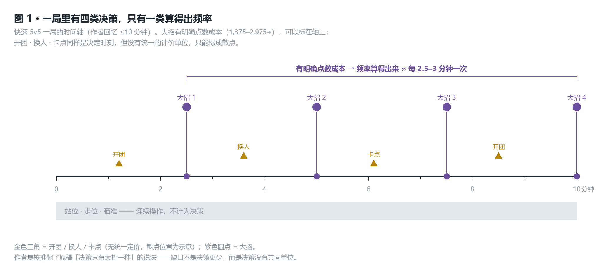

*图 1：一局摊开看。大招有点数成本、能标在时间轴上；开团 / 换人 / 卡点同样是决定时刻，但算不出频率，只能标成散点。*

再换一个口径看同一件事。若把一局的 10 名玩家视为结果可加，个人发挥能解释的单局结果方差上限 = 1 / 10 = **10%**；即便只跟己方 5 人比合力，也只有 **20%**。6v6 更低（**8.3% / 16.7%**）——人数越多，单个人占的那一份越小。

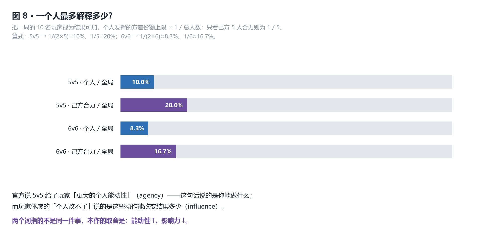

*图 8：官方说的「更大能动性」与玩家说的「个人改不了」是两个量——前者是**能做什么**，后者是**能改变结果多少**。*

决策点的数量（能动性）与它占结果的份额（影响力）仍然是两件事：**决策类型越多，你能做的越多；但你要和另外九个人分享同一局结果这一点没有变。**

### 判断

> **本作的局内决策不是一个「资源」，而是一组量纲各不相同的动作——只有大招能被算成频率，其余三类（开团 · 换人 · 卡点）算不出来。**
>
> *（本判断经作者复核后从原稿改写，原稿写的是「决策被压缩到大招这一个资源上」，被 n=1 第一手经验判负。留档见附录 D。）*

- **内部基准**：大招是唯一有明确充能点数（1,375–2,975+）的决策；作者的 2000 小时第一手判断把开团、换人、卡点与大招并列为决定结果的时刻——即决策点**至少四类，不是一类**。
- **外部对标**：《无畏契约》（Valorant）把决策折进**统一的定价**——每回合一条命、先到 13 回合（官方新手引导原文 *"switch sides after 12 rounds"*），每一回合都要重新决定买什么。买枪与分经济是一个可加总的资源，所以它的决策密度算得出来。OW2 没有这套统一定价：开团、换人、卡点各有各的量纲，这才是它「算不清」的原因，而不是「决策更少」。
- **边界与证伪条件**：若某个版本给开团 / 换人 / 卡点引入统一资源成本（例如把 Stadium 式的场内经济并入主线队列），「量纲不同、算不出频率」就不成立。

---

## 二 · 内容结构与关卡

> 竞技 / 多人口径：本域看**地图与模式结构**与**匹配机制**。

### 事实

**队列与模式结构**

| 层 | 内容 |
|---|---|
| 队列 | 5v5 职责队列（Role Queue）**1-2-2**（每队 1 坦 · 2 输出 · 2 辅助）；另有开放队列（Open Queue，无人限）；6v6 开放队列**最多 2 名坦克** |
| 模式 | Control（控制图，三局两胜）· Escort（推车，3 个检查点）· Hybrid（先占点再推车）· Push（推机器人，2 个检查点）· Flashpoint（5 个闪点，先到 3） |
| 已退场 | Assault（2CP）2022 年 OW2 首发即移出常规队列；Clash 于 2024-08 加入、其后移出常规队列 |
| 长线 | 一年 6 个赛季；2026 年 10 名新英雄 |

**6v6 的回归时间线**（官方公告）

| 时间 | 事件 |
|---|---|
| 2024-12-10（S14） | 测试两种 6v6 形态：限制 1–3 名坦克与固定 2-2-2 |
| S15 整季 | 6v6 开放队列加入，**最多 2 名坦克**；S16 延续 |
| 2026-07-16 → 07-19 | 测试 **Flex Queue**（1-3-2；同时只允许 1 名输出切坦克） |
| 2026-07-30 → 08-02 | 测试 **Dynamic Queue**（优先 2-2-2，坦克不足时回落 1-3-2） |

Flex 与 Dynamic 在活动期内**替代** 5v5 职责队列。

**官方公布的模式参与度**（Director's Take: Future Formats，2026-07-15）

官方限定：*"Players can be counted for every mode they play in a session... so these numbers won't add up to the standard 100%."*——各数互不排斥，不相加为 100%。

| 队列 | 占比 |
|---|---|
| 快速游戏 · 5v5 职责 | **~54%** |
| 竞技 · 5v5 职责 | ~37% |
| 快速 · 6v6 开放 | ~19% |
| 竞技 · 6v6 开放 | ~8% |
| 快速 · 神秘英雄 6v6 | ~4% |
| Stadium（竞技 / 休闲） | 各 ~3% |

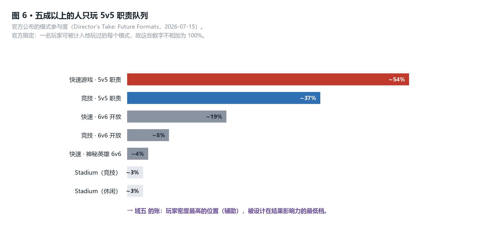

*图 6：五成以上的人只玩 5v5 职责队列——它是现役第一大队列，也是本文所有结论的主战场。*

**匹配机制**（官方 Director's Take，2024-07-25，Aaron Keller）

- 按**职责内的技能**匹配，不是只看总技能：*"matchmaking is based on skill within a given role, not just skill overall"*
- 队列时间的支配变量是**最稀缺职能的玩家比例**：*"almost solely governed by the ratio of people queuing for the least popular role"*
- 官方公布的技能偏好：*"Damage was, by far... the most popular role and tank was, by far, the least popular."*
- 官方为 1-2-2 给出的正当性：*"the actual ratio of players queueing for Tank, Damage and Support is much closer to the current 1-2-2 format than the previous 2-2-2 format"*

### 拆解

匹配器在这里**不是在解"公平"题，而是在解"角色供需"题**。

- 坦克玩家天然最少（官方数据）；
- 每队需要的坦克数：6v6 = 2，5v5 = **1** → 对坦克的需求直接**减半**；
- 队列时间由最稀缺角色支配 → 砍掉一个坦克位，就是砍掉瓶颈本身。

所以 5v5 转型的第一驱动不是"更好玩"，是**吞吐**。官方在讨论 6v6 回归风险时说得更直白：*"Just 'flipping the switch' and returning to 6v6 would likely cause a return to previous queue times or worse."* 谈到 2026 年那两次 6v6 队列实验时，官方又把坦克直接点名为瓶颈——*"based on the number of people queued for Tank (**which is our current bottleneck**)"*。

把这一步算清楚：

> 每队所需坦克数：6v6 = **2**，5v5 = **1**
> 若坦克玩家占总体的比例为 p（官方数据：坦克最少），则一名坦克要服务的队列吞吐 ∝ 1 / 每队所需坦克数
> → 5v5 把对坦克的**需求直接减半**，等于把瓶颈本身拆掉一半

代价是：6v6 的多种阵容可能性也被一并砍掉了——Clash 从加入到退出常规队列只隔了一个多赛季，就是这种反复的直接体现。

代价落在谁头上：**你的对局质量由别人的角色偏好决定**。你玩辅助，但你等多久、排到谁，取决于当刻有多少人在排坦克。

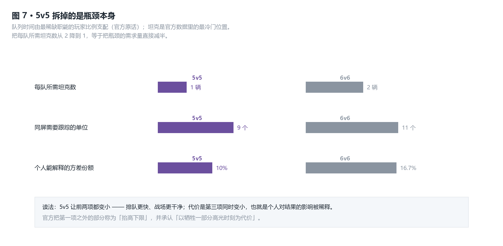

*图 7：同一个换手动作让三件事同时变小——排队更快、战场更干净，以及个人对结果的影响。前两项是目的，第三项是代价。*

### 判断

> **本作的匹配质量上限不由匹配算法决定，而由最稀缺职能的玩家比例决定；5v5 转型的第一驱动是队列吞吐，不是体验。**

- **内部基准**：官方自述队列时间「几乎只由最冷门角色的排队比例决定」，且坦克需求在 5v5 中减半；官方否认「排队久是因为玩家总数不够」。
- **外部对标**：《漫威争锋》（Marvel Rivals）选择**不做职责队列**，用开放阵容换掉了「职能稀缺」这个约束——代价是允许五输出这种极端阵容出现在正式对局里。同一个问题，两个作品选了相反的取舍点。
- **边界与证伪条件**：若官方公开坦克排队比例已接近输出，或上线了不依赖坦克供需的队列形态，本判断失效。

---

## 三 · 数值与经济

### 事实

**改动的频率**（`data/03-balance-changes.csv`，逐条数自官方补丁说明）

| 口径 | 值 |
|---|---|
| 2025-01 – 2026-10 英雄数值改动 | **≥645 条**（下限：未识别到英雄章节的月份按 0 计） |
| 月均 / 年化 | **≈29 条 / 月** · **≈350 条 / 年** → 平均每 **1.03 天**一条 |
| 同期机制级重做 | **2 次**（2025-12、2026-10） |
| 改动面 | 552 条可归属改动里，改动最多的单个英雄仅 **11 条（2%）**，前 5 名合计 **8.3%** |

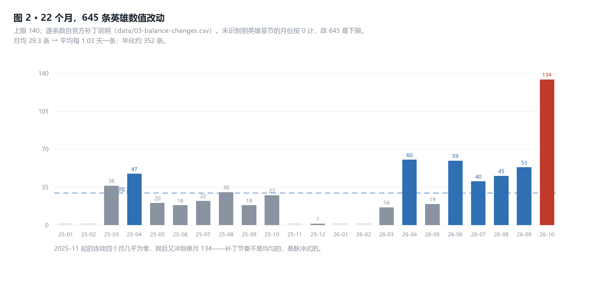

*图 2：改动不是匀速的——2025-11 起连续四个月几乎为零，其后又冲到单月 134 条。补丁是脉冲式的，玩家没法靠日历预期它。*

**单次改动的幅度**（2026-10 补丁，官方原文逐条）

| 对象 | 条目 | 数值 |
|---|---|---|
| Roadhog | Scrap Gun 主武器 | 每轮总伤 **175 → 204**（+16.6%）；弹药 6 → 12 |
| Roadhog | Take a Breather | 治疗 **150 → 200 / 秒**（+33%）；减伤 40% → 35% |
| Roadhog | Chain Hook | 拉后眩晕 0.4 → 0.3 秒；冷却 7 → 6 秒 |
| Sombra | EMP（大招） | 大招成本 **+67.5%** |
| 全局 | 命中弹道尺寸 | 大型 0.07 → 0.04 米；小型 0.04 → 0.02 米 |

**结算与经济结构**

- 局内**没有经济**：不买装备、不买枪（Stadium 模式除外）。
- **没有难度档**：玩家的强度只有「英雄数值」这一条来源。

### 拆解

645 条 ÷ 22 个月 ≈ **每天一条**。同期，机制级重做只有 2 次。

这套平衡的工具是**数值微调**，不是机制重做。好处是玩家的认知不被推翻——技能还是那个技能；代价是：**强度每天都在被重新定价，而玩家的练度是这笔账唯一的抵押物。**

看 2026-10 那把尺子：路霸齐射 +16.6%、自愈 +33%、Sombra 大招成本 +67.5%。单条都不致命。但要紧的是**改动是铺开的**——552 条可归属条目里，改动最多的单个英雄只占 2%，前 5 名合计 8.3%。没有"少数英雄被反复返工"，是整个池子在持续被调。

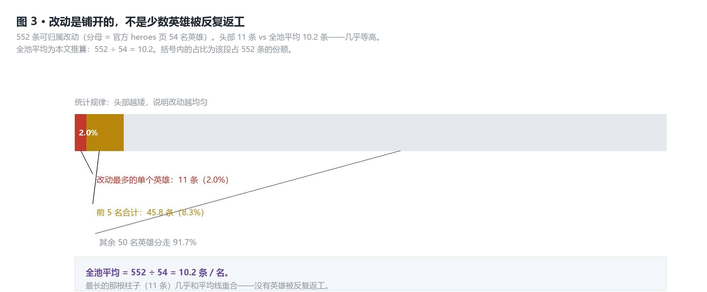

*图 3：改动最多的英雄（11 条）与全池平均（552 ÷ 54 = 10.2 条）几乎等高——长尾是平的，说明没有哪个英雄被单独"返工"。*

### 判断

> **本作的平衡是高频小幅：机制几乎不动，数值一直在动。它换来了稳定的操作手感，代价是把玩家的练度当消耗品。**

- **内部基准**：22 个月 ≥645 条英雄数值改动（月均 29 条、年化约 350 条），同期机制级重做仅 2 次；改动面铺得很开，头部英雄只占 2%。
- **外部对标**：《反恐精英 2》把强度调节放在地图池与回合经济上，而不放在武器数值上——它的回合结构与武器参数**写死在随游戏发布的数据文件里**（`gamemode_competitive.cfg`、`weapons.vdata`：先到 13 回合、每回合 1:55、购买 20 秒、起始资金 800、AK-47 伤害 36）。两个作品连「平衡什么」都不一样：一个平衡**英雄**，一个平衡**地图**——前者要求玩家持续重学英雄，后者的重学成本落在别处（地图与站位认知）。
- **边界与证伪条件**：若改动集中到少数英雄身上（长尾分布），"普遍折旧"就退化为"个别返工"。本锚点版本的实测分布不支持这一点。

---

## 四 · 系统与内容池

### 事实

**英雄池与节奏**

- 英雄总数 **54 名**（坦克 15 · 输出 23 · 辅助 16）——数自官方 heroes 页内嵌的 **54 个英雄卡片锚点**（`class="hero-card"`，逐张带唯一 `id`）。
- 2026 年计划新增 **10 名**英雄。官方原文：*"releasing 10 Heroes over the course of the year, with the first five joining the fight when Season 1 launches on February 10"*。
- 第三方口径 53 / 55 的差异：53 是漏收 2026 年新登场者的快照，55 是媒体给出的"年底计划值"。本文只采官方当页的 54。
- 采集缺口：官方**未公布英雄的基础数值**（生命 / 护盾 / 护甲 / 武器伤害 / 治疗量）——单英雄页只有背景故事、技能文字与 Perk（英雄的被动式强化项，见附录 B）。

**解锁**

- Season 10（2024-04）起**全英雄免费**，不再与战令挂钩。官方口径：新玩家仍需通过新手流程解锁 **OW1 老名单**，*"once the heroes from the original Overwatch roster have been unlocked, all Overwatch 2 heroes will also become available"*。
- 竞技队列解锁：完成新手流程并**赢下 50 场快速游戏**（官方 2022 年 OW2 说明）。

**商业化**（官方公告）

- 战令改革（S4，2026-08-11）：线性 **80 阶** → **5 条可自选的短轨**（每条 8–10 阶），末端仍是史诗 / 传说；官方承诺阶数与时长不变。
- **Unvaulted Passes**：S1–S15 的旧战令回归，可与当季**并行推进**、永久保留；但不含金币、经验加成、神话棱镜与神话皮肤。
- 每季免费轨可白嫖货币约 **600**；付费轨每季含 **5 传说 + 3 史诗 + 最多 80 神话棱镜**。
- 唯一一次官方定价回应（2023，Keller）：*"We do sell an Ultimate Battle Pass bundle every season... the lesson... is to make sure that we provide more ways to acquire some of our most popular skins."*——不撤高价包，只加获取途径。

**元进度（meta progression）**：Progression 2.0 的英雄等级制，每 20 级发一档头像框类奖励。

**已停更的模式**：Stadium 官方宣布 *"we're not planning on expanding Stadium with new Heroes or maps"*，仅保留赛季平衡与奖励更新。

### 拆解

内容池在这里走了一次明确的**转向**，三步：

1. 2022 年，新英雄是战令的钩子——要买、要肝；
2. 2024 年 S10，**钩子被拆掉**：全英雄免费；
3. 2026 年 S4，付费轨改成**自选**（5 条短轨，不必再走线性 80 阶），旧战令回归且可并行推进。

三步走完，商业化从**玩法准入**撤到了**身份表达**：付费买的是皮肤、棱镜、头像框。而 2023 年那次定价回应，正好说明转移的代价——当变现只能挂在皮肤上时，皮肤的价格就成了唯一的争论出口。

把两轨的产出并排放（官方数字）：

> 付费轨 / 季 = **5 传说 + 3 史诗 + 最多 80 神话棱镜**
> 免费轨 / 季 = 约 **600 货币**，**0 件皮肤**
> 比例 = **8 ∶ 0**

也就是说：这个游戏的**玩法内容**（英雄）现在是完全免费的，而**皮肤产出**几乎全部由付费轨供给——免费轨发的是货币与进度，不是外观。

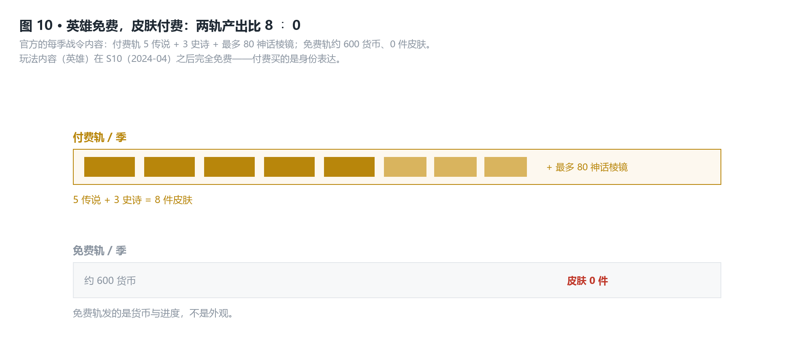

*图 10：把两条轨的每季产出并排——英雄免费之后，付费买的基本只剩外观。*

### 判断

> **本作把英雄从付费墙后面拿了出来、把皮肤放了进去：英雄是玩法，皮肤才是商品。**

- **内部基准**：S10 起全英雄免费（官方）；战令由线性 80 阶改为自选短轨；旧战令回归可并行——三处改动都在降低"为了内容而付费"的必要性。
- **外部对标**：《彩虹六号：围攻》长期把干员解锁放在进度系统的核心位置（可付费加速），玩家的"阵容"本身就是进度资产；OW2 在 S10 把这条路关掉，等于承认英雄是玩法而不是商品。
- **边界与证伪条件**：若后续出现"新英雄需购买或先行解锁"的回摆，本判断失效。

---

## 五 · 玩法机制

> 本域按作者主力位置**辅助（Support）**写。

### 事实

**官方对辅助在 5v5 里的定位**（Director's Take，2024-07-25）

- 6v6：*"Support heroes also had to focus almost exclusively on healing since there were bigger team health pools and more incoming damage on the field with the additional Tank player."*
- 5v5：*"In 5v5 they have more agency to add some damage or duel other heroes."*

**辅助的产出量级**（2026-10 补丁，官方原文；该版本把 Sombra 转入辅助）

| 条目 | 数值 |
|---|---|
| Hotfix（单体治疗） | 65 立即 + **25 / 秒**，上限 **175 总治疗 / 12 秒** |
| Cyberspace（区域） | 对盟友 **30 / 秒**，持续 3 秒 |
| 治疗压制 | 同一补丁把「减疗（healing reduction）」由 35% **提到 40%** |

**同一补丁里的伤害量级**

| 条目 | 数值 |
|---|---|
| Roadhog Scrap Gun（坦克主武器） | 每轮 **204** 伤害 |
| Roadhog Trash Compactor | 75 – 200 伤害 |

**大招成本**（逐英雄点数取自已存档的 Overwatch Wiki，按位置汇总求均值 = **本文推算，非官方公布值**）

- 输出 **≈2,049** · 坦克 **≈2,276** · 辅助 **≈2,625**——辅助最高，比输出高约 **28%**。

**作者的实测自述**（n=1，累计 2000 小时以上，主玩辅助）

- 「能稳住不崩，赢不赢看队友。」
- 正向案例：「有，一次大招 / 关键治疗翻回来。」

### 拆解

把两列数放在一起：

- 辅助一次完整的单体治疗（Hotfix）**12 秒总共 175 点**；
- 同一版本里一次坦克齐射 **204 点**，落点在一瞬间。

**一个辅助用满 12 秒的全部治疗量，补不回一次齐射。** 这是**治疗被设计成持续量、伤害被设计成爆发量**的结构性结果——而且同一补丁还在把减疗从 35% 提到 40%，等于给这道差距再加一道。

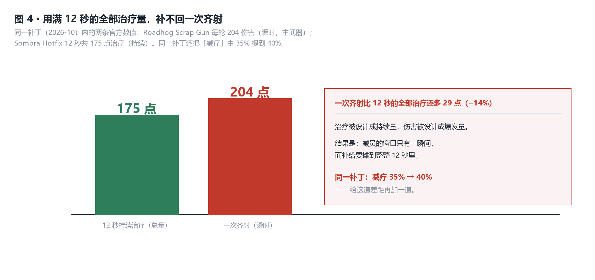

*图 4：同一份补丁里的两条数值。治疗总量要摊 12 秒才追平，减员却发生在一瞬间。*

但作者的第一手经验推翻了"缺口就在这里"这个解释。复述崩掉的局面时，他给的**不是**"奶不过来"，而是：

> **「队友不吃治疗、站位脱节。」**

也就是说：**175 < 204 这道数值缺口是真实的，但它不是辅助"救不了局"的第一原因。** 第一原因是需要被治的那个人**不在可被治疗的范围内**——治疗是射线、是范围，它只在"人已经站在里面"的前提下才生效。数值缺口只在第二层起作用。

辅助唯一能**改写结果**的手段仍然是大招（作者的正向案例正是"一次大招"），而大招成本是全池最高的一档：辅助均值 ≈2,625，比输出高约 28%。**最依赖大招才能撬动局面的位置，攒大招最慢。**

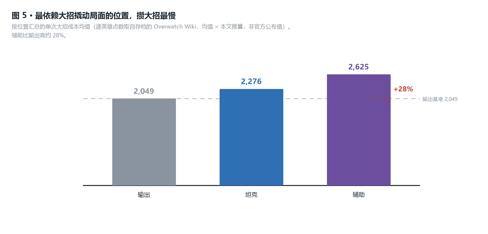

*图 5：按位置汇总的大招成本均值（本文推算）。最能改写局面的位置，需要的充能最多。*

官方在 5v5 给辅助的补偿是——"更多能动性去打输出或单挑"。注意这句话说的仍然是**动作**，不是**结果**。

### 判断

> **辅助的上限由两个条件同时决定：治疗能否覆盖到人（取决于队友站位），以及有没有充能（大招）。数值上的 175 < 204 只是第二层的缺口——第一层在队友那边，辅助改不了。**
>
> *（本判断经作者复核后从原稿改写，原稿把崩盘归因于"奶量追不上伤害"，被 n=1 第一手经验判负。留档见附录 D。）*

- **内部基准**：12 秒 175 点 vs 一次齐射 204 点（缺口 29 点 / 14%，真实存在）；但作者的 2000 小时第一手判断把崩盘归因于「队友不吃治疗 / 站位」，不是「奶量不够」；辅助大招成本均值 2,625，比输出高 28%。
- **外部对标**：《英雄联盟》的辅助可以用一次完美开团单独定胜负——它的产出（控制、视野）**不要求队友先站到某个位置**。OW2 的辅助产出（治疗）**必须由队友走进射线才生效**。同样是辅助位，一个的产出自己掌握，一个的产出需要对方配合——这就是两者的取舍点。
- **边界与证伪条件**：若某个辅助技能的收益不以「队友在范围内」为条件（例如全图范围的增益或自动生效的保护），本判断减弱。作者的 n=1 只覆盖快速游戏这一档对抗强度。

---

## 六 · 反馈与表现

### 事实

**官方把信息与胜负直接挂钩**（S4 更新说明，2026-08-11）：*"The difference between winning and losing often comes down to information."* 该次更新加入：

- **Team Status Indicator**：显示双方存活人数与队友复活倒计时；
- 坦克的 **Protect** 统计；
- 多杀图标；
- 治疗相关的特效与血条反馈（增益 / 减益 / 临时生命 / 濒死）；
- **Activity Feed 显示击杀贡献伤害**。

**通讯轮盘（Ping）**（官方专文）：情境化 ping；目标脱离视线后仍显示**最后已知位置**；位移类技能会使 ping 脱落；长按轮盘可传达进攻 / 防守 / 需要支援；可回应；配套屏蔽与静音。

**新手引导**（官方补丁）：前 5 场快速游戏可能遇到 AI 对手；默认走职责队列；解锁全部模式的场次由 10 降到 5；新账号的快速游戏 MMR 单独校准（反炸鱼）。

**无障碍**：色觉辅助滤镜（三种色盲类型 + 强度滑杆）与轮廓色自定义。

**地图投票**：S17 上线（随机 3 图、每票加权），其后改为多数决。

### 拆解

把这些放在一起，看出一条一致的路线：

- **战场上的信息在减少**——5v5 让需要跟踪的单位从 11 降到 9，官方明说这样"同屏特效更少、更好跟"；
- **界面上的信息在增加**——存活人数、复活倒计时、助攻伤害、最后已知位置。

也就是：**噪声从战场上被清出去，然后以结构化的形式搬回 UI。** 作者 6v6 的体感正落在这条线的另一端——「配合空间变大，但**战场更乱**」：多出来的两个人，就是被 5v5 清掉的那部分噪声。

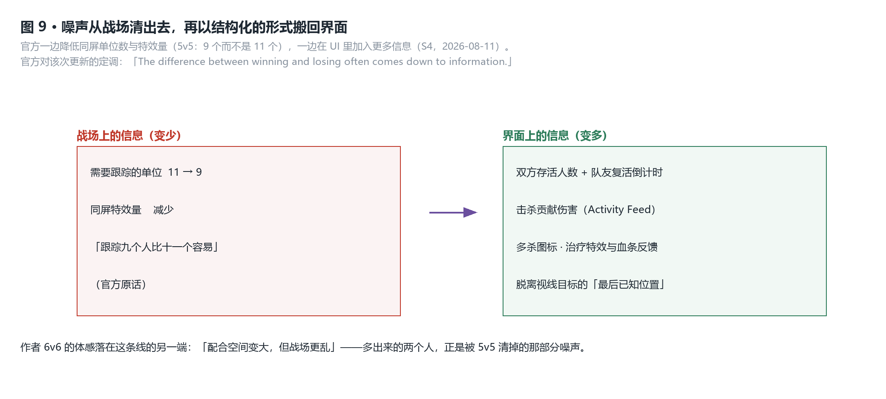

*图 9：一边是战场上被减掉的东西，一边是界面上被加回去的东西——官方把这两件事当成同一套账在记。*

### 判断

> **本作把"降低战场噪声"和"提高界面信息"当成同一件事的两半：官方认定胜负取决于信息，而它的选择是把信息从战场上搬到 UI 上。**

- **内部基准**：5v5 降低同屏单位数与特效量（官方）；同期 S4 却在 UI 里加入存活状态、助攻伤害、多杀图标；ping 系统为脱离视线的目标保留"最后已知位置"——用界面替玩家记住战场上已经消失的东西。
- **外部对标**：《绝地求生》把信息留在世界里——听脚步、读掩体，UI 不替玩家判断。两个作品对"玩家该知道什么"的分配点完全不同。
- **边界与证伪条件**：若后续版本减少 UI 信息、或把信息交回战场（例如削弱轮廓与复活提示），本判断失效。

---

## 它付出的代价

**① 上限。** 抬高下限是写进官方文档的目标，代价是自愿放弃"高光时刻"——6v6 那种"十二个人的混乱"不会再回来。要拿回它，得先还清队列时间那笔账（域二）。

**② 短板成了不可转嫁的风险。** 5v5 收走了 6v6 的那张安全垫。一个人不做自己的事，团队缺的那块功能没有第二个位置能补（域二 · 域五）。

**③ 练度的折旧。** 平均每天一条数值改动、22 个月只有 2 次机制级重做——玩家练的是会被持续重新定价的东西，而定价日历不归玩家管（域三）。

**④ 最大的队列，最低的结果影响力。** 快速职责队列是现役第一大队列（~54%），辅助是其中的主力位置之一；但按域五的账，辅助的工具在数值上追不上伤害。**玩家密度最高的位置，被设计在结果影响力的最低档。**

---

## 如果我来迭代

**① 把"贡献"做成赛后可见的第二块记分牌。** Activity Feed 已经在显示击杀贡献伤害——把它扩展成赛后可见的个人贡献面板（有效治疗量 / 承伤 / 空间控制时长）。代价：必须**只显示、不奖励**，否则会催生刷数据；而一旦公开，任何"贡献"定义都会被玩家当成新的 KPI 去优化。

**② 把救援从「需要对方配合」改成「不需要」。** 域五的账指出，辅助救不回人的**第一层**原因是目标不在可被治疗的范围内——治疗是射线和范围，队友不走进来就不生效。给辅助一个不依赖队友站位的救援手段（例如对**已脱离视野或已倒地**的队友生效的短时保护），把"能不能救回一个人"从"对方是否站在我射线里"中解放出来。代价：这会削弱站位惩罚——站错位的一方不再承担全部后果，对抗的可惩罚性直接下降；必须同时给该技能上更长的冷却或每次使用的次数上限，否则"站错位"会变成免费选项。

**③ 把"匹配的理由"还给玩家。** 快速游戏不显示段位是合理的设计，但连匹配质量都不说，玩家只能用队友行为反推——这正是作者回答"你怎么判断匹配崩了"时给出的答案。给一个赛后可见的匹配质量指标。代价：公开匹配器误差，会直接把新的投诉引到匹配器头上。

**④ 降低改动频率、提高单次幅度。** 把月均 29 条压到 10 条以内，改成季度性大改，让练度有一个可预期的折旧周期。代价：发现失衡的窗口从数周拉长到一个季度，中期的负反馈会被放大。

**⑤ 一条我不该做的。** 不要为了提高个人权重而回到 6v6。官方已经算过这笔账——坦克需求翻倍会把队列时间打回从前，那是**拿吞吐换权重**；而这笔交易并不能解决"个人改不了"，只会让更多人等更久。

---

## 附录

<b>附录 A · 系统依赖（mermaid）</b>

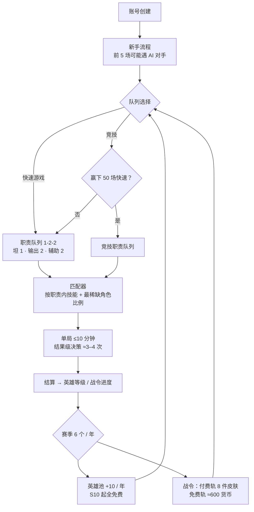

读法：**英雄池与战令都只在赛季层更新，而两者都只是在给队列层输送内容**——一局里能改变的东西（大招），和这两条长线完全不相交。

<b>附录 B · 数值细节与交付物表</b>

技能要求的十张交付物表，逐张交代落点。本作有三张因品类而显式留白，不填充。

| # | 表 | 状态 | 落在哪 |
|---|---|---|---|
| 1 | 时间轴与结构配比 | ✅ | 域二 · 队列与模式结构 + 6v6 回归时间线 |
| 2 | 单位 / 英雄数值表 | ⚠️ **采集缺口** | 官方未公布英雄基础数值（生命 / 护盾 / 武器伤害 / 治疗量）——单英雄页只有背景故事、技能文字与 Perk。见下方缺口说明 |
| 3 | 成长曲线 vs 压力曲线 | ➖ **品类留白** | 本作局内无成长（Stadium 除外），不存在「等级 vs 难度」的曲线；改为域三的「改动频率 vs 英雄强度」 |
| 4 | 资源产出与定价 | ✅ | 见下 |
| 5 | 难度修饰表 | ➖ **品类留白** | 无难度档，改为「队列口径修饰」（职责队列 1-2-2 / 开放队列） |
| 6 | 内容池结构 | ✅ | 见下 |
| 7 | 经济收支 | ✅ | 见下 |
| 8 | 路径期望 | ✅ | 见下 |
| 9 | 单次行动收益表 | ✅ | 域五 · 辅助产出量级 + 伤害量级 |
| 10 | 行为时序与信息表 | ✅ | 域五 · 大招成本与充能；域六 · 信息层级 |

**表 4 · 资源产出与定价**（官方公告）

| 来源 | 内容 | 频率 |
|---|---|---|
| 免费轨 | 约 **600 货币** | 每季 |
| 付费轨 | **5 传说 + 3 史诗 + 最多 80 神话棱镜** | 每季 |
| Unvaulted Passes | 旧战令（S1–S15）可**并行推进、永久保留**；不含金币、经验加成、神话棱镜与神话皮肤 | 常驻 |
| 英雄 | **免费**（S10 起） | — |

**表 6 · 内容池结构**（英雄池，数自官方 heroes 页 54 个 `hero-card` 锚点）

| 位置 | 数量 | 占比 | 每队需要 |
|---|---|---|---|
| 输出（Damage） | 23 | 42.6% | 2 |
| 辅助（Support） | 16 | 29.6% | 2 |
| 坦克（Tank） | 15 | 27.8% | 1 |
| **合计** | **54** | 100% | 5 |

**表 7 · 经济收支**

| 去向 | 来源 | 备注 |
|---|---|---|
| 英雄（玩法内容） | 免费 | 仅受新手流程限制 |
| 皮肤 / 神话皮肤 | 付费轨 + 商店 | 变现的唯一出口 |
| 货币 | 免费轨 ≈600 / 季 + 挑战 | 可兑换部分外观 |

**表 8 · 路径期望**

| 目标 | 期望 | 依据 |
|---|---|---|
| **凑齐 54 名英雄** | **付费为 0** | S10（2024-04）起全英雄免费——「攒齐」这件事被官方自己消掉了 |
| 竞技队列准入 | 新手流程 + **赢下 50 场**快速游戏 | 官方 2022 年 OW2 说明（**单源，未交叉验证**） |
| 每季获得皮肤 | 付费轨 **8 件** / 免费轨 **0 件** | 官方战令内容 |

**⚠️ 表 2 的缺口说明**：官方未公布英雄基础数值，因此本文**不给 TTK / EHP 表**，域五的全部数值只采 2026-10 补丁说明里逐条列出的量级（Roadhog 204、Sombra 175/12 秒、减疗 35%→40%）。第三方维基有这些数，但在本机采集通道（见附录 D）下无法逐字核对原页，故不采信、不转写。

<b>附录 C · 曲线与图（10 张）</b>

| 图 | 文件 | 说明 | 数值出处 |
|---|---|---|---|
| 1 | `01-一局决策时间轴.png` | 一局的时间轴与四类决策；只有大招能标成频率 | 作者回忆 + 作者复核 |
| 2 | `02-改动频次月度.png` | 22 个月改动频次，脉冲式 | `data/03-balance-changes.csv` |
| 3 | `03-改动集中度.png` | 头部 11 条 ≈ 全池平均 10.2 条 | 552 ÷ 54，本文推算 |
| 4 | `04-齐射对治疗.png` | 175 点治疗 vs 204 点伤害 | 官方 2026-10 补丁 |
| 5 | `05-大招成本三角.png` | 输出 / 坦克 / 辅助的大招成本均值 | 逐英雄点数取均值，本文推算 |
| 6 | `06-模式参与度.png` | 官方公布的模式参与度 | Director's Take，2026-07-15 |
| 7 | `07-5v5对6v6.png` | 坦克需求、同屏单位、方差份额的三组对比 | 官方 + 本文推算 |
| 8 | `08-个人方差份额.png` | 1/(2n) 与 1/n 两种口径 | 本文算式 |
| 9 | `09-信息搬到UI.png` | 信息从战场迁到界面 | 官方 S4 更新说明 |
| 10 | `10-两轨产出.png` | 付费轨 8 件皮肤 vs 免费轨 0 件 | 官方战令内容 |

全部由 `tools/make-figures.py`（纯 PIL，2 倍超采样）从官方数值与算式生成，不引入任何新数值。

<b>附录 D · 数据来源与可信度</b>

**一 · 实测**（作者 n=1）

| 项 | 值 |
|---|---|
| 累计时长 | **2000 小时以上** |
| 主要模式 | 快速游戏 · 5v5 职责队列 |
| 主力位置 | 辅助（Support） |
| 6v6 经验 | 第一手（开放队列） |
| 单局时长 | ≤10 分钟（**回忆估计**，未做逐场记录） |
| 排位 / 段位 | **二手印象**，作者自述「基本只玩快速，排位是看别人得来的印象」——全文凡涉及 MMR 与段位的结论均标为推断，未作实测 |

**二 · 公开**（逐条来自官方页面，已存档）

| 来源 | 覆盖 |
|---|---|
| 官方补丁说明 `news/patch-notes/live/YYYY/MM/` | **22 个月**（2025-01 – 2026-10），逐条计数 |
| Director's Take（2024-07-25） | 5v5 设计动因、匹配机制、队列时间支配变量、辅助定位 |
| Director's Take: Future Formats（2026-07-15） | 模式参与度、6v6 回归风险 |
| S4 更新说明（2026-08-11） | 信息类 UI 改动、战令改革 |
| 官方 heroes 页 | 54 个 `hero-card` 锚点（英雄池口径） |
| 已存档的 Overwatch Wiki | 逐英雄大招点数 |
| 外部对标（对家第一方） | Valorant 官方补丁说明与新手引导（回合结构、Warden / Phantom 伤害）；Marvel Rivals 官方英雄页与平衡公告（6v6、重装血量 600–850）；CS2 随游戏发布的数据文件（`gamemode_competitive.cfg` / `weapons.vdata`，经第三方镜像 `GameTracking-CS2` 读取，**非 valve.com**） |

**对标证据分三档，引用时逐项带限定**：官网明文（Valorant · Marvel Rivals）＞ 厂商随游戏发布的数据文件（CS2，托管在第三方镜像）＞ 官方 Wiki 上的社区实测近似值（TF2）。**本文采用前两档，不采用第三档**（TF2 武器数值的 wiki 页面脚注自述为「社区实测近似值」）。

**三 · 推断**（每条给算式，并写明哪些结论建立在它之上）

| 推断 | 算式 | 支撑了哪些结论 |
|---|---|---|
| 个人方差份额上限 **10% / 20%** | 1/(2×5)、1/5 | 核心发现 2 · 域一 · 域二 |
| 大招决策频率 **≈每 2.5–3 分钟** | (10 − 2.5) / 2.5 | 域一 判断 |
| 大招成本位置均值 **2,049 / 2,276 / 2,625** | 逐英雄点数按位置求均值 | 域五 判断 |
| 全池平均改动 **10.2 条 / 名** | 552 ÷ 54 | 域三 判断 |
| 月均 **29.3** / 年化 **352** | 645 ÷ 22、×12 | 域三 判断 |
| 坦克需求减半 | 每队坦克 2 → 1 | 域二 判断 |

**四 · 采集通道限制（必须披露）**

本机 **WebFetch 对全部目标域名被拦截**（`overwatch.fandom.com`、`overwatch.blizzard.com` 均返回 *"Unable to verify if domain is safe to fetch"*）。全部公开数据改由 `curl` 直连官方页面取得，逐条存档于 `research/`（不随作品发布）。

因此：**凡来自媒体文章的数值一律未采信**；媒体只用于支撑"官方表态"的转述，且随文标注。官方未公布的部分（英雄基础数值、地图总数、单局时长）在正文里明确写成缺口，不用第三方口径填充——`data/01-structure.csv` 里的地图总数一栏即标为「官方未公布」。

**五 · 判断终审（作者 n=1 复核）**

全部判断段成形后，四条机制推断交作者用其 2000 小时第一手经验复核。**两条被判负、两条被确认**——判负的已按结果改写正文，不静默保留。

| # | 原稿的判断（我的推断） | 作者复核 | 处置 |
|---|---|---|---|
| 域一 | 「局内决策被压缩到大招**这一个**资源上」 | **判负** | 作者指出开团、换人、卡点同样是决定时刻 → 已改写为「决策是一组**量纲不同**的动作，只有大招算得出频率」 |
| 域三 | 「高频小幅改动把练度变成折旧的消耗品」 | **确认** | 作者：「会，改完得重新适应」→ 原判断保留 |
| 域五 | 「辅助崩盘的原因是**奶量追不上伤害**」（175 < 204） | **判负** | 作者指出真正先崩的是「队友不吃治疗 / 站位脱节」→ 已改写为「第一层缺口在队友站位，数值缺口只是第二层」 |
| 域六 | 「官方把信息从战场搬进 UI，且玩家用得上」 | **确认** | 作者：「用上了，确实有帮助」→ 原判断保留 |

判负的两条不是数值错误——175 < 204 与「决策素材在减少」都是官方事实；错的是**把数值缺口当成了体感的来源**。这正是机制推演与实战经验之间系统性缺口的位置：公开数据能证明缺口存在，只有玩家能说明它是不是**首先**起作用的那个。

<b>附录 E · 术语表</b>

| 术语 | 原文 | 本文用法 |
|---|---|---|
| 核心循环 | core loop | 单次交火 → 单局 → 赛季，共三层；重心在单局 |
| 职责队列 | Role Queue | 固定 1-2-2（坦 1 · 输出 2 · 辅助 2） |
| 开放队列 | Open Queue | 无人限；6v6 开放队列限制最多 2 名坦克 |
| 大招 | Ultimate | 本作**唯一**的局内累积资源，以点数充能 |
| 减疗 | healing reduction | 2026-10 由 35% 提到 40% |
| 元进度 | meta progression | 英雄等级（Progression 2.0）+ 战令 |
| 资源产出与消耗 | faucet / sink | 货币产出 vs 皮肤支出 |
| 保底 | pity | 本作以战令的确定性轨替代随机保底 |
| 空间控制 | space control | 坦克占位为输出创造的机会 |
| Perk | Perk | 英雄的被动式强化项 |

