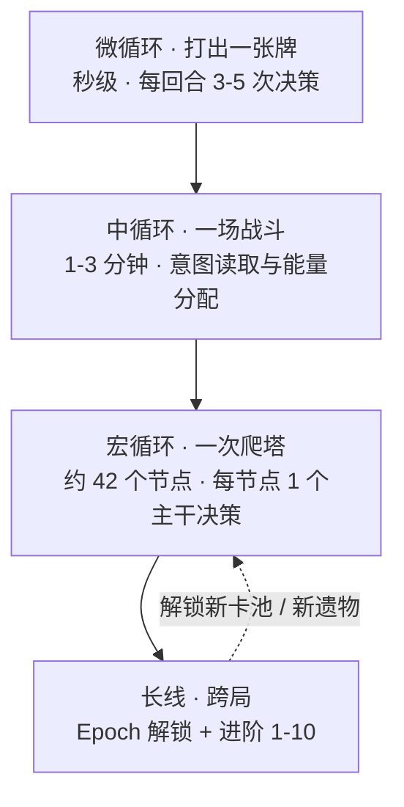
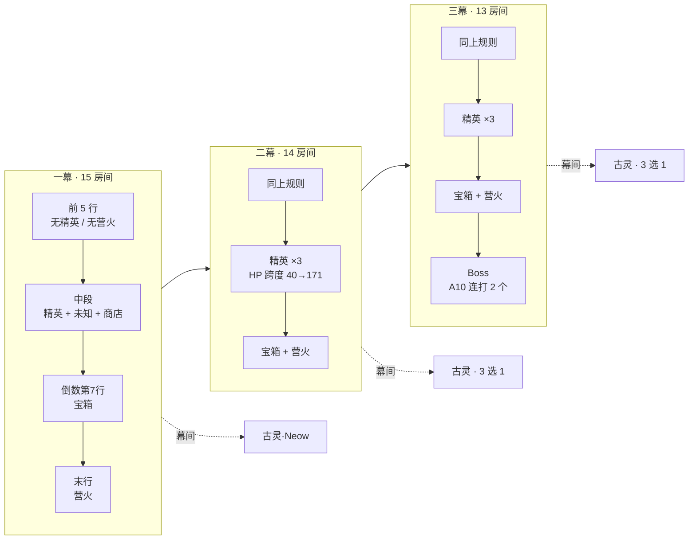
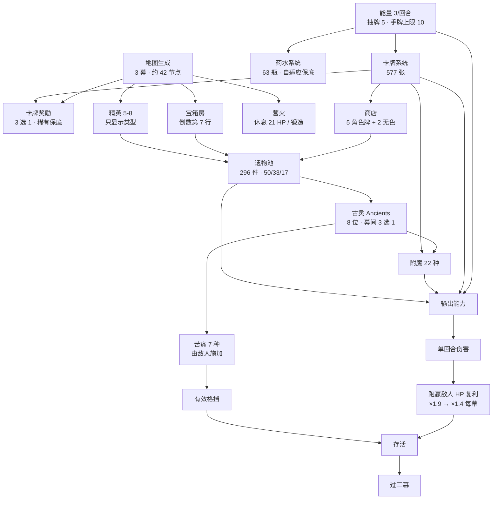
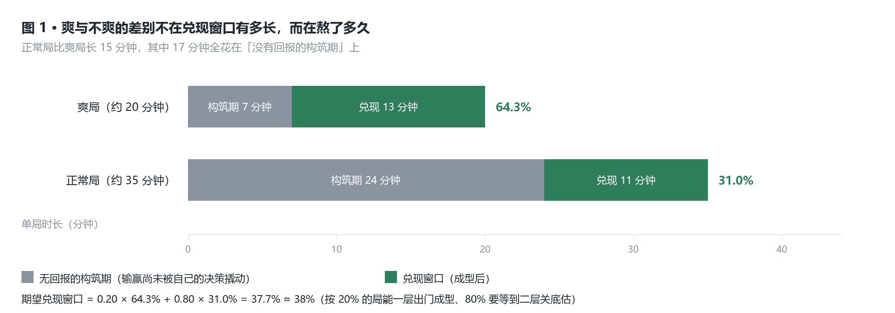
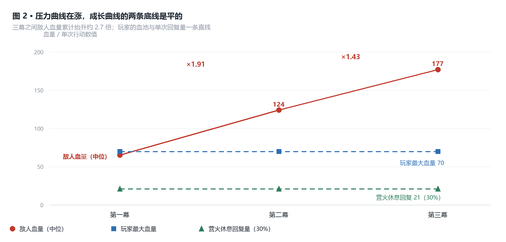
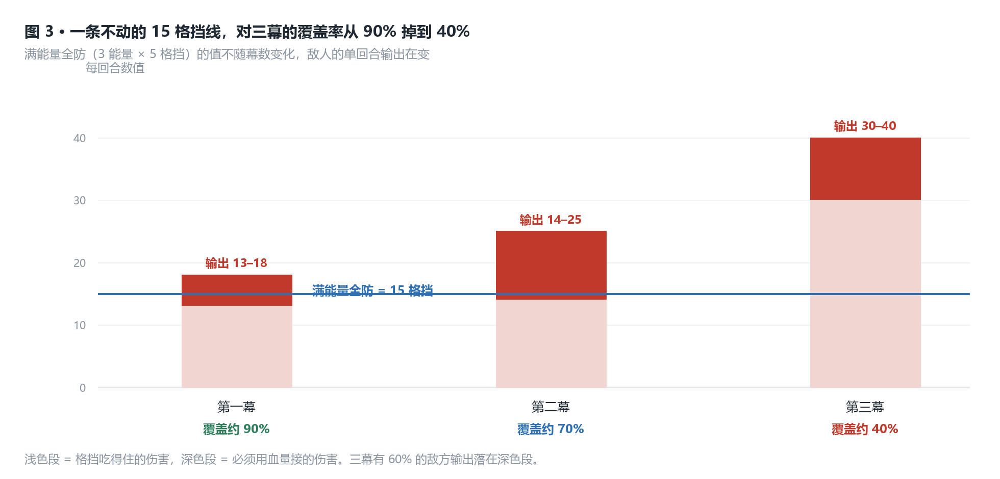
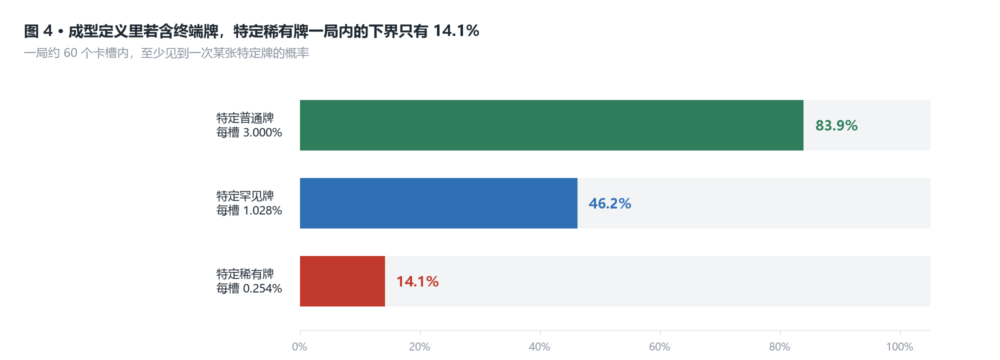
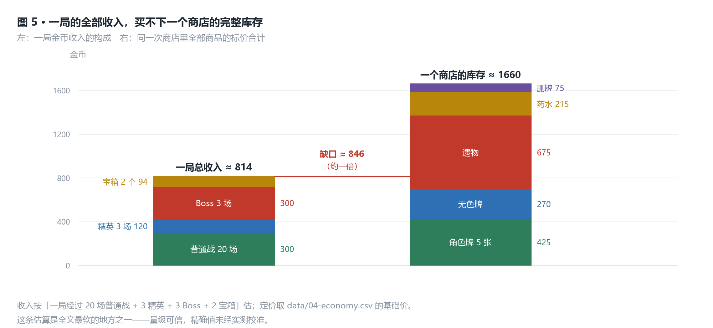
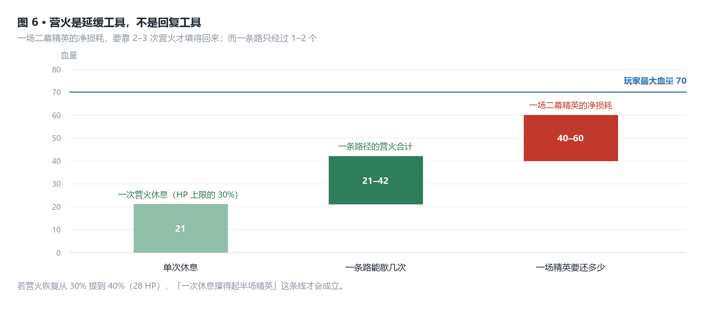

# 杀戮尖塔 2 拆解案

> 版本锚点：**v0.107.1（Major Update #2，2026-06-18）**
> 本文所有结论的有效期止于下一次大型更新。数值来源为反编译级公开数据库（Spire Codex，
> 由 Godot 4 / C# 客户端反编译得出），**与作者实测版本一致**。

## 产品卡片

| 项 | 值 |
|---|---|
| 名称 | Slay the Spire 2 / 杀戮尖塔 2 |
| 开发商 | Mega Crit |
| 平台 | Steam（Windows / macOS / Linux），Steam Deck 兼容 |
| 状态 | 抢先体验（Early Access），2026-03-05 上线 |
| **版本** | **v0.107.1 · Major Update #2（2026-06-18）** |
| 品类 | 卡牌 / 回合制 roguelike（deckbuilding roguelike） |
| 单局结构 | 3 幕 · 约 42 个可选节点 · 无第四幕 |
| 内容体量 | 577 张卡 · 296 件遗物 · 63 瓶药水 · 66 个事件 · 87 场战斗遭遇 · 5 名角色 |
| 难度阶梯 | 进阶 Ascension 1–10（累积式） |
| **样本量** | 玩家 200 小时 · 三职业进阶十 · 猎手十连胜 · 公开数据库为反编译级 |

---

## 核心发现索引

五条跨域判断。每条注明出自哪个域。

1. **玩家最爽的东西只占单局约 38% 的时长，而且恰好撞上最难的一段。**
   而"爽局"与"苦局"的差别几乎全在**煎熬期的长短**（7 分钟 vs 24 分钟），不在兑现期的长短
   （13 分钟 vs 11 分钟）。（域一 · 域三）

2. **这游戏为随机性建了 7 类保底，但保的是概率，不是结构。**
   结果：玩家的挫败感从"抽卡运气"迁移到了"路线运气"——而路线运气更难被察觉，
   会被误读成"我被这个怪克制了"。（域二 · 域三）

3. **精英节点只显示类型、不显示种类，逼玩家把门槛从"打得过某一个"提到"打得过全部"。**
   代价可算且会自我强化：少打精英 → 少拿遗物 → 构筑更慢 → 更不敢打精英。（域二 · 域四）

4. **玩家的"成型"定义里包含终端牌，而特定稀有牌一局内出现的下界只有 14.1%。**
   成型晚的根源不在玩家决策，在抽池概率。（域四 · 域一）

5. **玩家侧的生存资源逐幕零增长，压力侧却在复利上涨——所以营火不是回复节点，
   防守也不是可选解法。**血池 70、营火回复 21、满能量全防 15 格挡，三样都不随幕数变化；
   而敌人血量每幕涨 1.4–1.9 倍。结果：营火治不好一场精英（21 vs 40–60 HP，高手默认改成锻造），
   防守流对三幕输出的覆盖率从 90% 掉到 40%。**游戏用伤害数字把防守玩法逼成了竞速玩法，
   而这条漏斗没有任何规则宣告，只用数值表达。**（域三 · 域五）

---

## 域一 · 核心循环与节奏

### 事实

**四层循环结构**

| 层 | 单元 | 单次决策的对象 | 决策密度 |
|---|---|---|---|
| 微循环 micro | 打出一张牌 | 3 点能量怎么分配 | 每回合 3–5 次 |
| 中循环 meso | 一场战斗 | 攻/防的资源权衡 + 意图应对 | 每回合 1 次 |
| 宏循环 macro | 一次爬塔 | 选卡 / 选路 / 商店 / 营火 | **约 42 次** |
| 长线 meta | 跨局 | 玩哪个角色 / 爬哪一级进阶 | 每局 1 次 |



**结构常量**（公开 · Spire Codex · v0.107.1）

- 一局 **3 幕**：一幕 15 个房间 / 二幕 14 / 三幕 13，合计约 **42 个可选节点**，
  再加每幕 1 个古灵节点与 1 道 Boss 门
- 每回合抽 **5** 张，手牌上限 **10**，基础能量 **3**
- 地图为 7 列网格；**第一行必为战斗；最后一行必为营火；倒数第 7 行保证一个宝箱房；
  前 5 行不出精英，也不出营火**
- 营火共 9 个选项，核心两个是「**休息 = 回复最大 HP 的 30%**」与「**锻造 = 升级 1 张牌**」
- 精英 5 个（进阶 1 起为 8 个）；商店 3 个；未知节点 9–14 个

**成型时点**（实测 · n = 1 名玩家 · 200 小时 · 三职业进阶十）

玩家对「成型」的定义是三件齐备：**过渡牌 + 终端牌 + 启动能力不弱**。
时点自述：「**有时候一层出门就大概成型，大多数得二层关底。**」

### 拆解

**重心在宏循环，不在战斗。**

微循环与中循环占据操作时间，但分岔全在宏循环：每打出上百张牌，你只做约 42 个**不可逆**的
决定（拿哪张卡、走哪条路、在哪个营火停）。战斗输了就重来，宏循环**一次成型、无法回退**——
这正是它同时产生"构筑快感"与"路径焦虑"的原因。

**成型时点与单局时长的错配**（推断 · 算式如下）

把用户的时点自述折算成节点位置：

| 情形 | 成型发生的位置 | 剩余节点 | 占单局 |
|---|---|---|---|
| 一层出门成型 | 第 15 节点后 | 27 / 42 | 64.3% |
| 二层关底成型（**大多数**） | 第 29 节点后 | 13 / 42 | 31.0% |

按用户自述的「有时一层出门、**大多数**二层关底」，取 20% / 80% 加权：

```
期望成型后窗口 = 0.20 × 64.3% + 0.80 × 31.0%
               = 12.86% + 24.80%
               = 37.7%  ≈ 38%
```

**也就是说：约 62% 的单局时长里，玩家最爽的那个东西还没发生。**（图 1）

而这剩下的 38% 不但短，还**正好落在压力最大的区间**——三幕是 Glory，节点最少（13 个）、
敌人最强，且在进阶十还要**连打两个 Boss**。

这就把玩家的两条原始感受接到了一起：他说爽点是「成型后卡牌之间联动的快感」，
说不爽是「半路被卡死」。**这两个描述的是同一条曲线的两端**——
曲线的上升段占了 62% 的时长且没有回报，回报段只占 38% 且要连过两道关。

### 判断

> **本域判断**：这游戏的爽感结构是"长积累 + 短兑现"，且兑现窗口与难度峰值重合。
> 一代同为 3 幕、结构相近，但没有古灵与凋萎/附魔这层变量，构筑的分岔更少因而更早收敛——
> **StS2 用更高的构筑自由度，换来了更晚的成型时点**，代价落在同一处：**多数单局在兑现前就结束了**。
>
> **边界与证伪条件**：这条建立在 n = 1 的时点自述上。若实测成型时点显著早于二层关底，
> "62% 无回报"要整体下调。且成型时点是**主观判定**，乐观偏差只会把窗口算大——
> **38% 是上限估计，真实值更可能更低。**

**绝对刻度与"爽局更快"**（实测 · n = 1）

单局时长：**爽局约 20 分钟，正常局 30–40 分钟**（取 35 分钟）。

```
节点节奏     = 35 分钟 ÷ 42 节点        ≈ 50 秒 / 节点
不可逆决策   = 约每 50 秒 1 次（宏循环层）
兑现窗口时长 = 35 分钟 × 37.7%          ≈ 13 分钟
```

把两种局分开看，会出现一个反直觉的结果：

| | 正常局 | 爽局 |
|---|---|---|
| 总时长 | 35 分钟 | 20 分钟 |
| 成型时点（假设） | 二层关底（69% 节点） | 一层出门（36% 节点） |
| **兑现窗口** | 35 × 31.0% ≈ **11 分钟** | 20 × 64.3% ≈ **13 分钟** |
| **无回报的构筑期** | ≈ **24 分钟** | ≈ **7 分钟** |

> **换算成绝对时长之后，兑现窗口在两种局里几乎一样长（11 分钟 vs 13 分钟）。
> 真正差出来的是"没有回报的构筑期"——24 分钟 vs 7 分钟。**

也就是说：**"爽"和"不爽"的差别不在回报有多长，在煎熬有多长。**

（"爽局 = 早成型"是推断。但即便不成立，"35 vs 20 分钟"这个差本身也说明**局越顺、时间越短**
——两条路都指向同一结论：**时长的不确定性主要沉淀在构筑期。**）

### 本域待补

- 图 `images/01-成型窗口.png`（成长曲线 vs 压力曲线）待生成。

---

## 域二 · 内容结构与关卡

### 事实

**分幕结构**（公开 · Spire Codex · v0.107.1）

| 幕 | 地貌 | 房间数 | 楼层 | 弱怪战 | 精英 | Boss 数（随机 1） |
|---|---|---|---|---|---|---|
| 一幕 | Overgrowth / Underdocks（**二选一**） | 15 | 17 | 3 | 3 | 3 |
| 二幕 | Hive | 14 | 16 | 2 | 3 | 3 |
| 三幕 | Glory | 13 | 15 | 2 | 3 | 3 |

一局 **3 幕，没有第四幕**。终局是"建筑师"——9,999 HP、唯一招式名为 `NOTHING` 的**对话演出**，
不是战斗。"真胜利"在官方路线图上但无日期。

**地图生成硬约束**（公开 · 逐字）

1. 地图为 **7 列网格**
2. **第一行永远是战斗**
3. **倒数第 7 行保证一个宝箱房**
4. **最后一行永远是营火**
5. **前 5 行不出精英，也不出营火**
6. 房间配比：精英 **5**（进阶 1 起为 **8**）· 商店 **3** · 未知 **9–14** · 营火 **5–7**，其余为普通战斗



**保底清单**（把游戏里所有"防止倒霉"的机制列全）

| # | 类型 | 机制 | 保的是什么 |
|---|---|---|---|
| 1 | 位置 | 倒数第 7 行必出宝箱房 | 遗物产出 |
| 2 | 位置 | 最后一行必为营火 | 战前恢复 / 升级机会 |
| 3 | 结构 | 前 5 行不出精英 | 开局安全 |
| 4 | 节奏 | 弱怪战：一幕 3 场、二三幕 2 场 | 开局强度坡 |
| 5 | 品质 | Boss 战卡牌奖励 **100% Rare** | 品质下限 |
| 6 | 概率 | 稀有牌隐藏偏移（−5% 起、+1%/次、上限 +40%） | 长期稀有产出 |
| 7 | 概率 | 药水自适应（40% 起、±10%/次、无上限） | 长期药水产出 |

**★ 没有任何保底覆盖这些东西：**

- **精英的种类**（地图只显示"这是精英"，不显示是哪一种）
- **路径的结构可达性**（一条路上有没有营火、有没有商店）
- **第一幕是哪个地貌**（解锁后 50% 概率是你不熟的那张图）
- 地图的分支规则本身在公开数据库与官方处均为 **NOT FOUND**

### 拆解

**保底管"概率"，不管"结构"。**

上表 7 条保底里，5 条治的是**概率性伤害**（你会不会抽到好东西），2 条治**位置**。
**没有一条治"结构可达性"。** 先把保底的实际效力算出来——稀有牌保底：

```
偏移从 −5% 起，每次未出稀有则 +1%（基准 3%），出则重置
稀有概率 p_k = 3% + (k − 6)%，k 为连续未出次数
E[判定次数] = Σ_k Π_{j<k}(1 − p_j) ≈ 15.1 次
每次卡牌奖励有 3 个槽、共享同一偏移 → 每次奖励约推进 3 次
→ E[奖励数 / 稀有牌] ≈ 15.1 ÷ 3 ≈ 5.0

有效稀有率 ≈ 1 ÷ 15.1 ≈ 6.6%，是表面数字 3% 的 2.2 倍
```

**结论：保底是称职的。** 它把"连抽 20 次不出稀有"这种倒霉事压掉了，
把稀有牌从"3% 概率事件"变成了"**约每 5 次卡牌奖励必出一张**"。

**但它压的是抽卡运气，不是路线运气。** 你可以一整局都不抽到烂牌，同时被放进一条
没有营火、且必经一个克制你流派的精英的路上。

**精英的信息缺失 = 一份沉默的税** ★

- 二幕只有 **3 个精英**，血量跨度 **40 → 171（4.25 倍）**，而玩家**进门之前无法区分**
- 专家玩家的实际最优反应（实测）：「**一般绕，除非牌堆有明确克制所有精英的牌或者已经流派成型**」
- 注意"**所有**"：玩家的启发式不是"看情况决定打不打"，而是"**不能通吃就全绕**"
- 代价可直接算：少打一个精英 = 少 **35–45 金币 + 1 张卡 + 1 件遗物**（稀有度 Common 50% / Unc 33% / Rare 17%）
- 而遗物池共 **296 件**，是主要战力来源之一

### 判断

> **本域判断**：这游戏把随机性当核心资产经营——一次大型更新的招牌功能竟然是
> "**让随机真正随机**"（把多个 PRNG 的种子相关性用 xoshiro256\*\* 修掉）——
> 并且为此建了 7 类保底系统。**但它保的是概率，不保结构。**
>
> **结果是玩家的挫败感从"抽卡运气"迁移到了"路线运气"。** 而路线运气比抽卡运气更难被察觉：
> 抽卡脸黑你会骂系统，路线被堵你会以为是自己菜，或者——**你会以为是被那个怪克制了**（见域三）。
> 这是"设计意图与实际体验不一致"的典型现场。
>
> **它换来了什么**：极高的单局多样性（地图、精英顺序、Boss、第一幕地貌全都随机），
> 以及很低的"抽卡脸黑"抱怨率。**代价是结构性的不可控**，
> 而这份不可控在三幕叠加得最狠——节点最少（13 个）、敌人最强、兑现窗口最短（38%）、
> 且进阶十还要连打两个 Boss。
>
> **边界与证伪条件**：若二幕精英数从 3 增到 5–6，信息缺失的**期望伤害会被摊薄**
> （抽到克制你那一个的概率从 1/3 降到 1/5–1/6），本条力度下降。反过来说，
> **精英数越少、血量跨度越大，本条越成立**——v0.107.1 的二幕恰好是最坏组合。

## 域三 · 数值与经济

### 事实

**结算结构：加算与乘算分家**（公开 · Spire Codex）

| 类型 | 机制 | 缩放方式 |
|---|---|---|
| 力量 Strength / 敏捷 Dexterity | **加算**，每层 +1 攻击伤害 / +1 卡面格挡 | **线性，无上限** |
| 易伤 Vulnerable | **乘算 ×1.5 受到伤害** | **固定倍率，不随层数变化** |
| 虚弱 Weak | **乘算 ×0.75 造成伤害** | **固定倍率，不随层数变化** |
| 脆弱 Frail | **乘算 ×0.75 卡面格挡** | **固定倍率，不随层数变化** |

计算顺序（精确）：

```
攻击伤害 = (卡面伤害 + 力量) × 0.75^(虚弱) × 1.5^(易伤)
         → 被格挡吸收 → 余数进 HP
多段攻击的每一段各自完整走一遍上述流程
```

**成长曲线 vs 压力曲线**（图 2）

| | 一幕 | 二幕 | 三幕 | 逐幕倍率 |
|---|---|---|---|---|
| 普通怪 HP（中位） | ≈ 65 | ≈ 124 | ≈ 177 | **×1.91 → ×1.43** |
| Boss HP（中位） | ≈ 215 | ≈ 321 | ≈ 456 | ×1.49 → ×1.42 |
| **玩家 HP 池** | 70（猎手） | 70 | 70 | **×1.00（完全不涨）** |
| **营火恢复量** | 21 | 21 | 21 | **×1.00（完全不涨）** |

**经济产出**（公开 · v0.107.1）

| 来源 | 金币（A0–2） | A3+（贫困 ×0.75） |
|---|---|---|
| 普通战斗 | 10–20 | 7–15 |
| 精英战斗 | 35–45 | 26–33 |
| Boss 战斗 | 100 | 75 |
| 宝箱房 | 42–52 | 31–39 |

**一局总收入估算**（推断 · 模型见下）

```
假定一局路径经过：约 20 场普通战 + 3 场精英战 + 3 场 Boss + 2 个宝箱房
普通战  20 × 15（期望）  = 300
精英战   3 × 40          = 120
Boss 战  3 × 100         = 300
宝箱房   2 × 47          =  94
                         ─────
合计                     ≈ 814 金币（A0–2）  ≈ 610 金币（A3+）
```

**商店定价与一店库存价值**（公开 · v0.107.1）

| 品项 | 价格 |
|---|---|
| 角色卡 Common / Uncommon / Rare | 50 / 75 / 150（随机 1 张半价） |
| 无色卡（+15% 加价） | 55–60 / 82–91 / 163–182 |
| 遗物 Common / Shop / Uncommon / Rare | 175 / 200 / 225 / 275 |
| 药水 Common / Uncommon / Rare | 50 / 75 / 100 |
| **删牌（递增）** | **75 + 25n**（A6+ 为 **100 + 50n**） |

```
一个商店的完整库存价值（估算）：
5 张角色牌（期望 ~85）        ≈ 425
2 张无色（+15% 后 ~135）      ≈ 270
3 件遗物（期望 ~225）         ≈ 675
3 瓶药水（期望 ~72）          ≈ 215
1 次删牌                     =  75
                             ─────
一店库存                      ≈ 1660 金币
```

**难度修饰：进阶 1–10**（公开 · 累积生效，两两之间不可拆）

| 级 | 名称 | 效果 |
|---|---|---|
| 1 | 精英成群 | 地图精英 **5 → 8** |
| 2 | 疲惫旅人 | 古灵只回复缺失 HP 的 80% |
| 3 | 贫困 | 敌人与宝箱金币 **×0.75** |
| 4 | 紧腰带 | 药水槽 **3 → 2** |
| 5 | 登塔者之祸 | 开局带一张诅咒 |
| 6 | 通胀 | 删牌 100 起、每次 **+50** |
| 7 | 稀缺 | 稀有牌与升级牌更少见（稀有率约减半、保底更慢） |
| 8 | 强敌 | 敌人 HP 提升（**逐怪硬编码常量**，非全局乘数） |
| 9 | 致命之敌 | 敌人伤害提升（**逐怪硬编码常量**） |
| 10 | **双重 Boss** | 三幕末尾**连打两个 Boss** |

### 拆解

**为什么"乘算"必须锁成固定倍率。** 游戏把**成长**交给加算（力量、敏捷），把**减益**锁成固定倍率。
若易伤随层数缩放，它与力量的组合会乘法爆炸。**锁死之后，易伤/虚弱/脆弱的层数只控制
"持续多久"，不控制"有多强"**——力量是滚雪球（无上限线性），易伤是时间税（固定 1.5 倍）。

**压力曲线是复利的，回复曲线是恒定的。**

```
敌人 HP：逐幕 ×1.91 → ×1.43        （复利增长）
玩家 HP 池：70 → 70 → 70            （零增长）
营火恢复量：21 → 21 → 21            （零增长）
```

**敌人的血在三幕里涨了约 2.7 倍（1.91 × 1.43），而玩家的血池和回复量一动不动。**
唯一的出路是**输出增长**——每回合伤害必须以相近倍率上涨，否则就是慢性失血。

**把域一那条算式接上：**

```
一场二幕精英净损耗（估算） ≈ 40–60 HP
一次营火休息（猎手）       = 70 × 30% = 21 HP
→ 一场精英的损耗 ≈ 2–3 次营火
→ 而二幕地图上营火 6–7 个，一条路径只经过 1–2 个
```

**结论：营火治不好一场精英**（图 6），唯一作用是防猝死。这解释了实测到的老手行为——
营火**默认选锻造**，只有「血量特别少」或「想用血量换精英遗物」时才休息。

**金币是稀缺的，商店是菜单不是货架。**

```
一局总收入（A0–2） ≈ 814 金币
一个商店的完整库存 ≈ 1660 金币
→ 你买得起大约半个商店
```

**金币的设计意图不是"清空商店"，是"在十几件东西里挑 2–3 件"。**

### 判断

> **本域判断**：这套数值的骨架是"**压力复利、资源恒定**"——敌人 HP 每幕涨 1.4–1.9 倍，
> 而玩家的血池（70）和营火恢复（21）一动不动。**玩家被强制进入一场必须一直加速的赛跑。**
>
> 结构本身没问题，正是 roguelike 的张力。**问题在它和域一那条曲线叠加**：成型在二层关底，
> 而三幕恰是压力最陡的一段（进阶十还要连打两个 Boss）——**输出终于起来了，关卡也最难了。**
>
> **一个佐证**：玩家把棱柱的失败归因为"被克制"，但棱柱的真实机制是**伤害坡**
> （`Vital Spark`，越打越疼）——**它惩罚的正是"输出坡比它慢"的构筑**，与本域同构。
> **玩家感到的"被克制"，在数值上其实是"加速率不够"。**
>
> **外部对标**：一代同为 3 幕、70 HP、营火 30%。StS2 多出**古灵**（8 位）
> 与**附魔**（22 种）两层成长来源，它们拉高上限不拉低下限——复利未变缓，方差更大。
>
> **边界与证伪条件**：本条部分建立在"一局总收入 ≈ 814 金币"这个**估算模型**上
> （假定 20 普通战 + 3 精英 + 3 Boss + 2 宝箱）。量级可容错，精确值没有。
> 反过来说：**若把营火恢复从 30% 提到 40%（28 HP），本域的核心矛盾会被显著缓解。**

## 域四 · 系统与内容池

### 事实

**内容池总量**（公开 · Spire Codex · v0.107.1）

| 池 | 总数 | 细分 |
|---|---|---|
| 卡牌 | **577** | Common 100 · Uncommon 219 · Rare 155 · Ancient 18 · Curse 18 · Basic 19 · Event 19 · Status 16 · Token 10 · Quest 3 |
| 遗物 | **296** | Ancient 100 · Rare 50 · Uncommon 40 · Event 35 · Common 30 · Shop 30 · Starter 10 · 其他 1 |
| 药水 | **63** | Common 20 · Uncommon 20 · Rare 20 · Event 2 · Token 1 |
| 事件 | **66** | Event 39 · Shared 18 · Ancient 9；**其中 56 个有多页决策树** |
| 战斗遭遇 | **87** | Boss 12 · Elite 12 · Monster 63 |

**卡池按角色**（每个角色色 88 张）

| 颜色 | 合计 | Common | Uncommon | Rare | Basic | Ancient |
|---|---|---|---|---|---|---|
| 铁甲战士 | 87 | 20 | 36 | 26 | 3 | 2 |
| 静默猎手 | 88 | 20 | 36 | 26 | 4 | 2 |
| 其余三角色 | 各 88 | 20 | 36 | 26 | 4 | 2 |
| 无色 | 64 | **0** | 39 | 25 | 0 | 0 |

→ **可抽池（战斗奖励）每个角色色 = 20 + 36 + 26 = 82 张。** 无色牌**没有 Common 稀有度**。

**奖励稀有度权重与保底**

| 来源 | Common | Uncommon | Rare |
|---|---|---|---|
| 普通战 | 60% | 37% | 3% |
| 精英战 | 50% | 40% | 10% |
| 商店 | 54% | 37% | 9% |
| Boss | — | — | **100%** |

稀有牌保底：偏移 **−5%** 起、每次未出 **+1%**（A7+ 为 +0.5%）、上限 **+40%**、出则重置；
**每次奖励 3 个槽共享同一偏移**，且**跳过奖励仍然推进计数器 3 次**。
→ 有效稀有率约 **6.6%**（算式见域二）。

遗物稀有度权重（精英奖励 / 宝箱房）：**Common 50% / Uncommon 33% / Rare 17%**。
**Boss 战不掉遗物**——它的对应物是古灵节点。

**元进度**

- 解锁内容：**卡牌 60 · 遗物 45 · 药水 21 · 角色 4**，按**累计分数阈值**或「揭示 Epoch」解锁
- 角色解锁是**严格顺序链**：铁甲战士 → 静默猎手 → 储君 → 死灵缚者 → 故障机器人
- 进阶 1–10 累积解锁（见域三）
- **v0.103.2 起，每日模式与自定义模式不能解锁成就与 Epoch**

### 拆解

**逐系统走：古灵 Ancients**（本代取代「Boss 遗物」的新系统）

| 环节 | 内容 |
|---|---|
| 目标 | 把幕间决策从"三选一的遗物"升级为一次带取舍的战略选择 |
| 规则 | 幕间遭遇，共 8 位古灵；按选择规则从池中取**约 3 个祝福**，选 1 |
| 输入 | **免费**（事件前回满血；A2+ 只回缺失的 80%） |
| 输出 | 一件 Ancient 稀有度遗物（池共 100 件） |
| 反馈 | **三个选项全部可见**——完全信息 |
| 失败惩罚 | **无**。选差了只是错过，没有代价 |
| 边界漏洞 | 部分古灵带诅咒池（如 Neow 的诅咒池），"免费"实际是"用诅咒换强度" |

**★ 同一个游戏里，两种完全相反的选择设计。**

| | 古灵节点 | 精英节点 |
|---|---|---|
| 信息 | **三个选项全部可见** | **只显示"这是精英"，不显示是哪一种** |
| 可选性 | 必经（幕间） | 可绕（但有成本） |
| 失败惩罚 | 无 | 死亡风险 |

**这一对照本身就是证据**：设计者显然知道"完全信息的选择"长什么样，
并且在古灵上做到了。**精英上的零信息因此不是能力问题，是选择。**

**路径期望：稀有牌作为构筑终端，一局内自然得到的概率**（推断 · 算式 · 图 4）

一局约 **20 次卡牌奖励 × 3 个槽 = 60 个卡槽**。
某张**特定**卡在某一槽出现的概率 = 该稀有度的实际概率 ÷ 该稀有度的池大小：

```
特定稀有牌   = 6.6%（含保底的有效值） ÷ 26  = 0.254%/槽
特定罕见牌   = 37%              ÷ 36  = 1.028%/槽
特定普通牌   = 60%              ÷ 20  = 3.000%/槽

一局 60 槽内至少见到一次：P = 1 − (1 − p)^60

特定普通牌：1 − 0.97^60        = 83.9%
特定罕见牌：1 − (1−0.01028)^60 = 46.2%
特定稀有牌：1 − (1−0.00254)^60 = 14.1%
```

**读法：如果你构筑的"终端牌"是一张特定的稀有牌，那么 86% 的单局里你自然抽不到它。**
把容错放宽到"3 张可互换的稀有终端"：

```
P(至少见到 3 张中的 1 张) = 1 − (1 − 3 × 0.00254)^60 ≈ 36.9%
```

**即便如此，仍有约 63% 的单局见不到任何一张你期待的稀有终端。**

**池的覆盖率**（推断）：遗物 296 件、一局约得 8–12 件 → 覆盖 **≈ 3–4%**；
事件 66 个、一局约遇 6 个 → **≈ 9%**。

### 判断

> **本域判断**：这游戏用**极深的内容池**换来了低重复率，代价是**构筑的关键件变得不可得**。
> 一个角色只有 82 张可抽牌，其中 26 张稀有，有效稀有率仅 6.6%——
> **一局里自然见到某张特定稀有牌的概率只有 14.1%。**
>
> 这直接解释了域一那条"成型在二层关底"：用户的"成型"定义包含**终端牌**，而终端极可能是稀有牌。
> **他不是磨蹭到二层关底才成型，是等到二层关底才凑齐。根源不在玩家决策，在抽池概率。**
>
> **它换来了什么**：高单局多样性、低重复感（遗物覆盖率仅 3–4%）。**代价是构筑的不可控**——
> 玩家的应对只能是**准备 2–3 套备选终端**，这正是老手与新手的真实差距：
> 不是打得更好，是**备选方案更多**。
>
> **外部对标**：一代同为 3 幕、可抽池规模相近、同样"稀有牌稀有"。StS2 的增量是**古灵**
> 与**附魔**，它们让"可接受的备选"变多，但没有改变"特定关键件难抽"。
> **取舍点：一代靠"牌少所以每张都认得"，StS2 靠"系统多所以每条路都走得通"。**
>
> **边界与证伪条件**：14.1% 建立在"稀有度内均匀抽取"的假设上，且**未计入商店、事件、
> 无色牌与附魔**这几条额外渠道——它们会**显著抬高**实际可得性，所以 14.1% 应读作**下界**。
> 坐实它需要实测：记录每次"我需要的那张牌在第几次奖励/第几个商店才出现"。

## 域五 · 玩法机制

### 事实

**能量经济基线**（公开 · v0.107.1）

| 项 | 值 |
|---|---|
| 每回合基础能量 | **3** |
| 每回合抽牌 | **5** |
| 手牌上限 | **10** |
| 格挡清空时点 | 你**下个回合开始时** |
| 起始牌组 | 猎手 12 张（5 打击 / 5 防御 / 中和 / 生存） |

**卡池费用分布**（公开 · 全 577 张统计）

| 颜色 | 0 费 | 1 费 | 2 费 | 3 费 | 4 费以上 | X 费 |
|---|---|---|---|---|---|---|
| 铁甲战士 | 11 | 48 | 19 | 7 | 0 | 2 |
| 静默猎手 | 16 | 43 | 17 | 10 | 0 | 2 |
| 故障机器人 | 15 | 49 | 15 | 6 | 1 | 2 |
| 死灵缚者 | 9 | 54 | 14 | 7 | 2 | 2 |
| 储君 | 20 | 49 | 14 | 3 | 1 | 1 |
| 无色 | 20 | 28 | 9 | 6 | 0 | 1 |

→ **1 费占 ~50–60%，2 费 ~16%，3 费 ~7–11%，4 费以上几乎不存在。**
**牌池是被"3 能量"这个整数约束塑形的。**

**表 9 · 单次行动收益（基础牌的费效比）**

| 卡 | 费用 | 效果 | 费效比 | 升级后 | 升级增益 |
|---|---|---|---|---|---|
| 打击 Strike | 1 | 6 伤害 | 6.0 伤害/费 | 9 | **+50%** |
| 防御 Defend | 1 | 5 格挡 | 5.0 格挡/费 | 8 | **+60%** |

（升级规则无统一公式，逐卡定义：全 577 张里 **155 张升伤害、68 张升格挡**、
**57 张改费用且 56 张恰好 −1**、27 张加关键词、22 张去关键词。）

**★ 防护阈值（本域的核心算式 · 图 3）**

```
满能量全防 = 3 能量 × 5 格挡（防御牌） = 15 格挡/回合
```

| 幕 | 敌人典型单回合输出 | 15 格挡的覆盖率 |
|---|---|---|
| 一幕 | 13–18 | **≈ 90%**（挡得住） |
| 二幕 | 14–25 | **≈ 70%**（卡在线上） |
| 三幕 | 30–40 | **≈ 40%**（挡不住） |

**信息层与行为**（公开）

- **敌人意图完全可见**：14 种意图类型——Aggressive（攻击 X 伤害 ×N）· Empower（增益）·
  **Malicious（往你手牌塞苦痛牌）** · Death Blow · Strategic（负面状态 / 塞状态牌）·
  Defensive · Cowardly（逃跑）· Heal · Sleeping · Stunned · Summon · Unknown
- 但**敌人的招式循环顺序不显示**，只能靠记忆
- **抽牌是随机的**，且你不能在回合中重抽（除非有对应卡）

### 拆解

**"全防"是一条会自己失效的防线。**

三个数字放在一起，机制就清楚了：

```
3 能量 = 3 张防御牌 = 15 格挡
一幕敌人打 13–18  → 全防是可行的
二幕敌人打 14–25  → 全防刚好卡在线上
三幕敌人打 30–40  → 全防只覆盖约 40%
```

**从三幕开始，"把能量都用来防守"在数学上不再可行。** 你必须把能量分给输出，
赌在对方打死你之前打死它。**游戏用数值把一个回合制防守游戏逼成了竞速游戏**——
这一转变没有用任何规则宣告，只由敌人伤害数字悄悄完成。

**域三那条"压力复利"在这里落地了：** 敌人 HP 逐幕 ×1.9 → ×1.4，敌人伤害同步上涨，
而你的格挡值（防御牌 5）和能量（3）**一动不动**。玩家的应对只有三条路：
升级防御牌（5→8，+60%）、堆敏捷（每层 +1）、或者**根本不防，去打输出**。

**信息是透明的，但你的选择集不是。**

| 层 | 是否透明 |
|---|---|
| 敌人意图 | **完全透明**（明确标出伤害值与段数） |
| 敌人招式循环 | 不透明（需记忆） |
| 你的手牌 | **随机**，且回合内不可重抽 |
| 你的能量分配 | 完全可控（3 点） |

**所以每个回合的真实结构是：你看到一个完全透明的威胁，然后在一手随机牌里找答案。**

举例：一副 25 张、含 6 张防御牌的牌组，抽 5 张时至少摸到一张防御的概率：

```
P(一张都没有) = C(19,5) / C(25,5) = 11628 / 53130 = 21.9%
→ 约 22% 的回合你摸不到任何一张防御牌
```

**"我知道要来什么"和"我手里有答案"是两件事。** 这就是本作每一回合的张力来源。

### 判断

> **本域判断**：这套机制的核心不是"资源分配"，是"**在不可控的选择集里做分配**"。
> 能量是可控的（3 点），意图是透明的（明确标数值），但**手牌是随机的**——
> 三者组合出来的不是"策略游戏"，是"**带完全情报的应急处理**"。
>
> **它被设计成一条会自动收紧的漏斗**：一幕允许你玩防守（15 格挡够用），
> 二幕开始收窄，三幕强制你转攻。**这条漏斗没有用规则宣告，只用伤害数字表达**——
> 所以新手会在三幕突然"感觉打不动了"，却指不出是哪条规则变了。
>
> **外部对标**：一代的防御牌同为 5 格挡、能量同为 3、意图同为透明。StS2 的差别在
> **苦痛（Affliction）系统**——14 种敌人意图里有一类 `Malicious` 专门往你手牌塞负面修正
> （如"只能打 1 张牌"、"多加 1 费"）。**一代只攻击你的资源，二代开始攻击你的选择集本身**，
> 让"手牌是随机的"雪上加霜。
>
> **边界与证伪条件**：15 格挡这条线用的是**基础防御牌**，忽略了 relics、敏捷、
> 虚弱（×0.75）与更好的格挡卡——实际可达格挡远高于 15。
> 所以这条判断的正确读法是：**"基础牌的防护能力在三幕失效"**，
> 而不是"三幕挡不住"。**若玩家在三幕仍能靠基础牌全防过关，则本条不成立。**
> 但反过来，**棱柱的伤害坡（`Vital Spark`）恰好是这个判断的实证**：
> 它惩罚的正是"输出坡不够快"的构筑——而"必须加速"这件事，本域已经从数值上推出来了。

## 域六 · 反馈与表现

**本域折叠。** 本域需要截图支撑（一次交互的反馈层级、信息层级、手感与可读性、教学与引导），
作者不提供截图，因此**本域无实测支撑**，不写任何结论。这是六个域里唯一被允许整域折叠的一个。

---

## 它付出的代价

把六域的判断收拢，这款游戏用同一种货币支付了四次：

**① 用"深池"换"关键件不可得"。**
577 张卡、296 件遗物、66 个事件，换来极低的单局重复率（遗物覆盖率仅 3–4%）。
代价是**构筑的终端变得难抽**——特定稀有牌一局内出现的下界 14.1%。
玩家的应对只能是准备 2–3 套备选终端，**这才是老手与新手真正的差距**。

**② 用"完全随机的地图"换"结构不可控"。**
保底系统治好了抽卡运气，但没有任何一条保底保证"你的路上有营火"或
"你不会被堵在一个克制你的精英前面"。**不可控从概率层转移到了结构层。**

**③ 用"更高的构筑上限"换"更晚的成型时点"。**
古灵（8 位）与附魔（22 种）拉高了玩家能到达的上限，但没有拉低下限。
结果：**成型在二层关底，兑现窗口只占单局 38%，而且它恰好压在压力曲线最陡的三幕上。**

**④ 用"透明的意图"换"不可控的手牌"。**
敌人意图完全透明，但手牌随机、回合内不可重抽——约 **22%** 的回合你摸不到任何一张防御牌。
这份张力是每回合的乐趣来源，也是"我知道要死但没牌"这种无力感的来源。

**最尖锐的一处**：玩家把"我血不够"归因成"我被克制了"。
机制支持后者的证据不足——棱柱没有 Artifact、没有清毒，**它只是一个伤害坡**。
玩家的体感是真实的，但**归因错了**。**一个让人把资源管理失误读成敌人设计问题的游戏，
在沟通上有代价：玩家会要求削弱一个其实不需要削弱的敌人。**

---

## 如果我来迭代

四条，每条都落到具体数值或规则，并写明代价。

**1. 精英节点显示种类（或至少给一次预警）**

把精英节点从"只显示类型"改为"显示是哪一种精英"。若想保留悬念，退一步：
在**进入精英前一个节点**给出提示。

- **能解决什么**：域二那条"通吃才打"的自我强化循环会立刻松开，玩家的绕行决策从赌博变回规划。
- **代价**：老手会 100% 避开克制自己的那一个，**精英遭遇的平均难度会下降约一档**，
  且"盲进精英"的紧张感消失。补偿方式：同时提高精英的奖励诱惑力（如精英遗物必为 Uncommon 以上），
  把风险从"信息不对称"换回"收益权衡"。

**2. 营火恢复从 30% 提到 40%**

猎手 21 HP → **28 HP**。

- **能解决什么**：28 已经接近一场二幕精英净损耗（40–60）的下沿，"休息"从保命按钮变回可选策略，
  域三那条"营火治不好精英"的矛盾被显著缓解。
- **代价**：**整体难度会下降**，尤其对已经会管理资源的老手。需要通过抬高三幕压力来抵消，
  否则会削弱"损耗不可逆"这个核心张力。

**3. 补一条"结构性保底"：保证存在一条路上有 ≥2 个营火**

地图生成时增加约束——从起点到 Boss 至少存在一条路径，其上营火数 ≥ 2。

- **能解决什么**：这是唯一能治"路线运气"的办法。域二那 7 类保底全是概率保底，
  这一条补的是结构保底。
- **代价**：地图生成需要做路径可达性检查，**实现成本高于概率保底**；
  且会减少地图多样性（约束越强，生成出的图越像）。

**4. 把稀有牌一局可得性从 14% 提到约 25%**

先排掉一个反直觉的假杠杆：**"+40% 上限"是死条款。** 把 60 个卡槽的抽取过程跑一遍，
保底计数器在达到上限之前就已经走完了——把上限改成 +60%、+200% 还是取消，
**结果一个像素都不动**（算式见附录 D 推断 9）。**所以"提高保底上限"不是选项。**

真正的杠杆是保底的**起点与斜率**：

```
起点偏移   −5% → 0%，每次未出的补偿  +1% → +2%（上限保持 +40% 不动）
E[抽取次数]      15.21 → 8.10
有效稀有率        6.57% → 12.34%
一局可得性        14.1% → 24.8%
```

- **能解决什么**：域四那条"终端件不可得"的压力减半，成型时点会往前挪，
  域一那个 38% 的兑现窗口会变大。
- **代价**：**稀有感会被稀释**——稀有牌从"每约 5 次奖励见一张"变成"每约 2.7 次奖励见一张"，
  构筑同质化会加剧。**这条与第 2 条（营火加强）叠加会显著削弱游戏，两者不应同时做。**

**一个不该做的**：不要为了"让精英不那么痛"而直接削弱棱柱这类带伤害坡的敌人。
它的问题不在数值强度，在**玩家无法预知自己会遇上它**。**要改的是信息，不是数字。**

---

## 附录

<details>
<summary><b>A · 系统依赖图</b></summary>



**读法**：三条成长管道（卡牌 / 遗物 / 附魔）汇进同一条"输出能力"，
而生存端只有"有效格挡"一条。**域五那条"15 格挡"的阈值就卡在 `HP` 这个节点上。**

</details>

<details>
<summary><b>B · 数值细节与交付物表</b></summary>

由 `data/*.csv` 生成（GitHub 会自动渲染为表格）。

| # | 表 | 文件 | 状态 |
|---|---|---|---|
| 1 | 时间轴与结构配比 | [`data/01-timeline.csv`](data/01-timeline.csv) | ✅ |
| 2 | 敌人数值表（HP · 输出 · 招式） | [`data/02-enemies.csv`](data/02-enemies.csv) | ✅ |
| 3 | 成长曲线 vs 压力曲线 | — | 见域三正文表 |
| 4 | 资源产出、换算与定价 | [`data/04-economy.csv`](data/04-economy.csv) | ✅ |
| 5 | 难度修饰表 | [`data/05-difficulty.csv`](data/05-difficulty.csv) | ✅ |
| 6 | 内容池结构 | [`data/06-pools.csv`](data/06-pools.csv) | ✅ |
| 7 | 经济收支（来源 × 去向） | — | 见域三正文 |
| 8 | 路径期望 | — | 算式见域四正文 |
| 9 | 单次行动收益表 | [`data/09-action-value.csv`](data/09-action-value.csv) | ✅ |
| 10 | 行为时序与信息表 | — | 见域五正文 |

**合格标准自检**：把表里两列一除能算出判断里的数——
表 2 的 HP 与招式伤害 → 域五的 15 格挡覆盖率；
表 4 的定价与时长的产出模型 → 域三的"买得起半个商店"；
表 6 的池大小与稀有度权重 → 域四的 14.1%。

</details>

<details>
<summary><b>C · 曲线与图</b></summary>

**正文内嵌图（mermaid）**

- 域一 · 四层循环结构图（微 / 中 / 宏 / 长线）
- 域二 · 三幕结构与保底节点位置图
- 附录 A · 系统依赖图

**独立图表**（`images/`，由 `tools/make-figures.py` 从 `data/*.csv` 与正文算式渲染）

**图 1 · 单局时长在「无回报的构筑期」与「兑现窗口」之间怎么切**（域一）



爽局与正常局的兑现窗口只差 2 分钟（13 vs 11），但煎熬期差了 17 分钟（7 vs 24）。
**玩家抱怨的不是"爽得太少"，是"等得太久"。期望兑现窗口 37.7%，所以约 62% 的时长里没有回报。**

---

**图 2 · 压力曲线在涨，成长曲线的两条底线是平的**（域三）



敌人血量三幕累计 ×2.7（×1.91 → ×1.43），而玩家血池（70）和营火回复（21）逐幕零增长。
**唯一的出路是输出增长——每回合伤害必须以相近倍率上涨，否则就是慢性失血。**

---

**图 3 · 15 格挡这条不动的线，对三幕的覆盖率从 90% 掉到 40%**（域五）



满能量全防 = 3 能量 × 5 格挡 = 15。三幕有 60% 的敌方输出落在"必须用血量接"的深色段。
**防守流不是被削弱的，是被数值增长速度甩下的。**

---

**图 4 · 特定牌在一局 60 个卡槽内至少出现一次的概率**（域四）



按"成型定义含终端牌"来读，**86% 的单局自然见不到那张特定的稀有终端**；
即便把容错放宽到 3 张可互换的稀有终端，仍有约 63% 的单局一张都见不到。

---

**图 5 · 一局收入 vs 一个商店的完整库存**（域三）



814 与 1660 都建立在"一局经过 20 场普通战 + 3 精英 + 3 Boss + 2 宝箱"这个**未经实测校准的估算模型**上；
量级可信，精确值不可信。

---

**图 6 · 营火是延缓工具，不是回复工具**（域三）



一场二幕精英的净损耗要靠 2–3 次营火才填得回来，而一条路径只经过 1–2 个营火。
**恢复量撑不起消耗量，营火的真实功能是防猝死，而它还要和锻造争夺同一个节点。**

</details>

<details>
<summary><b>D · 数据来源与可信度</b></summary>

### 实测（作者本人游玩 + 访谈）

样本：**1 名玩家 · 200 小时 · 三职业进阶十 · 静默猎手十连胜**。

| 数据 | 样本量 | 用在哪 |
|---|---|---|
| 单局时长（爽局 20 分钟 / 正常 30–40 分钟） | n=1，自述 | 域一 |
| 成型时点（大多数二层关底） | n=1，自述 | 域一 · 域四 |
| 「成型 = 过渡牌 + 终端牌 + 启动能力不弱」 | n=1，定义 | 域一 · 域四 |
| 「一般绕，除非能克制所有精英或已成型」 | n=1，策略自述 | 域二 |
| 营火默认锻造 | n=1，策略自述 | 域三 |
| 二幕精英死于 40 HP（进门前） | **n=1 单例** | 域三 |
| 棱柱有伤害坡（技能牌扛不住） | **n=1 单例** | 域三 · 域五 |
| Aeonglass 带 Artifact 3 | n=1，实测观察 | 版本核对 |

> ⚠️ **本表的诚实说明**：所有玩家侧数据 n=1，属**单例观察**而非统计规律。
> 按本 skill 的标准，统计规律类结论需要 n≥20、节奏类需要 5 局起步——
> **本文没有达到这个标准**，因此**所有玩家侧数据只用于生成假设与解释机制，不用于下结论**。
> 正文中所有数值结论均来自公开数据库，玩家数据只提供"问题"和"验证方向"。

### 公开

**Spire Codex（spire-codex.com）** —— 反编译 Godot 4 / C# .NET 8 客户端（约 3,300 个文件）
得出的数据库，有机器可读 API。**本文所有客观数值来自此处。**

- **可信度上调的依据**：本文的版本锚点 v0.107.1 经**作者实测确认**，
  且一处曾与社区说法冲突的数值（Aeonglass 的 Artifact 3）**由用户实测判定数据库正确**。
- **官方补丁说明**（经 Spire Codex 逐字镜像）：
  Major Update #2 / v0.107.1 与 Major Update #1 / v0.103.2
- **未采用媒体数值**：IGN / Eurogamer / PC Gamer 等媒体来源**未用于任何数字**，
  仅用于确认定性事实。

### 推断（全部给算式）

| # | 推断 | 算式 | 建立在它之上的结论 |
|---|---|---|---|
| 1 | 成型后窗口 ≈ **37.7%** | `0.2×64.3% + 0.8×31.0%` | 核心发现 1 |
| 2 | 稀有牌有效产出 ≈ **6.6%**（每约 5 次奖励一张） | `E[判定] ≈ Σ Π(1−p_j) ≈ 15.1`，÷3 槽 | 域二判断 · 域四算式 |
| 3 | 一局总收入 ≈ **814 金币** | `20×15 + 3×40 + 3×100 + 2×47` | 域三"半个商店" |
| 4 | 一店库存 ≈ **1660 金币** | `425+270+675+215+75` | 域三"半个商店" |
| 5 | 二幕精英净损耗 **40–60 HP** | `15–18 输出 × 6–8 回合 × 格挡折减` | 域三营火判断 · 迭代建议 2 |
| 6 | 特定稀有牌一局可得 **14.1%**（下界） | `1 − (1 − 0.066/26)^60` | 核心发现 4 · 迭代建议 4 |
| 7 | 约 **22%** 的回合摸不到防御牌 | `C(19,5)/C(25,5) = 21.9%` | 域五判断 |
| 8 | 敌人 HP 逐幕 **×1.91 → ×1.43** | 各幕普通怪 HP 中位数之比 | 域三判断 · 域五判断 |
| 9 | 稀有保底上限 **+40% 永不生效（死条款）** | 精确递推 `E[抽取] = Σ_k Π_{j<k}(1−p_j)`；把上限设为 +40% / +60% / +200% / 取消，E 恒为 **15.21** | 迭代建议 4 |

> **推断的脆弱点**：3、4、5 依赖"一局路径经过 20 场普通战 + 3 精英 + 3 Boss + 2 宝箱"这个模型。
> 该模型是按地图配比估的，**未经实测校准**。若要坐实，需要一局的完整节点账本（本 skill 原定的
> T3 任务），而作者未能提供。**这三条是全文最软的地方，请按量级而非精确值阅读。**

</details>

<details>
<summary><b>E · 术语表</b></summary>

| 中文 | 英文 | 说明 |
|---|---|---|
| 核心循环 | core loop | 本文的"四层循环"指微/中/宏/长线四层 |
| 元进度 | meta progression | 跨局继承的解锁，本作载体是 Epoch/时间线 |
| 构筑 | build | 一局内围绕某个终端牌成型的牌组方案 |
| 有效生命 | EHP (effective HP) | 计入格挡与减伤后的实际承伤能力 |
| 能量费效比 | damage / block per energy | 每点能量换取的伤害或格挡 |
| 资源产出与消耗 | faucet / sink | 金币的产出来源与消耗去向 |
| 保底 | pity | 概率补偿机制；本作用于稀有牌与药水 |
| 绕行成本 | detour cost | 避开某个节点所付出的额外路程与机会成本 |
| 难度曲线 | difficulty curve | 敌人 HP/伤害逐幕的增长，本文测得 ×1.9 → ×1.4 |
| 古灵 | Ancient | 本代新增，幕间三选一的强力祝福，取代一代的 Boss 遗物 |
| 附魔 | Enchantment | 本代新增，永久附加在单张牌上的修正（22 种） |
| 苦痛 | Affliction | 本代新增，敌人施加的临时负面牌修正（7 种） |
| 凋萎 | Wither | Aeonglass 专属，塞进手牌、不可打出、回合结束扣血 |
| 伤害坡 | damage ramp | 敌人单回合输出逐回合上升的机制，如棱柱的 Vital Spark |

</details>
