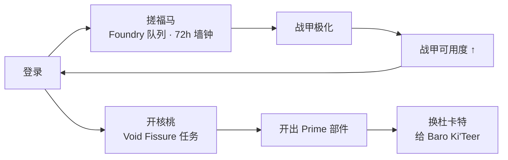
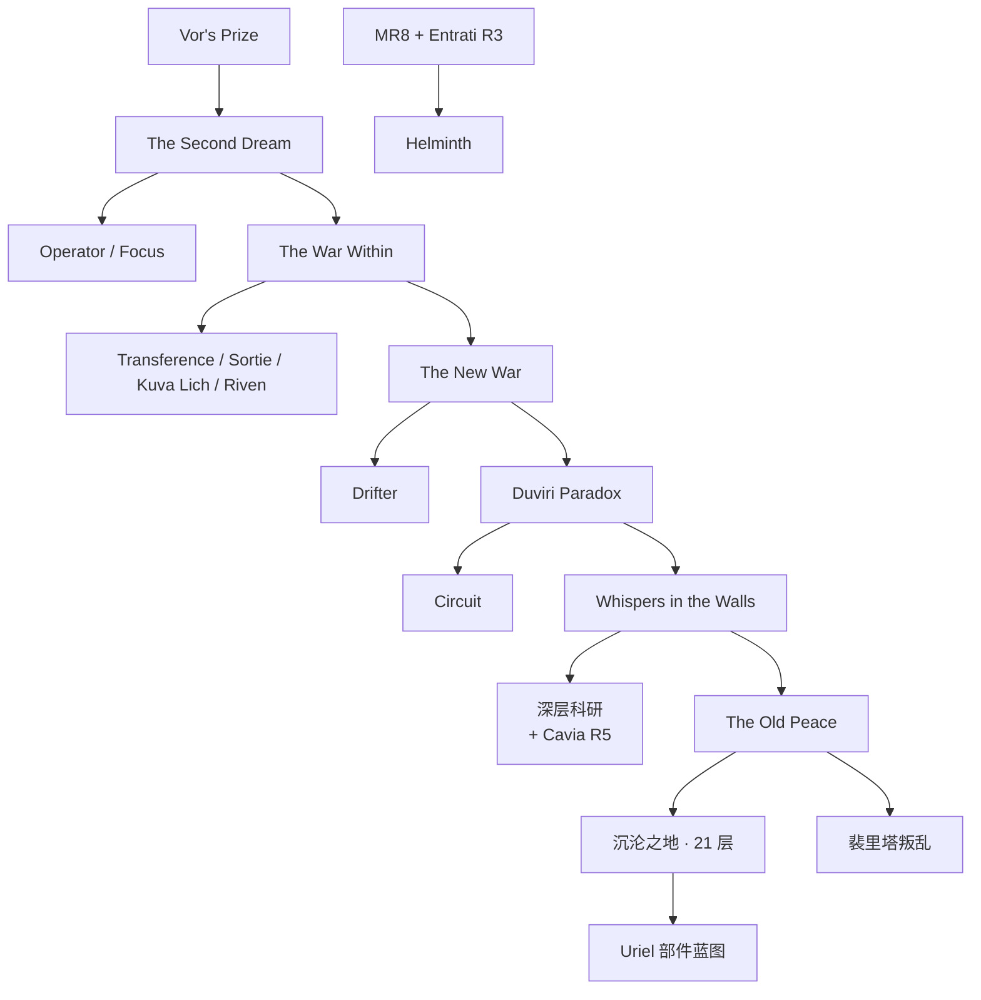

# Warframe 拆解案

> **版本为何必须钉死**：Warframe 是 2013 年上线、连续运营 13 年的免费游戏，结构以**月为单位**变动——
> 基座版本 U44《Iceblade of Narin》（2026-09-23）与本文锚点 U44.1.0（2026-10-07）只隔两周。
> 本文所有数值锚定 **Update 44.1.0《Iceblade of Narin: The Icebind》（2026-10-07）**，
> 结论有效期止于下一个大型更新。导航栏已预告下一个大版本 **Tau**。

## 产品卡片

| 项 | 值 |
|---|---|
| 游戏 | **Warframe** / 星际战甲 |
| 开发商 / 发行 | Digital Extremes（自主发行） |
| 平台 | PC / PlayStation / Xbox / Nintendo Switch / 移动端 |
| 品类 | 刷宝射击（looter shooter）· 免费游玩 + 长期运营 |
| 上线 | 2013-03-25（PC） |
| **当前锚点** | **Update 44.1.0《Iceblade of Narin: The Icebind》，2026-10-07** |
| 版本节奏 | U43.5（2026-08-12）→ U44（2026-09-23）→ U44.1（2026-10-07），约**月更** |
| 星图规模 | 20 个区域 · 主线任务节点 **259** · Railjack 节点 **39** · Junction **13** · 隐藏 19 |
| 模式规模 | **47 种**任务模式，其中 **16 种**为无限模式（endless） |
| 实测样本 | 作者累计**数百小时以上**，已收集大部分战甲；日常循环为「登录搓福马 → 开核桃 → 换杜卡特」 |

> **样本与边界**：作者的实测样本是一个**终局玩家**（自述「大多数战甲都搞完了」）。
> 因此全文凡涉及「前期体验」的结论，都是**从终点回望的事后归因**，不是当时体验——这类结论逐条标注。
> 公开数据来自 warframe.com 官方 patch notes 与 warframe.fandom.com（官方 wiki），随文标注；
> 同一数值在不同模式变体下口径不同处（如 Arbitration 里的 Excavation）在附录 D 列明。

---

## 核心发现

**1. 它的节奏和门槛都在掉落表与日历里，不在战斗与关卡里。**（域一 / 域二）
无尽模式的「每 5 分钟一次」是**开奖频率**，不是决策频率，非无尽节点连开奖都没有，只有一次结算；
259 个节点几乎全是**可绕行**的同质节点，没有哪件装备是必经的。真正拦住玩家的是日历——建造 72 小时、声望 14–15 天、每周重置。

**2. 它不卖强度，卖「跳过日历」；真实价格锚不是标价，是 −75% 券。**（域三）
Forma 的稀缺来自「同一物品不可同时建造」这条**通用规则的例外**，付 10p 即可跳过。官方标价 **21.5** 白金/美元，券后 **86.0**，差 **4 倍**。

**3. 前期的问题不是内容太少，是内容太多而没有排序。**（域四）
解锁链缺一个「接下来该做什么」；而**门后面有没有玩家想要的东西**，决定了他认不认这道门——同样是声望墙，深层科研被认下来，夜灵平原没有。

**4. 成长速度是「你解锁了哪条农场」的函数，不是「你打得怎么样」的函数。**（域五）
同一份 40,920 Endo：Sortie 路径 **85.25 天**，Arbitration 路径 **3.47 小时**——速率差 **24.6 倍**（`11,796 ÷ 480`）。

**5. 它最被记住的手感，是全局唯一一个「努力必然兑现」的系统。**（域六）
移动是秒级、连续、无随机的确定反馈；收益是分钟到天级、离散、随机的反馈。**正反馈与投入回报长期不在同一个地方。**

**五条指向同一件事：Warframe 把「时间」当成它真正的内容与通货。**
下表按域拆开它的形态（第 1 条横跨一、二两域）。

| 域 | 时间的形态 |
|---|---|
| 一 | **密度**——节奏是开奖频率 |
| 二 | **形状**——门槛是日历 |
| 三 | **价格**——商品是跳过日历 |
| 四 | **方向**——缺的是先后排序 |
| 五 | **汇率**——成长取决于渠道效率 |
| 六 | **确定性**——唯一能立刻兑现的是移动 |

**五条的关系**：第 1 条说骨架——节奏在掉落表、门槛在日历；
第 2 条是这套骨架的**变现方式**；第 3 条是它在**新玩家身上失败的原因**（有骨架没路标）；
第 4 条是**老玩家**的处境（路标有了，但每条路的汇率差 24.6 倍）；
第 5 条解释了为什么上面四条都不讨喜，这款游戏却依然被记住——**因为唯一确定的那件事，做得足够好。**

---

## 一 · 核心循环与节奏

### 事实

**三层循环（core loop）**

| 层 | 结构 | 一次循环多长 | 来源 |
|---|---|---|---|
| 单次任务（mission） | 选节点 → 完成目标 → 结算；无尽模式每轮判定「继续 / 撤离」 | 无尽模式单轮：Survival **5 分**（AABC）· Defense **5 波** · Excavation **100 秒** · Disruption **2:00** | 公开 · wiki 任务页 |
| 每日 / 每周 | Sortie（日）· Nightwave（周）· Archon Hunt（周）· Circuit（周）· Deep Archimedea（周）· Steel Path Incursions（日 6 个）· Icebind（周 3 次） | 日 17:00 UTC / 周一 00:00 UTC / 周日 00:00 UTC | 公开 · 官方 patch notes |
| 长期养成 | 收集战甲与武器 → Forma 极化 → 段位（MR） | 单件战甲：**掉落 7–8 小时** + 升级 **10 分钟** + 墙钟 **72 小时** | 实测（n=1） |

**星图构成**：20 区域 · 主线节点 **259** · Railjack 节点 **39** · Junction **13**。按节点数排的任务类型前五：Exterminate **31** / Survival **28** / Defense **28** / Mobile Defense **23** / Sabotage **21**。

**用户实测的登录节奏**（原话）：搓福马 → 顺手开几个核桃 → 换杜卡特。

### 拆解

把「操作」和「决策」分开算：

- **单次任务层**：唯一离散的决策是**撤离与否**，在无尽模式里每 **5 分钟**出现一次。它是真的风险-收益决策——继续打进入更高档的奖励轮次（AABC 循环），代价是敌人等级持续爬升。**非无尽模式的节点没有这个决策**：进去、打完、出来，全程无分支。
- **每次登录**：三个动作的**决策密度 ≈ 0**。「搓福马」是把蓝图丢进 Foundry 的**队列管理**（之后 72 小时自动跑，与玩家在线与否无关）；「顺手开核桃」——用户自己用的词就是「顺手」；「换杜卡特」是结算动作。三个动作加起来，不含一次需要权衡的选择。
- **重心落在长期层**。把 8 小时的账摊开：掉落 farming 7–8 小时 / 升级 10 分钟 / 墙钟 72 小时。
  **98% 的游玩时间花在长期养成层的收集上**；每日层只是维持（Forma 队列 + 每周例行）；
  单次任务层是**执行层**——它不是玩家想要的，是玩家为了长期层必须重复的动作。

**两个钟**：

> 游玩时间 **8 小时** vs 墙钟时间 **80 小时**（8 + 72）→ 比值 **1 : 10**
> 建造那 72 小时不消耗玩家任何操作，只消耗**日历**。

展开见**图 1**（`images/01-两个钟.png`）：同一根对数轴上，绿色是玩家的操作时间，红色是不玩也在走的时间。

### 判断

**Warframe 的节奏不在战斗里，在掉落表的开奖节奏里；它的「每 5 分钟一次」不是决策频率，是开奖频率。**

- **内部基准**：本作 47 种模式里 **16 种是无限模式**——官方把「继续 / 撤离」做成了显式决策，
  说明它自己清楚这是核心张力点。但张力来自**奖励轮次**，不是来自战斗。
- **外部对标**：同为刷宝射击的 Destiny 2 用**设计好的遭遇战（encounter）**切分节奏，没有「撤不撤」这个决策。
  两家的取舍点很干净——**Destiny 用关卡生产买节奏，Warframe 用掉落表买节奏**。
  代价分两头：前者内容打完就没了，必须持续生产新关卡；后者节点可极少量复用，
  但玩家对战斗的记忆点随之稀薄，换成了对**掉落表**的记忆（「这个部件在哪个节点、什么概率」）。
- **边界与证伪条件**：这条只对**无尽模式**成立。对一次性节点（Exterminate / Capture / Assassination）
  不成立——那些节点连开奖节奏都没有，只有一次结算。若能分别实测两类节点上
  **玩家单位时间内的有效决策次数**，就能证伪或加强这条。

---

## 二 · 内容结构与关卡

### 事实

**星图构成**（公开 · wiki 数据模块）：20 个区域 · 主线任务节点 **259** · Railjack 节点 **39** · Junction **13** · 隐藏节点 19。
按节点数排的任务类型前五：Exterminate **31** / Survival **28** / Defense **28** / Mobile Defense **23** / Sabotage **21** / Assassination **21**。
**47 种**模式中 **16 种**是无尽模式。前六类合计 **152 个节点，占 259 个的 58.7%**——见**图 2**（`images/02-节点类型分布.png`）。

**模式的时间刻度**（公开 · wiki 任务页）

| 模式 | 一轮多长 | 结构 |
|---|---|---|
| Survival | **5 分** | AABC 轮次循环，无尽 |
| Defense | **5 波** | AABC，无尽 |
| Excavation | **100 秒 / 台** | 无尽 |
| Disruption | **2:00 / 导管**（轮间 20 秒） | 按守住导管数定档，非 AABC |
| Defection | **40 秒 / 队**（8 队一循环） | 无尽 |
| Interception | ≥ **3 分** | 无尽 |

**每周常驻内容**（公开 · 官方 patch notes）

| 内容 | 周期 | 门槛 |
|---|---|---|
| Sortie | 每日 17:00 UTC | MR5 + The War Within |
| Nightwave | 每周日 00:00 UTC（30 级） | — |
| Archon Hunt | 每周一 00:00 UTC | Veilbreaker |
| Circuit | 每周一 00:00 UTC | Duviri Paradox |
| 深层科研 | 每周一 00:00 UTC（耗 2 Search Pulse） | Cavia R5 |
| Steel Path Incursions | 每日 00:00 UTC，6 个 | Steel Path |
| 沉沦之地 | 每周一 00:00 UTC，**21 层** | The Old Peace |
| Icebind | 每周日 00:00 UTC，3 次 | U44.1 新增 |

**用户的实测路径成本**（n=1）：一件战甲 = 刷部件 **7–8 小时** + 升级 **10 分钟** + 墙钟 **72 小时**；夜灵平原（自述）= 声望 **两周**。

### 拆解

**「想要 X 就去刷 Y」的实际路径，由两种完全不同的成本构成：**

| 成本类型 | 实测例子 | 能不能压缩 |
|---|---|---|
| **重复次数** | 刷战甲部件 7–8 小时 | **能**——提效率、运气、组队 |
| **日历** | 建造 72 小时；声望两周 | **不能**——只跟日期走 |

7–8 小时是第一种，72 小时和两周是第二种。**第二种不因任何操作而缩短**，只能等，或者付钱。

**绕行成本（detour cost）几乎为零**——这是本作与关卡制游戏最根本的差别。
用户原话「Forma 不够就把那个战甲搁下」：**搁下这个，立刻能玩那个。**
259 个节点、109 个战甲之间**不存在堵路关系**，任何一件装备都不是必经的。
唯一的硬门是**主线任务链**，而它是线性的、有指引的，不构成「卡住」。

**崩盘点不在难度上，在两处**：
1. **日历墙叠加**——72 小时 + 两周 + 每周重置同时压着，「目标队列」越排越长；
2. **主线门之前的真空**——社区口径（**观点**）指最大流失区在 The Second Dream **之前**。

### 判断

**Warframe 的内容结构不是一座塔，是一张并列的清单；它的关卡几乎不构成门槛——真正会卡住人的是日历。**

- **内部基准**：259 个节点里绝大多数是**同质可替换**的（Exterminate 31 个、Survival 28 个……），
  47 种模式里 16 种无尽。这意味着玩家**很少因为「打不过」而停下，只会因为「还没到日期」而停下**。
- **外部对标**：同为刷宝射击的 Destiny 2 把关键奖励锁在**唯一路径**上——要那个东西只能打那个 raid，
  且每周只结一次掉落。两家的取舍点很干净：**Destiny 用「必经」制造峰值体验（通过考验的爽感），
  Warframe 用「可绕行」消灭挫折（永远有别的能做）。** 代价是 Warframe **没有峰值**——
  没有一关是「你必须变强才能过」的。这同时解释了为什么它的难度上限是 Steel Path 那类
  **纯数值加固**，而不是设计过的挑战。
- **边界与证伪条件**：这条只覆盖**装备与资源层**，不覆盖**主线进度层**（quest 是硬门，不能绕）。
  证伪条件：若统计出「因打不过而卡住」的时长占比显著（而非因日历），判断即被推翻。
  目前只有 **n=1**，样本不足，**不宣称已证**。

---

## 三 · 数值与经济

### 事实

**货币与产出口径**（公开 · fandom 官方 wiki）

| 资源 | 主要产出 | 硬性上限 | 去向 |
|---|---|---|---|
| Credits | 结算式 `1000 + 100 ×（最低敌等级 − 1）+ 奖励`；Index 高风险首局 **200,000** / 后续 **250,000**；Sortie 三连 **100,000** | 无 | 一切消耗的底噪 |
| Endo | 掉落 15 / 50 / 80；Sortie **4,000**（12%） | 无 | 升 Mod |
| Kuva | Siphon 约 **550–700**、Flood **1,100–1,400** | 无 | 洗紫卡（Riven） |
| Void Traces | 每局裂隙 **6–30** | **MR × 50 + 100** | 精炼遗物（25 / 50 / 100） |
| 声望 Standing | 6 个**派系辛迪加**走任务亲和 **15%** 转化；**Ostron / Quills / Entrati / Cavia / Solaris 不吃这一条**，走赏金与资源兑换 | **16,000 + MR × 500 / 天** | 阵营等级 |
| 白金 Platinum | 充值 / 玩家交易 / 活动 | 无 | 跳过下面的一切 |

**两条被规则卡死的产率**

1. **声望**：日上限 `16,000 + MR × 500`（MR10 → **21,000/天**）。它是**日历**，不是难度。
2. **Forma**：Foundry 的通用规则是**无限并行**，wiki 原文——
   *"The Foundry can have an unlimited number of builds progressing at once, the only restriction being
   that it cannot have two builds of the exact same item going simultaneously."*
   → **Forma 恰好是「同一件物品」**。所以它的产率上限 = **1 个 / 23 小时 ≈ 1.04 个 / 天**（**图 3**，`images/03-Forma产率上限.png`）。

**Forma 的渠道清单**（公开 · fandom + 官方 patch notes）——这条决定了上面那条上限能不能被绕开：

| 渠道 | 给什么 | 速率 |
|---|---|---|
| Foundry 建造 | **成品** | 1 个 / 23 小时（受同物不可并行约束） |
| 虚空裂缝开遗物 | **蓝图**（仍需建造） | Lith/Meso/Neo/Axi 四档共 **459** 个遗物可出；单遗物命中约 **25%**（Intact Common）→ 约每 4 个遗物 1 张 |
| Sortie | **成品** | 每日 **2.5%** |
| 入侵 Invasion | 蓝图 | 0.5% |
| Nightwave / 市场 / 沉沦之地 21 层 | 成捆或单卖 | 周期或付费；沉沦之地每日仅结一次 |

**当前 Prime Access**（官方站，落地香港给 HKD + USD 双价）：在售 **Citrine Prime**。Accessories $40.52 / Weapons $40.52 / Access $66 / Complete $114.42。

**被 Rank5 声望卡住的究竟是谁**（公开）：五家阵营晋升阶梯一致——R1 **5,000** → R2 **22,000** → R3 **44,000** → R4 **70,000** → R5 **99,000**，满段累计 **240,000**。
按日上限折算满段时间：MR0 ≈ **15 天**、MR8 ≈ 12 天、MR30 ≈ 8 天。这条条上有**两类门**：
**R1（5,000）开门、R5（240,000）开物**——见**图 6**（`images/06-声望阶梯.png`）。

**定价表**（公开 · wiki 存档。官方中文站按 IP 出人民币，USD 只能取存档）

| 项 | 白金 | 备注 |
|---|---|---|
| 战甲建造加速（72 h） | **50p** | |
| Forma 加速（23 h） | **10p** | 恰好是直购价的一半 |
| Forma 市场直购 | **20p** | |
| Orokin Catalyst / Reactor | 20p | Mod 容量翻倍 |
| 战甲槽位 | 20p（武器 12p / 2 个） | |
| 战甲直购 | **75p** | 跳过刷取与建造的全部环节 |

充值档（USD）：4300 = **$199.99** / 2100 = $99.99 / 1000 = $49.99 / 370 = $19.99 / 170 = $9.99 / 75 = $4.99。
**但用户实付走的是 −75% 券**（实测）——两条价折算成同一单位后差 **4 倍**（算式在下方拆解里，图见**图 5**，`images/05-白金定价与折扣.png`）。

**内容池规模与交易门槛**（公开 · wiki 数据模块）

| 池 | 数量 | | 交易规则 | 值 |
|---|---|---|---|---|
| Warframe | **109**（含 Prime 47） | | 门槛 | MR2 + 双重验证 |
| Mod | **1,414**（传说 66 / 金 800 / 银 365 / 铜 181） | | 单笔上限 | 6 项 |
| Arcane | **145** | | **每日笔数** | **= MR** |
| 武器 | 主 182 / 副 145 / 近战 221 | | 交易税上限 | 1,000,000 cr / R5 Arcane 2,100,000 cr |

行情（2026-10-11 查询，仅在线卖家挂单）：Wisp Prime Set 最低 **69p**、Khora 79p、Nekros 94p；Primed Continuity R10 **99p**；Arcane Energize R0 7p / R5 125p。

### 拆解

**第一条账 · Forma 的产率上限，来自一条通用规则的一个例外。**

> Foundry 允许无限并行建造——**但同一件物品不能同时造两个**。Forma 就是「同一件物品」。
> 所以 **N 个 Forma ≥ N × 23 小时 = N 天**。想要 10 个 Forma，最短 10 天。
> 这 10 天**与技术水平无关，与资源多寡无关，只与日历有关**。

而官方给这条日历标了价：**加速 10p、直购 20p**。加速价恰好定在直购价的一半——
等于把「你愿意多等多久」明码标价。用户原话「Forma 不够就把那个战甲搁下」，
就是这条规则在玩家侧的落点：**搁下的不是战甲，是 23 小时的定价。**

**第二条账 · 两个钟差一个量级，赎金只有 50p。**

> 实测：战甲 = 掉落 **7–8 h**（游玩）+ 升级 **10 min**（游玩）+ 建造 **72 h**（墙钟）
> → 游玩 **8 h** vs 墙钟 **80 h**，**1 : 10**
> 72 小时的赎金 = **50p**；按 −75% 券实付 ≈ **$0.58**。

**第三条账 · −75% 券把标价变成了一个等待游戏。**

> 官方标价：$199.99 / 4300p = **21.5 p/USD**
> 用 −75% 券：$49.99 / 4300p = **86.0 p/USD** → 比值 **4.0×**

### 判断

**Warframe 不卖强度，卖「跳过日历」；它的真实价格锚不是美元，也不是白金标价，是 −75% 券。**

- **内部基准**：本作两条硬产率上限（声望日上限、Forma 的 23 h/个）各自精确对应一档白金定价。
  Forma 尤其干净——**它的稀缺来自一条通用规则的例外，而不是来自内容难度**。
  一个付费玩家和不付费玩家拿到的是**同一份内容**，差的只是到达时间。
- **外部对标**：同为 F2P 刷宝射击的 Destiny 2 卖**内容门**——赛季通行证与资料片，不买就玩不到；
  它的时间墙是 raid 每周掉落锁定。两家的取舍点在这里：**Destiny 卖「能不能玩到」，
  Warframe 卖「多久能玩到」。** 代价是 Warframe 的付费冲动更弱（买不到独占体验），
  但触发面更广（每一件装备、每一个阵营都挂着一条日历）。
- **边界与证伪条件（已查证，判断成立）**：本判断的软肋是「Foundry 的 23 小时是不是唯一瓶颈」。
  查证结果：**Forma 确实存在第二条渠道——虚空裂缝开遗物，但遗物给的是「蓝图」，不是成品。**
  而蓝图从来不是瓶颈（459 个遗物可出，约每 4 个命中一张）。
  **成品仍然必须过 Foundry，仍然受「同一物品不可同时建造」约束。**
  → 第二条渠道不构成对上限的绕过，反而把上限**定位到了唯一的那一环**。
  能真正绕过 23 小时的只有一条路：**付白金**（加速 10p / 直购 20p）。判断成立。

---

## 四 · 系统与内容池

### 事实

**解锁门锁（主线任务 → 系统）**（公开 · fandom Quest 页 + 官方 patch notes）

| 主线任务（quest） | 解锁的系统 |
|---|---|
| The Second Dream | Operator / Focus |
| The War Within | Transference / Sortie / Kuva Lich / Riven |
| The New War | Drifter |
| Duviri Paradox | Circuit |
| Whispers in the Walls | 深层科研 Deep Archimedea（另需 Cavia 声望 R5） |

**非主线锁**：Helminth 需 **MR8 + Entrati 声望 R3**；Railjack 需 Rising Tide；Incarnon 需 Angels of the Zariman（Genesis 另需 Duviri + Steel Path）；Archon Shard 需 Veilbreaker。

**内容池规模**（公开 · wiki 数据模块）：Warframe **109**（含 Prime 47）· Mod **1,414**（传说 66 / 金 800 / 银 365 / 铜 181）· Arcane **145** · 武器 主 182 / 副 145 / 近战 221 · 市场可交易条目 **3,893**——见**图 8**（`images/08-内容池规模.png`）。

**段位（MR）的经验公式**：`2,500 × 等级²`，MR30 = **2,250,000**。来源：武器满级 3,000（Kuva / Tenet 满 40 = 4,000）、战甲与守护 6,000、Junction 1,000、Intrinsics 每点 1,500。

**玩家的实测门槛与必要性判断**（n=1，2026 年建号）：

| 系统 | 门（公开数据） | 玩家判 |
|---|---|---|
| 夜灵平原 | Quills / Ostron 声望——**核心玩法只需 Quills R1 = 5,000 ≈ 1 天**；刷满 R5 累计 240,000 ≈ **14–15 天** | **未判必要** |
| 深层科研 | **Cavia 声望 R5** + 主线《墙中低语》 | **必要** |
| 沉沦之地 | 《旧日和平》主线；**每周 21 层**，第 **7 / 14** 层检查点，周一 00:00 UTC 重置；每周每难度只结一次奖 | **必要** |
| 裴里塔叛乱 | 《旧日和平》主线；12 分钟限时 | **必要** |
| Forma | 建造队列（23 h/个） | 不进则搁置战甲 |

**商业化**：F2P + 白金；每日登录发放白金购买折扣券（最高 **−75%**，用户实付走此档）；Prime Access；TennoCon 数字包（每年 7 月，可一次买全 Baro Ki'Teer 的全部库存）。

### 拆解

**解锁链的形状不是一条线，是在 The War Within 前后集中开门。**
社区口径（**观点，非数值**）：Warframe 的两个流失口分别在 The Second Dream 之前，和 War Within 之后的信息过载——Operator / Focus / Helminth / Railjack / Syndicate / Riven 同时开放。

**门有三类，玩家的评价也跟着分三类：**

1. **主线门（quest）**——真前置依赖，不学 Transference 就没有 Operator。用户判「**必要**」。
2. **声望门（深层科研）**——日历墙，用户判「**必要**」，因为它后面站着终局玩法的产出源。
3. **声望门（夜灵平原）**——同样是日历墙，用户**没有**判它必要。

> ★ **玩家不是反对门槛，是反对门后面没有他要的东西。**
> 两条门都是「刷声望」，科研被认下来、平原没被认下来——差别不在门的类型，在**门后的东西值不值**。

**★ 初稿写错、由样本本人纠正的一笔（本文唯一一处）**

初稿把用户「平原要花两周升声望才能解锁玩法」读成**记忆膨胀**——R1 ≈ 1 天解锁 vs R5 ≈ 14–15 天刷满，差 48 倍，
于是写成「玩家把刷满记成了解锁」。**用户当场否掉：「有的东西必须刷满解锁。」**

回查公开数据，**用户是对的**：

| 阵营 | 只存在于 R5 的东西 | R1–R4 有替代吗 |
|---|---|---|
| The Quills | **Virtuos Shadow / Virtuos Ghost / Magus Elevate / Magus Nourish** | **没有** |
| Ostron | **整套 Exodia Arcane**（Brave / Valor / Might / Triumph / Hunt / Force） | **没有** |
| Cavia | **每周 Archon Shard**（30,000 声望兑换） | **没有** |

所以刻度不是「R1 解锁线 / R5 拿满线」两条，而是同一条条上有**两类门**：
**R1 开门（系统能用了），R5 开物（顶级的那些只长在顶端）。**
我原来的写法，把一个**结构性事实**降级成了**玩家的认知偏差**。

**裴里塔叛乱**：用户称它刷「指挥官武器与恶魔甲材料」；官方 U41 只写掉 **Prime 武器蓝图**（Sagek / Galariak Prime）、
Tektolyst Mod 与 Arcane、资源，**未提战甲部件**。Uriel 总图来自《旧日和平》任务邮件（100%），
三张部件蓝图来自沉沦之地第 21 层，**无公开掉率**——所以「多少把出一套」算不出期望，**本文不给这个数**（见附录 D）。

**元进度的载体是段位，而段位同时是经济权限。**
MR 由收集驱动（每件装备 3,000–6,000 经验），但 **MR 不提供任何战力**。
它的实际作用之一是 **每日交易笔数 = MR**——段位越高，市场权限越大。

### 判断

**Warframe 前期的问题不是内容太少，是内容太多而没有排序——它的解锁链缺一个「接下来该做什么」。**

- **内部基准**：主线门有清晰顺序（quest 链是线性的），但**主线之外**的门（声望、周重置、Helminth、Railjack、Incarnon）
  没有统一的先后提示，且集中在 War Within 前后同时开放。玩家的 n=1 实测正是这一段的产物。
- **外部对标**：同为刷宝射击的 Destiny 2 用**光等（Power Level）**做单一数字化的进度刻度，
  每个活动都标一个门槛数字，玩家永远知道「我还差多少」。Warframe 没有这个统一刻度——
  它有 MR，但 **MR 不表示战力**（MR30 的账号不一定打得过 Steel Path）。取舍点很干净：
  **Destiny 用一条数字轴换方向感，Warframe 用 109 个战甲和 1,414 张 Mod 换自由度。**
  代价就是那句「一百小时不知道自己在干什么」。
- **边界与证伪条件**：这条判断目前建立在 **n=1 的实测 + 一条社区口径**上，两者都不构成统计。
  证伪条件是**新号前 100 小时的目标分布**——若能记录一批新玩家在这段时间里「有明确目标」与
  「不知道干什么」的时间比，就能量出「方向感缺失」到底值多少小时。**该项已列入待验证，不假装已有。**

---

## 五 · 玩法机制

### 事实

**构筑的容量预算**（公开 · wiki Mod 页）

| 项 | 值 |
|---|---|
| 武器 Mod 容量 | **60** |
| 战甲 Mod 容量 | **78**（Jade 96） |
| 极性匹配 | 该 Mod 消耗**减半** |
| Aura / Stance 槽 | **反向增加**容量 |
| Orokin Catalyst / Reactor | 容量**翻倍** |
| Mod 池 | **1,414** 张（传说 66 / 金 800 / 银 365 / 铜 181） |

**Mod 升级成本**（公开 · wiki Mod 页）

- `Endo = 10 × 稀有度系数 × (2^Rank − 1)`，系数 铜 1 / 银 2 / 金 3 / 传说 4
- `Credits = Cr_BC × (2^Rank − 1)`，Cr_BC 铜 483 / 银 966 / 金 1,449 / 传说 1,932
- → **传说 R10 从零升满 = 40,920 Endo + 1,976,436 Credits**。这条指数曲线长什么样见**图 7**（`images/07-Mod升级成本.png`）：R5 之前几乎贴地，最后一级吃掉全额的 50.0%——`(2^10 − 1) = 1023` 里，第 10 级独占 `2^9 = 512`。

**Endo 的两条渠道**（公开 + 社区口径）

| 渠道 | 速率 | 性质 |
|---|---|---|
| Sortie | 4,000 Endo，每日 1 次、12% 概率 | 公开 |
| Arbitration | 约 **11,796 / 小时** | **社区口径（观点）**，非官方标定 |
| Rathuum | 约 18,000 / 小时 | **社区口径（观点）** |

**单次行动的收益刻度**：无尽模式一轮 5 分钟 = 掉落表抽一次；16 / 47 种模式为无尽。

### 拆解

**第一笔账 · 同一份 Endo 需求，两条渠道用两个不同的单位计量。**

> 传说 R10 = **40,920 Endo**
> **渠道 A（Sortie）**：0.12 × 4,000 = 480 Endo/天 → 40,920 ÷ 480 = **85.25 天**
> **渠道 B（Arbitration）**：40,920 ÷ 11,796 ≈ **3.47 小时**
> → **85.25 天 vs 3.47 小时**（两个数不同单位，不能直接相除；能相除的是**速率**：
> `11,796 ÷ 480 = 24.6`，即打 **1 小时 Arbitration 的量 = 24.6 天的 Sortie 打卡量**）

决定你多久拿到这张 Mod 的，不是你的水平，是你在哪条渠道上。
而渠道 A 的门槛是「MR5 + The War Within」，渠道 B 的门槛是「推进到 Pluto → Eris Junction」——
**新号被结构性地放在慢渠道上。**（展开见**图 4**，`images/04-Endo两条渠道.png`。）

**第二笔账 · 可操作空间是容量，不是选择。**

1,414 张 Mod 看着像自由度，但真正的约束是那 **78 点容量**（战甲，Catalyst 后）。
极性匹配把消耗减半，Aura/Stance 反向加容量——**玩家的决策单位是「这一格值不值」，
而不是「我要不要这张 Mod」。** 构筑问题在这里被化简成了背包问题。

**上限与代价**：难度上限 Steel Path 是**数值加固**（提高敌人等级与耐久倍率），不是新机制。
所以「变强」的回报是「能打更高的数字」。

### 判断

**本作的成长速度是「你解锁了哪条农场」的函数，不是「你打得怎么样」的函数。**

- **内部基准**：同一份 40,920 Endo，Sortie 路径 **85 天**、Arbitration 路径 **3.5 小时**。
  用户的实测同向——刷一件战甲的经验只要 **10 分钟**，因为手上有满级武器带；同一个动作新号要数小时。
  **同一个内容的名义时长和实际时长差一个量级，而这个差由账号状态决定。**
- **外部对标**：Destiny 2 的成长速度主要由**每周可涨的光等上限**决定，与农场选择关系较小——
  它用一条每周封顶的轴控制所有人的节奏。Warframe 相反：**不设周上限，
  让渠道之间的效率差本身成为主要变量。** 取舍点很清楚——Destiny 换到的是平滑可控的成长曲线，
  Warframe 换到的是自由，代价是**成长曲线在解锁高优农场的那一刻发生阶跃**，不是平滑上升。
- **边界与证伪条件**：Arbitration 与 Rathuum 的速率是**社区口径，不是官方标定**，
  换算式见附录 D。若官方公布的实际速率与该口径偏差大于 2 倍，本判断需重算。
  另需注意：这条判断描述的是**效率差**，不是说慢渠道不能玩——85 天也能到，只是账不一样。

---

## 六 · 反馈与表现

### 事实

**移动系统（Maneuvers）**（公开 · wiki Maneuvers 页）

| 动作 | 关键数值 |
|---|---|
| Sprint（冲刺） | 每件战甲有**不同的基础冲刺速度** |
| Roll（翻滚） | 动画期间减免全部伤害的 **75%**；可甩脱附着型敌人与部分异常状态 |
| **Bullet Jump（子弹跳）** | 把玩家推向前上方，**可在空中再次使用**，可与 Aim Glide 连段 |
| Aim Glide | 最长 **3 秒**，之后快速下坠 |
| Wall Latch / Edge Grab / Wall Dash | 跑墙、抓边、墙冲 |
| 可修改性 | 位移距离与速度可被 Mod 改（Mobilize、Parkour Velocity 系列） |

**玩家实测（n=1）**：「子弹跳非常爽」。

**信息侧的事实**：移动系统的操作是自明的（按了就发生）；而需要**计算**的信息部分查不到——
沉沦之地 21 层与 Uriel 三个部件的掉率**均无公开数据**。

### 拆解

**本作的即时反馈与延迟反馈，被分到了两个互不相干的系统上。**

| | 移动 | 收益 |
|---|---|---|
| 时间尺度 | **秒级** | 分钟（5 分钟一轮开奖）→ 天（23 小时建造）→ 周（14–15 天声望） |
| 形态 | 连续 | 离散 |
| 随机性 | **无**——按了就发生 | 高——掉落表 |
| 玩家可控度 | **完全可控** | 基本不可控 |

Roll 的 **75% 固定减伤**是这条特性的极端形式：**固定数值、无随机、无冷却**的保命手段。
它不是「手感好」，它是**确定性**。

→ 这解释了为什么一个「节奏在掉落表里」（域一）的游戏，最被记住的却是子弹跳——
**因为那是全局里唯一一处「玩家的操作能立刻、确定地改变结果」的地方。**

**信息层级**：本作把「能立刻体验到的」做得不需要教，把「需要计算的」做得查不到。
移动没有任何教学任务，掉落率没有任何游戏内提示——两者都不考验玩家的阅读，但方向相反。

### 判断

**Warframe 最被记住的手感，恰恰是它唯一一个「努力必然兑现」的系统。**

- **内部基准**：移动是秒级的确定反馈，收益是分钟到天级的随机反馈，两者**可控性恰好相反**。
  Roll 的 75% 减伤把这一点写成了规则：固定数值、无随机、无冷却。
- **外部对标**：Destiny 2 把「爽」押在**枪械手感与击杀反馈**上，而收益也在同一套动作上兑现——
  **爽与回报是同一个动作**。Warframe 把它们拆开了：爽在移动，收益在掉落表。
  代价是**玩家的正反馈与投入回报长期不在同一个地方**。
- **边界与证据强度（本文最弱的一域，必须说清）**：本域只有 **n=1 的一条实测**，无截图、无录屏。
  **我不替它编造反馈层级的细节**（音效、粒子、镜头震动）。要把它做实，需要的是**录屏**，不是访谈。
  这是全文唯一一处由我自己点名「证据不够」的域。

---

## 它付出的代价

| 代价 | 落点 | 依据 |
|---|---|---|
| **没有峰值体验** | 域二 | 259 个节点可绕行，没有一关是「必须变强才能过」 |
| **战斗记忆点稀薄** | 域一 | 节奏由掉落表提供，不由关卡提供 |
| **新玩家的 100 小时真空** | 域四 | n=1 实测 + 一条社区口径（非统计） |
| **付费买不到独占体验** | 域三 | 付费与非付费玩家拿到的是**同一份内容**，差的只是到达时间 |
| **正反馈与回报分离** | 域六 | 爽在移动，收益在掉落表 |
| **内容量的自重** | 域四 | 109 战甲 / 1,414 Mod / 3,893 个可交易条目，以**月**为单位更新 |

这六条不是六种独立的毛病，是同一条设计选择的六笔账：**把时间做成通货**，
就必然要放弃「靠关卡制造高峰」这条最省事的路。

---

## 如果我来迭代

**1. 给 Forma 豁免那条「同一物品不可同时建造」的规则。**
允许 Forma 同时建造 3 个 → 战甲池的闸门从**日历**退回**资源**。
- 落点：Foundry 规则加一条例外（Forma / Catalyst / Reactor 并行上限 3）。
- 代价：Foundry 加速是纯利润（10p / 个），放开并行直接削掉这块收入。
  **可折中的版本**：只对已通过 MR 门槛的账号放宽，把削掉的收入换成留存。

**2. 把声望条拆成两条可见的进度。**
- 落点：阵营界面显示双刻度——**R1 标「玩法解锁」、R5 标「奖励拿满」**。
- 代价：直接暴露了大部分声望条的**内容其实很短**（Amp 只需 1 天）。
  官方未必愿意承认这一点。

**3. 公布沉沦之地 21 层与 Uriel 三个部件的掉率。**
- 落点：并入官方 Drop Tables。
- 代价（必须先说）：**公开后玩家会算账，一部分人算完就放弃了。**
  举个假设的例子说明这个机制：若单部件掉率是 3%，期望就是 `1 ÷ 0.03 ≈ 33` 把——
  **这个 33 是假设立场，不是本作的数**（真实掉率未公开，见域四）。要说明的是机制，
  不是数值：公布掉率等于把「值不值得投入」的判断权交还给玩家。
  这正是当前不公布的经济学。
- **我的立场：该公布。** 因为不公开所惩罚的是**时间有限的玩家**——他们无法判断值不值得投入；
  时间无限的玩家不受影响。信息不对称在这里筛掉的，恰好是最需要做计划的那批人。

**4. 在 The War Within 之后加一张「你现在能做的三件事」。**
- 落点：星图界面加一个推荐页签，列出当前可选的三个目标 + 各自门槛的**类型**（主线 / 声望 / 日历）。
- 代价：削弱探索感，且官方需要**承认**某些内容可以被跳过——
  这与「109 个战甲都是内容」的叙事直接冲突。

---

<b>附录 A · 系统依赖（解锁链）</b>

<b>附录 B · 数值细节与交付物表</b>

本附录是交付物索引：十张表按通用清单编号，落在 `data/*.csv` 的会被 GitHub 直接渲染成表格，落在正文的给锚点。

| # | 表 | 落在哪 | 内容 | 来源等级 |
|---|---|---|---|---|
| 1 | 时间轴与结构配比 | 正文 域一「三层循环」· 图 1 | 三层循环各一圈多长、两个钟的 1 : 10 | 实测 n=1 + 公开 |
| 2 | 单位 / 任务数值表 | `data/09-action-value.csv` | 6 种无尽模式的轮次时长与轮次结构 | 公开 |
| 3 | 成长曲线 vs 压力曲线 | `data/03-path-expected.csv` · 图 1 / 3 / 7 | 养成耗时 vs 日历门槛 | 公开 + 推断 |
| 4 | 资源产出、换算与定价 | `data/04-economy.csv`（46 行）· 正文 域三「定价表」 | 货币、建造时长、白金档位与券后价、交易门槛、行情 | 公开 |
| 5 | 难度修饰表 | `data/05-difficulty.csv` | Steel Path / Archon Hunt / 深层科研的等级与倍率 | 公开 |
| 6 | 内容池结构 | `data/06-pools.csv` · 图 8 | 战甲 / 武器 / Mod / Arcane 池与节点类型 | 公开 |
| 7 | 经济收支（来源 × 去向） | 正文 域三「货币与产出口径」表 | 五种资源各自的 faucet / sink 与硬上限 | 公开 |
| 8 | 路径期望 | `data/03-path-expected.csv` | 9 条期望，每条带算式 | 推断 |
| 9 | 单次行动收益表 | `data/09-action-value.csv` · 正文 域五 | 每轮时长 → 每轮一次「继续 / 撤离」 | 公开 |
| 10 | 行为时序与信息表 | 正文 域二 · 图 2 | 259 个节点的类型配比、无尽模式占比 | 公开 |

**合格标准是「两列一除能算出判断里的数」，抽查三条**：

- `85.25 天 = 40,920 ÷ (0.12 × 4,000)` —— 域五那条「85 天 vs 3.5 小时」要用它
- `24.6 = 11,796 ÷ 480` —— 核心发现第 4 条的「汇率差 24.6 倍」
- `15 天 = 240,000 ÷ 16,000` —— 域四「日历卡人」

**两张表没做满，理由写明**：

- 表 2 只给了**时间刻度**，没有「敌人有效血量 / 玩家期望输出」两列。那需要实测战斗数据，而本文样本是 n=1 且按约定不做逐场记录，拿不到——**按纪律不估一个数填进去**。
- 表 10 的通用槽位是「敌人 AI / 关卡节奏」，本文替换成了**节点类型配比**：本作的重点在结构不在遭遇战设计（见域一判断），沿用原槽位反而写不出东西。

<b>附录 C · 曲线与图</b>

八张图，全部由 `tools/make-figures.py` 生成（纯 PIL，无第三方绘图库）。图的数值取自 `data/*.csv` 与正文算式，并在脚本里现算——改数据表，图跟着变。

**图 1 · 两个钟**（域一）`images/01-两个钟.png`
同一根对数轴上，绿色是玩家的操作时间（5 分钟一轮 → 7.5 小时刷部件），红色是不玩也在走的时间（72 小时建造 → 348 小时刷满一家阵营）。**红杆的长度与玩家做了什么无关。**

**图 2 · 节点类型分布**（域二）`images/02-节点类型分布.png`
259 个节点里前六类占 152 个（58.7%）。形状是**平的**，不是金字塔——没有难度递进，只有类型重复。

**图 3 · Forma 产率上限**（域三）`images/03-Forma产率上限.png`
一条斜率为 23 小时 / 个的直线。它不因为技术好或资源多而变陡：Foundry 允许无限并行建造，唯独「同一件物品」不能同时造两个，而 Forma 恰好就是同一件物品。

**图 4 · Endo 两条渠道**（域五）`images/04-Endo两条渠道.png`
同一份 40,920 Endo，一边用「天」计（85.25），一边用「小时」计（3.47）。两个数不同单位，不可直接相除；能相除的是**速率** 24.6 倍。

**图 5 · 白金定价与折扣**（域三）`images/05-白金定价与折扣.png`
官方标价 21.5 白金/美元，用 −75% 券后 86.0，比值恰为 4.0。**真实价格锚是右边那一根。**

**图 6 · 声望阶梯**（域三 / 域四）`images/06-声望阶梯.png`
同一条声望条上有**两类门**：R1（约 1 天）只是开门、让系统能用；**R5（约 15 天）才发那些「只长在顶端」的物**——Quills 的 Virtuos / Magus 系列、Ostron 的整套 Exodia、Cavia 的每周 Archon Shard，低阶一件都不发。用户说「必须刷满解锁」指的是后者，不是记忆膨胀。

**图 7 · Mod 升级成本**（域五）`images/07-Mod升级成本.png`
指数曲线的形状解释了为什么「Mod 池有 1,414 张」不等于 1,414 个选择：R5 之前几乎贴地，最后一级吃掉全额的 **50.0%**。

**图 8 · 内容池规模**（域四）`images/08-内容池规模.png`
3,893 个可交易条目、1,414 张 Mod、109 个战甲。这既是本作最大的资产，也是「不知道要干什么」的另一面。

图 1–8 均已从对应域内反向引用。

<b>附录 D · 数据来源与可信度</b>

### 一 · 实测（n=1）

样本 = 一名**终局玩家**（自述「大多数战甲都搞完了」、Forma 库存「十多个」、2026 年建号）。所有实测值都带同一个前提：**这是从终点回望的记录，不是新手期当时的体验。**

| 项 | 值 | 性质 |
|---|---|---|
| 一件战甲：刷部件 | 7–8 小时 | 游玩时间 |
| 一件战甲：升满经验 | 10 分钟 | 游玩时间 |
| 一件战甲：建造 | 72 小时 | 墙钟时间 |
| 每日登录循环 | 搓福马 → 开核桃 → 换杜卡特 | 三个动作，决策密度 ≈ 0 |
| Forma 库存 | 10 多个 | 缺 Forma 时会搁置战甲 |
| 付费 | 走 −75% 券；买过 TennoCon 数字包 | — |

**n=1 就是 n=1**：这条不承担统计结论，只用于交叉验证公开数值的合理性、以及支撑判断段。

### 二 · 公开

| 来源 | 取了什么 | 限制 |
|---|---|---|
| fandom 官方 wiki（`Module:` 数据模块、Foundry、Standing、Mod、Platinum、任务页） | 星图构成、内容池规模、建造时长、Endo / Mod 公式、声望阶梯、白金档位 | **内容线只到 Update 38** |
| fandom 官方 wiki（The Steel Path、Deep Archimedea、Archon Hunt） | 难度修饰的等级与倍率 | 同上 |
| 官方 patch notes | U41《旧日和平》：沉沦之地 21 层、裴里塔叛乱 12 分钟、Uriel 部件来源 | U39+ 只能靠它，交叉验证比别处薄一档 |
| warframe.market（2026-10-11 查询） | Prime Set / Mod / Arcane 挂单价 | 只是挂单，不是成交价 |

**「wiki 只到 U38」这条要说清**：本作更新频繁，英文 wiki 的内容线滞后于当前版本。凡涉及 U39 以后（沉沦之地、裴里塔叛乱、Uriel）的结论，本文的验证层级比别处低一档——只有官方 patch notes 一个来源，没有第二处可对照。

**同一数值的模式变体口径**——域二表里的轮次时长是**基础模式**的数值，变体模式会改它，引用时必须带前提：

| 数值 | 基础模式 | 变体 | 差多少 |
|---|---|---|---|
| Excavation 轮次 | 100 秒 / 台，1 台 = 1 轮 | **Arbitration：180 秒 / 台，且 2 台 = 1 轮奖励** | 单轮实际耗时 **3.6 倍**（`180 × 2 ÷ 100`） |

这条同时给了域五那个「Arbitration 是最快的 Endo 渠道」一个限定：它的**单轮时间被拉长了**，
优势来自**掉落表与结算规则**，不是来自关卡更快。

### 三 · 推断（每条给算式）

| # | 结论 | 算式 | 建立在什么之上 |
|---|---|---|---|
| 1 | 白金券后溢价 **4.0 倍** | `(4300 ÷ 49.99) ÷ (4300 ÷ 199.99) = 86.0 ÷ 21.5` | 官方 USD 档位 |
| 2 | Forma 产率上限 **1.04 个 / 天** | `24 ÷ 23` | Foundry「同物不可并行」 |
| 3 | 传说 Mod 升满（Sortie）**85.25 天** | `40,920 ÷ (0.12 × 4,000)` | 假设每日打满且命中 12% 档 |
| 4 | 传说 Mod 升满（Arbitration）**3.47 小时** | `40,920 ÷ 11,796` | 产率是**社区口径**，非官方标定 |
| 5 | 阵营声望拿满（MR0）**15 天** | `240,000 ÷ 16,000` | 假设每日打满上限 |
| 6 | 平原玩法解锁（Quills R1）**0.31 天** | `5,000 ÷ 16,000` | 兑换式声望不吃 15% 亲和转化 |
| 7 | 两个钟比值 **1 : 10** | `8 ÷ 80` | — |
| 8 | 前六类节点占比 **58.7%** | `152 ÷ 259` | — |
| 9 | 攒 10 个 Forma **9.58 天** | `10 × 23 ÷ 24` | 10 个取自实测库存 |

**建立在推断之上的结论**：核心发现第 2 条（4.0 倍）、第 4 条（24.6 倍速率比）、域四「日历卡人」（15 天）。推翻推断 1 或 3，会直接推翻对应结论。

### 四 · 两处用户口径与官方数据的冲突（不抹平）

1. **裴里塔叛乱刷什么。** 用户说它是「刷恶魔甲的模式」；官方 U41 patch notes 说它掉 **Prime 武器蓝图（Sagek Prime / Galariak Prime）、Tektolyst Mod / Arcane 与资源**，而 Uriel（恶魔甲）的部件来自**沉沦之地第 21 层**。本文按官方写，用户口径如实保留在此。
2. **「平原两周」——此条已由样本本人判负，本文已改。**
   初稿读成「玩家把刷满记成了解锁」（R1 = 5,000 ≈ 1 天解锁 vs R5 = 240,000 ≈ 14–15 天刷满，差 48 倍）。
   用户否定：「**有的东西必须刷满解锁**。」回查公开数据，**用户是对的**——R5 确实挂着低阶没有的物：

   | 阵营 | 只存在于 R5 的物品 | 来源 |
   |---|---|---|
   | The Quills | Virtuos Shadow / Virtuos Ghost / Magus Elevate / Magus Nourish | fandom The Quills 报价表 |
   | Ostron | Exodia Brave / Valor / Might / Triumph / Hunt / Force（整套 6 件） | fandom Ostron 报价表 |
   | Cavia | 每周 Archon Shard（30,000 声望兑换）· 深层科研本体 | fandom Cavia + 官方 patch notes |

   → 正确的刻度是**同一条条上两类门：R1 开门、R5 开物**。本文据此重写域四对应段落与图 6，
   并把它记为**「样本 n=1 判负机制推断」的唯一一例**——这正是把专家评审与公开数据分开走的理由。

<b>附录 E · 术语表</b>

| 中文 | 英文 / 缩写 | 一句话 |
|---|---|---|
| 核心循环 | core loop | 三层：单次任务 / 每日每周 / 长期养成 |
| 元进度 | meta progression | 账号级的永久解锁 |
| 构筑 | build | Mod 与极化的组合 |
| 难度曲线 | difficulty curve | 敌人等级与玩家输出的相对关系 |
| 有效生命 | EHP | 抗性折算后的等效血量 |
| 击杀耗时 | TTK | 击杀单个目标所需时间 |
| 资源产出 / 消耗 | faucet / sink | 货币与材料的进出总量 |
| 保底 | pity | 达到次数后强制给的机制 |
| 战甲 | Warframe | 可操作单位 |
| 段位 | Mastery Rank（MR） | 账号等级，**不提供战力**；每日交易笔数 = MR |
| 福马 / 极化 | Forma / Polarization | 重置等级以改变 Mod 槽极性，建造 23 小时 |
| 虚空遗物 | Void Relic | 「核桃」，开出 Prime 部件蓝图 |
| 虚空裂隙 | Void Fissure | 消耗遗物的任务，须带遗物进关卡 |
| 杜卡特 | Ducat | 遗物产出的兑换货币，用于 Baro Ki'Teer |
| 虚空残渣 | Void Traces | 精炼遗物的消耗品，上限 = MR × 50 + 100 |
| 恩多 | Endo | 升级 Mod 的资源 |
| 库瓦 | Kuva | 洗紫卡的资源 |
| 紫卡 | Riven Mod | 词条随机的 Mod |
| 声望 | Standing | 阵营货币，日上限 = 16,000 + MR × 500 |
| 制造厂 | Foundry | 建造队列所在之处 |
| 钢铁之路 | Steel Path | 星图难度档：敌 +100 级、生命与护盾 ×2.5 |
| 深层科研 | Deep Archimedea | 火卫二周常，需 Cavia R5；敌 L250–275 |
| 精英科研 | Elite Archimedea | 其高难变体，敌 L375–400 |
| 沉沦之地 | Descendia | 每周 21 层的爬塔，第 7 / 14 层检查点 |
| 裴里塔叛乱 | Perita Rebellion | 12 分钟限时模式，掉 Prime 武器蓝图 |
| 夜灵平原 | Plains of Eidolon | 开放地形，对应 Ostron / Quills 声望 |
| 解剖圣所 | Sanctum Anatomica | 火卫二枢纽，Cavia 声望所在地 |
| 灵化 | Helminth | 吸取战甲技能的系统，需 MR8 + Entrati R3 |
| 洞察之刃 | Incarnon | 武器强化系统，需 Angels of the Zariman |
| 子弹跳 | Bullet Jump | 核心移动动作，可在空中复用 |
| 拱翼 / 机甲 | Archwing / Necramech | 两种非战甲载具 |
| 大黄脸 | Baro Ki'Teer | 周期商人，收杜卡特 |

